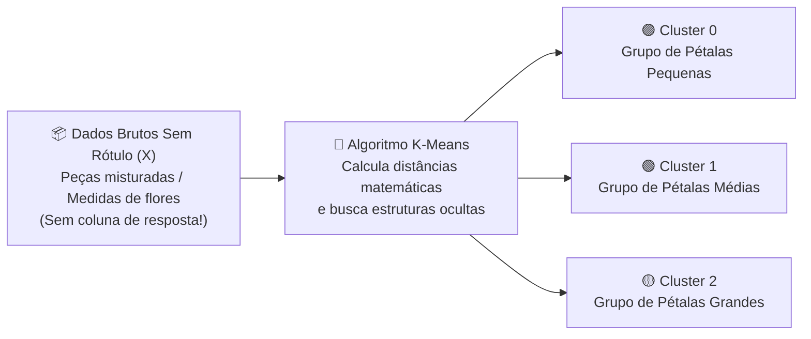
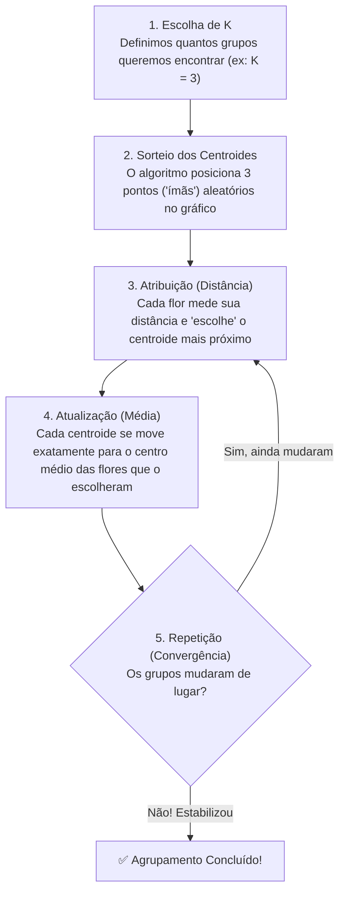

# 🧠 Introdução ao Aprendizado de Máquina Não Supervisionado

**Curso:** Aperfeiçoamento Profissional em Programação em Inteligência Artificial Generativa (SENAI-SP)  
**Unidade / Aula:** Aula 01 — Módulo 5: Aprendizado de Máquina Não Supervisionado  
**Algoritmo Foco:** `K-Means` (*Clusterização / Agrupamento*)  
**Dataset da Prática:** `iris.csv` (150 amostras botânicas da Flor Iris)

---

## 🧩 A Metáfora: A Caixa de Peças sem Manual

> ### 🎲 Imagine o Seguinte Cenário...
> Você acabou de receber uma caixa com **centenas de peças de um jogo de tabuleiro totalmente desconhecido**. Você **não tem o manual de instruções** e ninguém lhe disse o nome ou a função de cada peça.  
> **O que você faz instintivamente?**  
> Naturalmente, você começa a observar as características visuais e a **separar as peças que são parecidas em grupos**:  
> * *"Essas aqui são redondas e azuis..."*  
> * *"Essas outras são quadradas e vermelhas..."*  
> * *"Aquelas são compridas e amarelas..."*
>
> **Isso é, na essência, o Aprendizado de Máquina Não Supervisionado!**

---

## 1. 🔍 O que é Aprendizado Não Supervisionado?

Diferente do **Aprendizado Supervisionado** (onde o modelo aprende com um "professor" e exemplos previamente rotulados, como *"esta foto é um gato"* ou *"esta garrafa é da Casta 1"*), no **Aprendizado Não Supervisionado** o algoritmo trabalha **às cegas**, recebendo dados brutos que **não possuem rótulos, etiquetas ou gabarito ($y$)**.

* **🎯 Objetivo Principal:** Descobrir **estruturas ocultas**, semelhanças matemáticas ou padrões naturais dentro dos dados.
* **🗂️ Técnica Mais Comum:** **Clusterização (*Clustering* / Agrupamento)** — dividir automaticamente um conjunto de dados em grupos (*clusters*) onde os itens de um mesmo grupo sejam muito parecidos entre si e muito diferentes dos itens de outros grupos.

---

### 🔄 Como funciona a Clusterização com K-Means?

O **K-Means** (*K-Médias*) é o algoritmo de agrupamento mais famoso e utilizado na indústria. Ele funciona de maneira iterativa em **5 passos cíclicos**:

1. **Escolha de $K$:** Definimos quantos grupos queremos que a IA procure (ex.: $k = 3$).
2. **Centroides:** O algoritmo coloca $3$ pontos centrais ("âncoras") em posições iniciais no gráfico.
3. **Atribuição:** Cada amostra (flor) calcula sua distância matemática e se conecta ao centroide mais próximo.
4. **Atualização:** O centroide se desloca para o "centro de gravidade" (a média aritmética) de todas as flores que o escolheram.
5. **Repetição:** Os passos 3 e 4 se repetem em ciclos rápidos até que os centroides parem de se mover e os grupos fiquem perfeitamente estáveis!

---

## 2. 🧰 Nossas Ferramentas (Ecossistema de Bibliotecas Python)

Para executar essa investigação científica em Python no Google Colab, utilizamos um ecossistema de **6 bibliotecas poderosas**, onde cada uma cumpre um papel específico no projeto:

| Biblioteca | Papel e Função no Nosso Projeto |
| :--- | :--- |
| 🐼 **`Pandas`** | Manipulação, leitura do arquivo `.csv` e organização dos dados em tabelas estruturadas (`DataFrames`). |
| 🔢 **`NumPy`** | Operações matemáticas de alta velocidade e transformação da tabela em matrizes numéricas puras (`arrays`). |
| 📈 **`Matplotlib`** | Criação da estrutura base de gráficos, títulos, eixos e exibição visual das figuras (`plt.show()`). |
| 🎨 **`Seaborn`** | Construção de gráficos estatísticos avançados e altamente visuais (`scatterplot`, `regplot` e `pairplot`). |
| 🧠 **`Scikit-Learn`** | O "cérebro" da operação: fornece o algoritmo `KMeans`, o codificador `LabelEncoder` e as métricas (`silhouette_score`, `accuracy_score`). |
| 📐 **`SciPy`** | Utilizada para otimização matemática avançada (`linear_sum_assignment`), permitindo alinhar e auditar os rótulos gerados pela IA. |

---

## 3. 🗺️ O que encontraremos nos Códigos? (A Jornada em 6 Etapas)

O laboratório prático a seguir foi desenhado como uma verdadeira **jornada de Ciência de Dados**. Veja o que faremos passo a passo:

1. **👁️ Exploração Visual:** Antes de acionar qualquer IA, vamos enxergar as medidas das pétalas e sépalas da flor Iris por meio de gráficos de dispersão (`scatterplot`) e matrizes multivariadas (`pairplot`).
2. **🙈 O "Cegamento" dos Dados:** Vamos remover propositalmente a coluna `species` (o nome das espécies) usando `.drop("species")`, forçando o modelo a descobrir os grupos sozinho e sem gabarito!
3. **⚙️ Aplicação do K-Means:** Configuraremos o algoritmo para buscar $3$ grupos ocultos (`k = 3`) apenas medindo distâncias geométricas.
4. **🧮 Mapeamento de Inteligência:** Como o K-Means batiza os grupos apenas com números arbitrários (`Cluster 0`, `Cluster 1`, `Cluster 2`), usaremos a matemática do `SciPy` para conferir se o "Grupo 0" realmente corresponde à espécie biológica certa.
5. **🎯 Validação de Performance:** Calcularemos a acurácia final para comprovar quão perto da realidade biológica o algoritmo chegou sem nunca ter tido aula de botânica!
6. **📐 Otimização (O Segredo do $K$):** E quando estamos no mundo real e **não sabemos** quantos grupos existem? Aprenderemos a descobrir o número ideal de clusters usando duas técnicas definitivas: o **Método do Cotovelo (*Elbow Method*)** e o **Índice de Silhueta (*Silhouette Score*)**.

> [!TIP]
> **💡 Dica de Aula:** Ao executar cada bloco de código no Google Colab, preste muita atenção em como os dados evoluem de **"informação bruta em tabela"** para **"conhecimento visual intuitivo"** através dos gráficos de `pairplot`!
