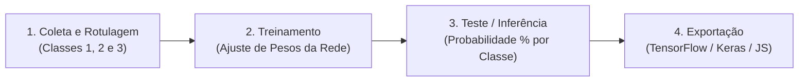

# 🧪 Laboratório Prático: Treinando sua Primeira Rede Neural com Google Teachable Machine

**Plataforma:** [teachablemachine.withgoogle.com](https://teachablemachine.withgoogle.com/)  
**Modalidade:** Aprendizado de Máquina Supervisionado (*No-Code* / Visão Computacional)  
**Tempo Estimado:** 25 a 30 minutos  
**Requisitos:** Navegador Web (Chrome/Edge). *Funciona **com ou sem webcam** (modo Upload de arquivos).*

---

## 📋 1. ENUNCIADO DA ATIVIDADE (CONTEXTO DE NEGÓCIO)

> ### 🏭 Desafio: Triagem Inteligente de Produtos no Centro de Distribuição (InovaMarketplace)
> Você acaba de ingressar na equipe de Inteligência Artificial do **InovaMarketplace**. O setor de logística precisa automatizar a esteira de triagem visual de produtos e o controle de acesso/qualidade usando Visão Computacional.
>
> Antes de escrevermos centenas de linhas de código em Python, a diretoria pediu um **Protótipo Rápido (MVP)** usando a plataforma **Google Teachable Machine** para provar como uma Rede Neural Convolucional aprende a diferenciar categorias visuais a partir de exemplos rotulados (**Aprendizado Supervisionado**).
>
> **Sua Missão:**
> 1. Criar um projeto de classificação de imagens com **pelo menos 3 classes distintas** (ex.: *Classe 1: Garrafa/Caneca*, *Classe 2: Celular/Mouse*, *Classe 3: Controle/Chaveiro* — ou, no modo sem webcam, 3 categorias de produtos baixadas da internet, como *Tênis*, *Relógio* e *Mochila*).
> 2. Coletar um dataset equilibrado (mínimo de **15 a 30 imagens por classe**).
> 3. Treinar a Rede Neural diretamente no navegador e avaliar a **taxa de confiança (%)** em tempo real com imagens ou objetos inéditos (dados de teste que o modelo não viu no treino).
> 4. Provocar um erro intencional no modelo (**Viés de Fundo / Overfitting**) e documentar como corrigi-lo!

---

## 🛠️ 2. PASSO A PASSO DETALHADO DO LABORATÓRIO

### Passo 1: Acessar a Plataforma e Iniciar um Projeto de Imagem
1. Abra o navegador e acesse: **[https://teachablemachine.withgoogle.com/](https://teachablemachine.withgoogle.com/)**
2. Clique no botão azul **"Get Started"** (Primeiros Passos).
3. Na tela *New Project*, clique em **"Image Project"** (Projeto de Imagem).
4. Selecione a opção **"Standard image model"** (Modelo de imagem padrão — imagens coloridas `224x224 px`, ideal para web e Python).

---

### Passo 2: Definir as Classes (Rótulos / *Targets* $y$)
Você verá na esquerda dois blocos iniciais chamados `Class 1` e `Class 2`:
1. Clique no ícone de **lápis (editar)** ao lado de `Class 1` e renomeie para a sua primeira categoria (ex.: `Tenis_Esportivo` ou `Objeto_Celular`).
2. Clique no lápis de `Class 2` e renomeie para a segunda categoria (ex.: `Relogio_Pulso` ou `Objeto_Caneca`).
3. Abaixo da segunda classe, clique no botão retangular **"+ Add a class"** (Adicionar uma classe) e renomeie a 3ª categoria (ex.: `Mochila` ou `Fundo_Neutro_Sem_Objeto`).

> [!TIP]
> **Por que criar uma classe "Fundo Neutro / Nada"?**  
> As redes neurais de classificação sempre distribuem $100\%$ de probabilidade entre as classes existentes. Se você não ensinar à IA como é o cenário vazio, ela tentará classificar a parede vazia como "Celular" ou "Caneca"!

---

### Passo 3: Coletar as Amostras de Treinamento (*Features* $X$)
Escolha **UMA** das duas opções abaixo conforme o equipamento da sua bancada:

#### 🔹 Opção A: Bancada SEM Webcam (Modo Upload de Arquivos)
1. Abra uma nova aba no Google Imagens e salve no seu computador **10 a 15 fotos variadas** para cada uma das suas 3 classes (reserve também 2 fotos extras de cada categoria em uma pasta separada chamada `Teste_Final` — **não** use essas 2 fotos no treinamento!).
2. No Teachable Machine, dentro de cada classe, clique no botão **"Upload"** (Fazer upload).
3. Clique em *"Choose images from your files, or drag & drop here"* e selecione as imagens de treino daquela classe.

#### 🔹 Opção B: Bancada COM Webcam (Modo Captura ao Vivo)
1. Em cada classe, clique no botão **"Webcam"** e permita o acesso à câmera no navegador.
2. Posicione o objeto da **Classe 1** em frente à câmera e mantenha pressionado o botão azul **"Hold to Record"** (Segure para gravar) até capturar entre **30 e 50 quadros**.
3. **Importante:** Enquanto grava, gire levemente o objeto, aproxime e afaste da câmera para que a IA aprenda o objeto em diferentes ângulos!
4. Repita o processo para a **Classe 2** e para a **Classe 3**.

---

### Passo 4: Configurar e Executar o Treinamento (`Train Model`)
Na coluna central (**Training**), antes ou depois de clicar em treinar, clique na aba **"Advanced"** (Avançado) para observar os **3 hiperparâmetros clássicos de Deep Learning**:

| Hiperparâmetro | Valor Padrão | O que ele significa na prática? |
| :--- | :---: | :--- |
| **Epochs (Épocas)** | `50` | Quantas vezes a Rede Neural vai ler **todo o conjunto de fotos** do início ao fim para ajustar seus pesos. |
| **Batch Size (Tamanho do Lote)** | `16` | Quantas fotos a IA analisa de uma só vez antes de atualizar suas sinapses internas. |
| **Learning Rate (Taxa de Aprendizado)** | `0.001` | O tamanho do "passo" matemático que a IA dá ao corrigir um erro. Se for muito alto, ela fica instável; se for muito baixo, demora para aprender. |

1. Mantenha os valores padrão inicialmente e clique no botão **"Train Model"** (Treinar Modelo).
2. **Atenção:** Não mude de aba do navegador durante os 10 a 20 segundos de treinamento (o modelo treina usando a placa de vídeo/processador local via *TensorFlow.js*).

---

### Passo 5: Teste e Validação em Tempo Real (`Preview`)
Quando o treinamento terminar, o painel da direita (**Preview**) será ativado automaticamente:
1. **Se estiver sem webcam:** Mude a chave seletora no topo do painel *Preview* de `Webcam` para **`File` (Arquivo)** e arraste uma daquelas **fotos inéditas** da sua pasta `Teste_Final` (uma foto que o modelo nunca viu durante o treino!).
2. **Se estiver com webcam:** Mostre os objetos para a câmera em posições diferentes.
3. Observe as **barras de probabilidade (Output)** na parte inferior:
   * A soma das barras sempre totaliza **$100\%$** (função matemática *Softmax*).
   * Verifique se a classe correta atinge mais de **$85\%$ a $99\%$** de certeza!

---

## 🧪 3. EXPERIMENTO CIENTÍFICO: QUEBRANDO O MODELO (CAÇA AO VIÉS)

Agora que seu modelo funciona, realize os **3 testes de estresse** abaixo e responda no seu caderno/bloco de notas:

1. **Teste 1 — Oclusão Parcial:** Tampe metade do objeto com a mão (ou recorte metade da foto no Paint antes de enviar). A confiança da IA caiu? Para quantos $\%$?
2. **Teste 2 — Objeto Desconhecido (*Out-of-Distribution*):** Envie a foto de um objeto que **não pertence a nenhuma das 3 classes** (ex.: a foto de um cachorro ou de uma cadeira). O que a IA fez? Ela teve "dúvida" (ex.: $33\%$ para cada classe) ou afirmou com $99\%$ de certeza uma resposta errada?
3. **Teste 3 — Viés de Cenário (*Background Bias*):** Se todas as fotos da Classe 1 foram tiradas com fundo branco e todas as da Classe 2 com fundo escuro, o que acontece se você colocar um objeto da Classe 1 em um fundo escuro? *(Spoiler: Muitas vezes a IA aprende a cor do fundo em vez do objeto!).*

---

## 💻 4. BÔNUS: COMO LEVAR ESSE MODELO PARA O PYTHON / GOOGLE COLAB?

1. No canto superior direito do painel *Preview*, clique no botão **"Export Model"** (Exportar Modelo).
2. Na janela que abrir, clique na aba **"Tensorflow"** $\rightarrow$ marque **"Keras"** e clique em **"Download my model"**.
3. O Teachable Machine baixará um arquivo `.zip` contendo:
   * `keras_model.h5`: O "cérebro" treinado com todos os pesos da rede neural!
   * `labels.txt`: A lista com os nomes das suas classes (`0 Classe_1`, `1 Classe_2`...).
4. Logo abaixo na mesma tela, o próprio Teachable Machine já fornece o **código Python pronto** para carregar esse arquivo `.h5` no Google Colab!

---

## ✅ 5. ENTREGÁVEL DA ATIVIDADE (CHECKLIST DE CONCLUSÃO)

Para concluir o laboratório, apresente ao instrutor (ou salve um print da tela):
- [ ] **3 Classes** criadas e nomeadas corretamente.
- [ ] Pelo menos **15 amostras** em cada classe.
- [ ] Modelo treinado e painel **Preview** exibindo **acima de $85\%$ de confiança** em uma imagem de teste inédita.
- [ ] Resposta rápida: *O que aconteceu quando você mostrou ao modelo uma imagem que não pertencia a nenhuma das classes treinadas?*
