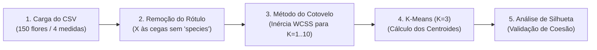

# 🌸 Laboratório Prático: Agrupamento Não Supervisionado com K-Means — O Mistério das Espécies Florais

**Ambiente:** Google Colaboratory (`Python 3.10+`)  
**Modalidade:** Aprendizado de Máquina Não Supervisionado (*Clustering / Agrupamento Espacial*)  
**Tempo Estimado:** 35 a 45 minutos  
**Dataset:** `iris.csv` (150 amostras botânicas de comprimento e largura de sépalas e pétalas)  
**Algoritmo:** `KMeans` (*K-Médias*), Método do Cotovelo (*Elbow Method*) e Coeficiente de Silhueta

---

## 📋 1. ENUNCIADO DA ATIVIDADE (CONTEXTO DE NEGÓCIO)

> ### 🌿 Desafio: Triagem Botânica Automatizada em Estufa de Exportação
> Você foi encarregado de desenvolver um módulo de Inteligência Artificial para um centro de pesquisa botânica e exportação de flores tropicais. Chegou ao laboratório um lote contendo **150 flores da espécie Iris**, porém todas as etiquetas físicas foram extraviadas durante o transporte internacional.
>
> Não temos nenhum enólogo ou botânico para nos dar o gabarito. Contamos apenas com uma régua de precisão que mediu **4 características morfológicas em centímetros**: comprimento e largura da sépala, e comprimento e largura da pétala.
>
> **Sua Missão:**
> 1. Carregar o arquivo [`iris.csv`](./iris.csv) no Google Colab e remover a coluna de nomes (`species`) para simular o cenário real **às cegas**.
> 2. Aplicar o algoritmo **K-Means** para descobrir agrupamentos naturais (*clusters*) puramente por similaridade geométrica de distâncias.
> 3. Utilizar a técnica matemática do **Método do Cotovelo (*Elbow Curve*)** para determinar qual é o número ótimo de grupos ($K$).
> 4. Validar a qualidade da separação dos grupos através do **Índice de Silhueta (*Silhouette Score*)**.
> 5. Comparar os grupos descobertos pela IA com a taxonomia botânica real e interpretar onde houve sobreposição natural.

---

## 🛠️ 2. PASSO A PASSO DETALHADO DO LABORATÓRIO



### Passo 1: Preparação do Ambiente e Upload do Dataset
No Google Colab, faça o upload do arquivo `iris.csv` clicando no ícone da pasta no menu lateral esquerdo e importe os pacotes:

```python
import numpy as np
import pandas as pd
import matplotlib.pyplot as plt
import seaborn as sns

from sklearn.cluster import KMeans
from sklearn.metrics import silhouette_score
from sklearn.preprocessing import StandardScaler

# Leitura do dataset
df = pd.read_csv('iris.csv')
print("Visualização das 5 primeiras amostras:")
print(df.head())
```

---

### Passo 2: Isolando as Variáveis para Aprendizado Não Supervisionado
Para que o aprendizado seja verdadeiramente não supervisionado, a IA não pode ter acesso à coluna `species`. Guardamos apenas as 4 colunas numéricas:

```python
# Separamos apenas as medições morfológicas (Features X)
X = df[['sepal_length', 'sepal_width', 'petal_length', 'petal_width']].values
gabarito_real = df['species'].values

print(f"Dimensão da matriz de entrada X: {X.shape}")
```

> [!IMPORTANT]
> **Diferença Crucial:** No aprendizado supervisionado usamos `model.fit(X, y)`. No aprendizado **não supervisionado**, passamos apenas `model.fit(X)`! Não existe vetor $y$.

---

### Passo 3: O Método do Cotovelo (*Elbow Method*)
Como saber quantos grupos ($K$) existem sem consultar especialistas? Calculamos a **Inércia (WCSS — Soma dos Quadrados Intra-Cluster)** variando $K$ de 1 a 10:

```python
wcss = []
k_range = range(1, 11)

for k in k_range:
    kmeans_teste = KMeans(n_clusters=k, random_state=42, n_init=10)
    kmeans_teste.fit(X)
    wcss.append(kmeans_teste.inertia_)

plt.figure(figsize=(8, 4))
plt.plot(k_range, wcss, 'ro-', linewidth=2, markersize=7)
plt.title("Método do Cotovelo (Elbow Method) — Busca do K Ótimo")
plt.xlabel("Número de Grupos (K)")
plt.ylabel("Inércia (WCSS - Distância Interna)")
plt.grid(True, linestyle='--', alpha=0.5)
plt.show()
```

* Onde a curva "dobra" como uma articulação de cotovelo (visivelmente em **$K=3$**), temos o ponto ótimo de custo-benefício!

---

### Passo 4: Treinando o K-Means com $K=3$ e Visualizando os Centroides
Configuramos o modelo com 3 centros de gravidade:

```python
# Instanciação do K-Means com K=3
kmeans = KMeans(n_clusters=3, random_state=42, n_init=10)
clusters_previstos = kmeans.fit_predict(X)

# Armazenamos o resultado de volta no DataFrame para visualização
df['cluster_ia'] = clusters_previstos

# Coordenadas dos 3 centros médios (centroides)
centroides = kmeans.cluster_centers_

# Gráfico de dispersão das pétalas com centroides
plt.figure(figsize=(8, 5))
cores = ['#E30613', '#1A73E8', '#1E8E3E']
for i in range(3):
    grupo = df[df['cluster_ia'] == i]
    plt.scatter(grupo['petal_length'], grupo['petal_width'], 
                label=f'Cluster {i}', color=cores[i], alpha=0.7, s=60)

# Plotando os centroides
plt.scatter(centroides[:, 2], centroides[:, 3], c='black', s=200, marker='X', label='Centroides')
plt.title("Agrupamento Não Supervisionado K-Means (Pétalas da Flor Iris)")
plt.xlabel("Comprimento da Pétala (cm)")
plt.ylabel("Largura da Pétala (cm)")
plt.legend()
plt.grid(True, alpha=0.3)
plt.show()
```

---

## 🧪 3. EXPERIMENTO CIENTÍFICO: TESTES DE ESTRESSE E VALIDAÇÃO

Execute os **3 testes analíticos** e registre suas conclusões:

### Teste 1: Cálculo do Coeficiente de Silhueta (*Silhouette Score*)
O coeficiente de silhueta varia de $-1$ a $+1$. Quanto mais próximo de $+1$, mais bem separados e coesos estão os grupos:

```python
score_3 = silhouette_score(X, clusters_previstos)
print(f"Coeficiente de Silhueta para K=3: {score_3:.4f}")

# Teste com K=2 e K=5
score_2 = silhouette_score(X, KMeans(n_clusters=2, random_state=42, n_init=10).fit_predict(X))
score_5 = silhouette_score(X, KMeans(n_clusters=5, random_state=42, n_init=10).fit_predict(X))

print(f"Silhueta para K=2: {score_2:.4f}")
print(f"Silhueta para K=5: {score_5:.4f}")
```
* **Questão:** Por que matematicamente $K=2$ obtém silhueta mais alta que $K=3$? *(Dica: A espécie `setosa` é completamente isolada, enquanto as outras duas têm leve interseção!).*

### Teste 2: Confrontando a IA com o Gabarito Oculto
Crie uma tabela de contingência (*crosstab*) comparando as espécies botânicas verdadeiras com os números dos clusters atribuídos pela IA:

```python
confronto = pd.crosstab(df['species'], df['cluster_ia'])
print("\nTabela de Confronto: Botânica Real vs. Clusters K-Means")
print(confronto)
```

---

## 💻 4. CÓDIGO FONTE COMPLETO (EXECUTÁVEL NO GOOGLE COLAB)

```python
# ==============================================================================
# PIPELINE DE APRENDIZADO NÃO SUPERVISIONADO - K-MEANS NO DATASET IRIS
# SENAI-SP & Infoeste — Trilha Google Cloud Skills Boost
# ==============================================================================

import pandas as pd
import matplotlib.pyplot as plt
from sklearn.cluster import KMeans
from sklearn.metrics import silhouette_score

# 1. Carregar os dados
df = pd.read_csv('iris.csv')
X = df[['sepal_length', 'sepal_width', 'petal_length', 'petal_width']].values

# 2. Executar K-Means com K=3
kmeans = KMeans(n_clusters=3, random_state=42, n_init=10)
df['cluster'] = kmeans.fit_predict(X)
score = silhouette_score(X, df['cluster'])

print("=== RESULTADOS DO AGRUPAMENTO NÃO SUPERVISIONADO ===")
print(f"Número de Amostras Analisadas: {len(df)}")
print(f"Coeficiente de Silhueta Médio: {score:.4f}\n")
print("Contagem por Grupo Descoberto:")
print(df['cluster'].value_counts())

# 3. Plotagem dos Clusters
plt.figure(figsize=(7, 5))
plt.scatter(df['petal_length'], df['petal_width'], c=df['cluster'], cmap='viridis', s=60, alpha=0.8)
plt.scatter(kmeans.cluster_centers_[:, 2], kmeans.cluster_centers_[:, 3], c='red', s=180, marker='X', label='Centroides')
plt.title(f"K-Means (K=3) — Flores Iris (Silhueta: {score:.2f})")
plt.xlabel("Petal Length (cm)")
plt.ylabel("Petal Width (cm)")
plt.legend()
plt.grid(True, alpha=0.3)
plt.tight_layout()
plt.show()
```

---

## ✅ 5. ENTREGÁVEL DA ATIVIDADE (CHECKLIST DE CONCLUSÃO)

Para validar a conclusão deste laboratório, certifique-se de preencher os itens:
- [ ] Arquivo `iris.csv` importado e colunas numéricas extraídas com sucesso.
- [ ] Gráfico do Método do Cotovelo (*Elbow Curve*) gerado comprovando o ponto de inflexão em $K=3$.
- [ ] Modelo K-Means treinado e clusters plotados com a marcação dos 3 centroides.
- [ ] Coeficiente de Silhueta calculado para $K=2$, $K=3$ e $K=5$.
- [ ] Análise da tabela de confronto respondida: *Qual espécie de flor a IA agrupou com 100% de perfeição e quais duas espécies apresentaram sobreposição de medidas?*
