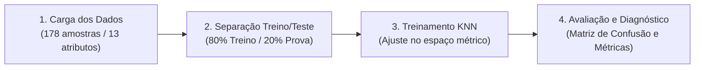

# 🍷 Laboratório Prático: Classificação Supervisionada com KNN — O Desafio da Vinícola Italiana

**Ambiente:** Google Colaboratory (`Python 3.10+`)  
**Modalidade:** Aprendizado de Máquina Supervisionado (*Machine Learning Clássico / Classificação*)  
**Tempo Estimado:** 35 a 45 minutos  
**Dataset:** `sklearn.datasets.load_wine` (178 amostras químicas de safras italianas)  
**Algoritmo:** `KNeighborsClassifier` (*K-Nearest Neighbors* — KNN)

---

## 📋 1. ENUNCIADO DA ATIVIDADE (CONTEXTO DE NEGÓCIO)

> ### 🏰 Desafio: Controle Inteligente de Safras e Qualidade Sommelier
> Você atua como **Especialista em Inteligência Artificial** para uma tradicional vinícola da região do Piemonte, na Itália. A empresa comercializa **três safras premiadas de vinhos** derivadas de diferentes castas de uva (`Casta 0`, `Casta 1` e `Casta 2`).
>
> Atualmente, a rotulagem e inspeção química de cada lote de barris é manual e dispendiosa. A diretoria solicitou a criação de um modelo em Python capaz de receber **13 componentes químicos** de uma nova amostra e predizer instantaneamente a qual safra ela pertence (**Aprendizado Supervisionado**).
>
> **Sua Missão:**
> 1. Carregar o dataset oficial `load_wine` e inspecionar suas 13 propriedades físico-químicas.
> 2. Separar os dados em conjuntos de **Treino (80%)** e **Teste (20%)** usando `train_test_split`.
> 3. Treinar o modelo `KNeighborsClassifier` com $K=5$ vizinhos e prever as amostras inéditas de teste.
> 4. Gerar a **Matriz de Confusão** e o **Relatório de Classificação** (`accuracy`, `precision`, `recall`).
> 5. Realizar o teste de estresse de padronização com `StandardScaler` e documentar o impacto na acurácia!

---

## 🛠️ 2. PASSO A PASSO DETALHADO DO LABORATÓRIO



### Passo 1: Preparar o Ambiente e Carregar o Dataset
No Google Colab, importe as bibliotecas essenciais e carregue o dataset embutido do Scikit-Learn:

```python
import numpy as np
import pandas as pd
import matplotlib.pyplot as plt
import seaborn as sns

from sklearn.datasets import load_wine
from sklearn.model_selection import train_test_split
from sklearn.neighbors import KNeighborsClassifier
from sklearn.metrics import confusion_matrix, classification_report, accuracy_score
from sklearn.preprocessing import StandardScaler

# Carrega os dados da vinícola
dados = load_wine()
X = dados.data  # 13 medições químicas (Features)
y = dados.target  # Classes 0, 1 ou 2 (Rótulos)
nomes_classes = dados.target_names

print(f"Total de garrafas analisadas: {X.shape[0]}")
print(f"Número de componentes químicos por garrafa: {X.shape[1]}")
print(f"Classes de vinhos: {nomes_classes}")
```

---

### Passo 2: O que são as Features e o Target?

| Componente | Tipo | Exemplos Práticos |
| :--- | :---: | :--- |
| **Features ($X$)** | Variáveis Contínuas | `alcohol` (Teor alcoólico), `malic_acid` (Acidez), `total_phenols` (Fenóis/Taninos), `color_intensity` (Cor), `proline` (Aminoácido). |
| **Target ($y$)** | Categórica (0, 1, 2) | `0 = class_0` (59 garrafas), `1 = class_1` (71 garrafas), `2 = class_2` (48 garrafas). |

> [!NOTE]
> **Por que este problema é Supervisionado?**  
> Porque cada garrafa do conjunto de treino possui uma "resposta certa" (`target`) informada por enólogos. O modelo compara sua tentativa com a verdade para calibrar as fronteiras de decisão.

---

### Passo 3: Divisão Estratificada de Treino e Teste
Garantimos que o modelo aprenda com $80\%$ dos vinhos e guarde $20\%$ para a prova final:

```python
# 80% para treino (142 garrafas) e 20% para teste (36 garrafas)
X_train, X_test, y_train, y_test = train_test_split(
    X, y, test_size=0.20, random_state=42, stratify=y
)

print(f"Garrafas para a IA estudar (Treino): {X_train.shape[0]}")
print(f"Garrafas para a Prova Final (Teste): {X_test.shape[0]}")
```

---

### Passo 4: Treinamento do Classificador KNN
O algoritmo KNN armazena os vetores de treino. Na inferência, mede a **Distância Euclidiana** até os $K$ vizinhos mais próximos:

```python
# Instanciando o classificador com K = 5 vizinhos
modelo_knn = KNeighborsClassifier(n_neighbors=5)

# O treinamento ajusta o modelo ao conjunto de dados
modelo_knn.fit(X_train, y_train)
print("Modelo KNN treinado com sucesso!")
```

---

### Passo 5: Avaliação com Matriz de Confusão
Avaliamos as predições nos dados inéditos de teste:

```python
# Realiza a predição para as 36 garrafas de teste
y_pred = modelo_knn.predict(X_test)

# Acurácia simples
acuracia_inicial = accuracy_score(y_test, y_pred)
print(f"Acurácia Inicial do KNN (Sem Padronização): {acuracia_inicial * 100:.2f}%\n")

# Relatório detalhado
print(classification_report(y_test, y_pred, target_names=nomes_classes))
```

Visualizamos a Matriz de Confusão em mapa de calor (*heatmap*):

```python
matriz = confusion_matrix(y_test, y_pred)

plt.figure(figsize=(7, 5))
sns.heatmap(matriz, annot=True, fmt='d', cmap='Reds',
            xticklabels=nomes_classes, yticklabels=nomes_classes)
plt.title("Matriz de Confusão — Classificador de Vinhos KNN (K=5)")
plt.xlabel("Predição da IA")
plt.ylabel("Classe Verdadeira")
plt.tight_layout()
plt.show()
```

---

## 🧪 3. EXPERIMENTO CIENTÍFICO: QUEBRANDO O MODELO (TESTES DE ESTRESSE)

Execute os **3 experimentos** investigativos e anote os impactos no seu notebook:

### Teste 1: O Efeito da Escala de Medidas (O Pulo do Gato)
Observe que a `proline` atinge valores como `1500`, enquanto o `alcohol` varia entre `11` e `14`.  
O KNN se baseia em distância euclidiana, logo atributos com números maiores "esmagam" atributos com números menores!
Aplique o `StandardScaler` e compare:

```python
# Padronizando para média zero e desvio-padrão unitário
scaler = StandardScaler()
X_train_scaled = scaler.fit_transform(X_train)
X_test_scaled = scaler.transform(X_test)

modelo_knn_scaled = KNeighborsClassifier(n_neighbors=5)
modelo_knn_scaled.fit(X_train_scaled, y_train)
y_pred_scaled = modelo_knn_scaled.predict(X_test_scaled)

acuracia_scaled = accuracy_score(y_test, y_pred_scaled)
print(f"Acurácia Sem Escalonamento: {acuracia_inicial * 100:.2f}%")
print(f"Acurácia COM StandardScaler: {acuracia_scaled * 100:.2f}% 🚀")
```

### Teste 2: Variação do Hiperparâmetro $K$
O que acontece se mudarmos $K$ para um valor extremo?
* Teste com $K=1$ (*Risco de Overfitting* — o modelo fica muito sensível a ruídos).
* Teste com $K=15$ ou $K=25$ (*Risco de Underfitting* — o modelo suaviza demais e perde detalhes).

### Teste 3: Diagnóstico de Falsos Positivos
Na matriz de confusão sem padronização, quais classes o modelo mais confunde? Por que vinhos da `class_1` e `class_2` se misturam mais do que com a `class_0`?

---

## 💻 4. CÓDIGO FONTE COMPLETO (EXECUTÁVEL NO GOOGLE COLAB)

```python
# ==============================================================================
# PIPELINE COMPLETO DE CLASSIFICAÇÃO SUPERVISIONADA - DATASET VINHOS
# SENAI-SP & Infoeste — Trilha Google Cloud Skills Boost
# ==============================================================================

import numpy as np
import pandas as pd
import matplotlib.pyplot as plt
import seaborn as sns

from sklearn.datasets import load_wine
from sklearn.model_selection import train_test_split
from sklearn.neighbors import KNeighborsClassifier
from sklearn.preprocessing import StandardScaler
from sklearn.metrics import confusion_matrix, classification_report, accuracy_score

# 1. Carga dos dados
wine = load_wine()
X, y = wine.data, wine.target

# 2. Divisão Treino e Teste (80/20)
X_train, X_test, y_train, y_test = train_test_split(
    X, y, test_size=0.2, random_state=42, stratify=y
)

# 3. Pré-processamento: Padronização Z-Score
scaler = StandardScaler()
X_train_scaled = scaler.fit_transform(X_train)
X_test_scaled = scaler.transform(X_test)

# 4. Treinamento do Modelo com K=5
knn = KNeighborsClassifier(n_neighbors=5)
knn.fit(X_train_scaled, y_train)

# 5. Avaliação de Desempenho
y_pred = knn.predict(X_test_scaled)
acc = accuracy_score(y_test, y_pred)

print(f"=== RESULTADOS DA VINÍCOLA ===")
print(f"Acurácia Final nos Dados de Teste: {acc * 100:.2f}%\n")
print(classification_report(y_test, y_pred, target_names=wine.target_names))

# 6. Gráfico da Matriz de Confusão
plt.figure(figsize=(6, 5))
sns.heatmap(confusion_matrix(y_test, y_pred), annot=True, fmt='d', cmap='Blues',
            xticklabels=wine.target_names, yticklabels=wine.target_names)
plt.title(f"Matriz de Confusão - KNN Padronizado (Acurácia: {acc*100:.1f}%)")
plt.xlabel("Predição do Modelo")
plt.ylabel("Classe Real da Casta")
plt.tight_layout()
plt.show()
```

---

## ✅ 5. ENTREGÁVEL DA ATIVIDADE (CHECKLIST DE CONCLUSÃO)

Para validar a conclusão deste laboratório, certifique-se de preencher os itens:
- [ ] Notebook `lab_vinhos_knn.ipynb` executado sem erros no Google Colab.
- [ ] Separação estratificada de 80% treino e 20% teste implementada.
- [ ] Comparativo documentado: acurácia antes e depois do `StandardScaler`.
- [ ] Gráfico da Matriz de Confusão gerado com anotações visuais.
- [ ] Resposta no caderno/célula de texto: *Por que a padronização de dados é fundamental em algoritmos baseados em distâncias como o KNN?*
