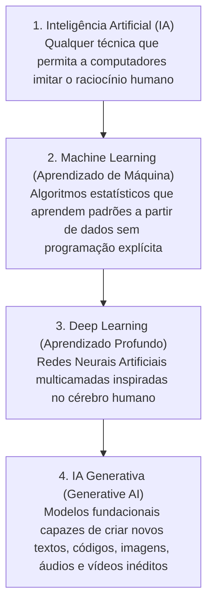

# Apostila Didática & Guia do Estudante - Aula 1 (Dia 1): Introdução à IA, IA Generativa, Engenharia de Prompt & Laboratórios Supervisionado vs. Não Supervisionado

**Curso:** Aperfeiçoamento Profissional em Programação em Inteligência Artificial Generativa (SENAI-SP)  
**Carga Horária:** 4 horas (240 minutos)  
**Metodologia:** Nivelamento Conceitual e Prático + 2 Laboratórios no Google Colab + Onboarding na Trilha Oficial **Google Cloud Skills Boost**  
**Ambiente:** Python 3.10+, Google Colab | Teachable Machine | Google Cloud Skills Boost  
**Bibliotecas Necessárias:** `scikit-learn`, `google-generativeai`, `pandas`, `numpy`, `matplotlib`, `seaborn`, `scipy`

---

## 🏬 CONTEXTO DO PROJETO INTEGRADOR INOVAMARKETPLACE (DIA 1)

Bem-vindo à equipe de Engenharia de Inteligência Artificial do **InovaMarketplace**!  
Durante nossos 5 encontros, construiremos um ecossistema inteligente de e-commerce enquanto conquistamos as insígnias oficiais (**Skill Badges**) da trilha **Iniciante: Programa de Aprendizado Introdução à IA Generativa** do Google Cloud.

> **O Desafio do Dia 1:**  
> 1. Compreender a diferença prática entre a **IA Tradicional (Machine Learning)** e a **IA Generativa**.  
> 2. Dominar as técnicas fundamentais de **Engenharia de Prompt** (Persona, Contexto, Few-Shot, Chain-of-Thought e Saída JSON).  
> 3. Aprender a utilizar o **Google Colaboratory (Google Colab)** do zero (abrir, criar, renomear e salvar notebooks).  
> 4. Executar o **Laboratório 1 (Aprendizado Supervisionado com KNN no dataset `load_wine`)** e o **Laboratório 2 (Aprendizado Não Supervisionado com K-Means no dataset `iris`)**, analisando criticamente os gráficos e métricas de retorno!  
> 5. Realizar o cadastro e onboarding na plataforma **Google Skills** para iniciar os vídeos e quizzes da trilha oficial!

---

## 📖 ÍNDICE DE CONTEÚDOS

1. [Módulo 1: Panorama da IA — Da Lógica Simbólica à IA Generativa](#1-módulo-1-panorama-da-ia--da-lógica-simbólica-à-ia-generativa)
2. [Módulo 2: Engenharia de Prompt para Desenvolvedores (Zero-Shot, Few-Shot & JSON)](#2-módulo-2-engenharia-de-prompt-para-desenvolvedores-zero-shot-few-shot--json)
3. [Módulo 3: Primeiro Contato com o Google Colab](#3-módulo-3-primeiro-contato-com-o-google-colab)
4. [Módulo 4: Aprendizado Supervisionado & Lab 1 — Classificação de Vinhos com KNN](#4-módulo-4-aprendizado-supervisionado--lab-1--classificação-de-vinhos-com-knn)
5. [Módulo 5: Aprendizado Não Supervisionado & Lab 2 — Agrupamento do Dataset Iris com K-Means](#5-módulo-5-aprendizado-não-supervisionado--lab-2--agrupamento-do-dataset-iris-com-k-means)
6. [Módulo 6: Onboarding na Trilha Google Cloud Skills Boost](#6-módulo-6-onboarding-na-trilha-google-cloud-skills-boost)

---

## 1. MÓDULO 1: PANORAMA DA IA — DA LÓGICA SIMBÓLICA À IA GENERATIVA

A Inteligência Artificial evoluiu em 4 camadas concêntricas ao longo das décadas:



### 🔍 Programação Tradicional vs. Machine Learning vs. IA Generativa

| Paradigma | Entrada | Processamento | Saída | Exemplo no E-commerce |
| :--- | :--- | :--- | :--- | :--- |
| **Programação Clássica** | Dados + Regras (`if/else`) | Execução determinística | Resposta exata | Calcular frete fixo por CEP. |
| **Machine Learning (Discriminativo)** | Dados Históricos + Rótulos | Treinamento estatístico | Padrão / Classificação | Prever a categoria de um produto (`0`, `1` ou `2`). |
| **IA Generativa** | Prompt (Instrução em Linguagem Natural) | Modelo Fundacional (LLM) | Conteúdo Novo e Inédito | Escrever um anúncio persuasivo em JSON para um tênis. |

---

## 2. MÓDULO 2: ENGENHARIA DE PROMPT PARA DESENVOLVEDORES

**Engenharia de Prompt (*Prompt Engineering*)** é a arte e a ciência de projetar instruções precisas para guiar Grandes Modelos de Linguagem (LLMs) a gerarem saídas confiáveis e integráveis a sistemas de software.

### 🧩 Os 4 Pilares de um Prompt Profissional
1. **Persona (Papel):** Quem a IA deve ser? *(Ex: "Atue como um Especialista de SEO do InovaMarketplace")*.
2. **Contexto e Restrições:** Quais são as regras de negócio? *(Ex: "Produto: Tênis AirRun 300g, solado EVA, R\$ 299")*.
3. **Tarefa Clara (Verbo de Ação):** O que deve ser feito? *(Ex: "Crie um título de até 50 caracteres e 3 benefícios técnicos")*.
4. **Formato de Saída (*Output Format*):** Como o software vai ler a resposta? *(Ex: "Responda exclusivamente em formato JSON válido")*.

---

## 3. MÓDULO 3: PRIMEIRO CONTATO COM O GOOGLE COLAB

O **Google Colaboratory (Google Colab)** é um ambiente de desenvolvimento Python gratuito que roda **100% na nuvem dentro do navegador**, sem exigir nenhuma instalação ou configuração no computador do laboratório.
* **Notebook Interativo (`.ipynb`):** Dividido em **Células de Código** (`+ Código`, executadas clicando no botão **▶ Play** ou pressionando `Shift + Enter`) e **Células de Texto** (`+ Texto`, para títulos e anotações).

### 🛠️ Passo a Passo: Criando, Renomeando e Salvando seu Primeiro Notebook
1. **Abrir o Google Colab:** Acesse [colab.research.google.com](https://colab.research.google.com/) logado com sua conta Google.
2. **Criar o Primeiro Notebook:** Clique no botão azul **+ Novo notebook** (ou vá no menu superior *Arquivo $\rightarrow$ Novo notebook no Drive*).
3. **Renomear o Notebook:** No canto superior esquerdo, clique sobre o nome padrão `Untitled0.ipynb` e altere para `Aula01_Laboratorios_ML.ipynb`.
4. **Executar os Blocos:** Digite o código na célula e pressione `Shift + Enter` (ou clique no ícone **▶**). Para criar uma nova célula abaixo, clique em **+ Código**.
5. **Salvar ao Final:** Pressione `Ctrl + S` (*Arquivo $\rightarrow$ Salvar*) para gravar automaticamente no seu **Google Drive**, ou vá em *Arquivo $\rightarrow$ Fazer o download $\rightarrow$ Fazer download do .ipynb*.

---

## 4. MÓDULO 4: APRENDIZADO SUPERVISIONADO & LAB 1 — CLASSIFICAÇÃO DE VINHOS COM KNN

### 🎯 Conceito: O que é Aprendizado de Máquina Supervisionado?
No **Aprendizado Supervisionado**, o algoritmo aprende sob a "supervisão" de um **gabarito previamente conhecido (Dados Rotulados)**. Durante o treinamento, fornecemos ao modelo tanto as características de entrada (**Features $X$**) quanto a resposta correta (**Target / Rótulo $y$**).
* **Classificação:** Quando o alvo $y$ é uma categoria discreta (ex: `class_0`, `class_1`, `class_2`).
* **Regressão:** Quando o alvo $y$ é um valor numérico contínuo (ex: preço ou temperatura).

---

### 🍷 Guia de Aula (Lab 1): Classificação de Vinhos com KNN

Nesta atividade, vamos construir um modelo de IA capaz de identificar o tipo de um vinho apenas analisando suas propriedades químicas.

#### 1. Preparando as Ferramentas
* **Pandas:** Usada para organizar os dados em tabelas.
* **Scikit-Learn (`sklearn`):** A biblioteca "mãe" do aprendizado de máquina no Python.
* **Matplotlib / Seaborn:** Ferramentas gráficas para "enxergarmos" o que a IA está fazendo.

```python
import pandas as pd
import matplotlib.pyplot as plt
import seaborn as sns
from sklearn.model_selection import train_test_split
from sklearn.neighbors import KNeighborsClassifier
from sklearn.metrics import confusion_matrix, ConfusionMatrixDisplay, classification_report
from sklearn.datasets import load_wine 

# Explicação: 
# 'train_test_split' divide os dados para estudo e prova.
# 'KNeighborsClassifier' é o nosso algoritmo (o "cérebro").
```

#### 2. Carregando os Dados
O dataset `wine` contém informações de 3 tipos de vinhos cultivados na mesma região da Itália, mas por produtores diferentes.

```python
# Carregando o dataset e transformando em uma tabela (DataFrame)
data = load_wine()
df = pd.DataFrame(data.data, columns=data.feature_names)
df['target'] = data.target

print(f"Dataset carregado com {df.shape[0]} amostras.")
print("Classes de vinho:", data.target_names)
```

#### 3. Definindo Features ($X$) e Target ($y$)
Na IA, chamamos de **X** as características que o modelo usa para aprender (entradas) e de **y** a resposta que queremos que ele acerte (saída).

```python
# X = Dados Químicos (Álcool, Ácido Málico, Cinzas, etc.)
X = df.drop('target', axis=1) 

# y = O rótulo (Classe 0, Classe 1 ou Classe 2)
y = df['target']              
```

#### 4. A Divisão de Treino e Teste
Para garantir que a IA não apenas "decore" as respostas (*overfitting*), separamos os dados:
* **Treino:** O modelo estuda esses dados.
* **Teste:** O modelo é desafiado a prever dados que ele nunca viu antes.

```python
# Reservamos 20% dos dados para o teste final
X_train, X_test, y_train, y_test = train_test_split(X, y, test_size=0.20, random_state=42)

print(f"Treino: {len(X_train)} amostras | Teste: {len(X_test)} amostras")
```

#### 5. O Algoritmo KNN (K-Nearest Neighbors)
O KNN funciona por proximidade. Se um novo vinho aparece perto de 5 pontos que são "Vinho Tinto", ele será classificado como "Vinho Tinto".

```python
# Criando o classificador com k=5 (ele olhará os 5 vizinhos mais próximos)
knn = KNeighborsClassifier(n_neighbors=5)

# O método .fit() é onde o aprendizado acontece!
knn.fit(X_train, y_train)
```

#### 6. Fazendo Previsões e Avaliando o Sucesso
Após o treino, pedimos para o modelo tentar adivinhar os vinhos do grupo de teste e comparamos as previsões (`y_pred`) com as respostas reais (`y_test`).

```python
# Realizando as previsões
y_pred = knn.predict(X_test)

# Gerando a Matriz de Confusão para ver os acertos
cm = confusion_matrix(y_test, y_pred)

# Visualização gráfica
plt.figure(figsize=(8, 6))
disp = ConfusionMatrixDisplay(confusion_matrix=cm, display_labels=data.target_names)
disp.plot(cmap='Blues', values_format='d')
plt.title('Onde a IA acertou e onde errou?')
plt.show()

# O Relatório de Classificação nos dá a porcentagem de precisão (Accuracy)
print("\nRelatório de Classificação:\n")
print(classification_report(y_test, y_pred, target_names=data.target_names))
```

---

### 📊 Considerações sobre o Retorno da Atividade (Análise da Matriz de Confusão)


Ao executar o código acima no Google Colab, obtemos exatamente o gráfico e o relatório mostrados na imagem:
1. **Interpretando a Diagonal Principal (Acertos = 26 de 36 amostras de teste):**
   * **`class_0`:** De 14 vinhos reais dessa classe, a IA acertou **12** e confundiu apenas 2 como `class_2` (*Precision/Recall = 0.86*).
   * **`class_1`:** De 14 vinhos reais, a IA acertou **11** e confundiu 3 como `class_2` (*Precision/Recall = 0.79*).
   * **`class_2`:** De 8 vinhos reais, a IA acertou apenas **3** (confundiu 2 com `class_0` e 3 com `class_1`, gerando um *F1-Score* baixo de **0.38**).
2. **Acurácia Global (`accuracy = 0.72`):** O modelo acertou **72%** das amostras de teste no geral.
3. **💡 Insight de Engenharia (Por que a `class_2` errou mais?):** Nos dados brutos de `load_wine()`, a coluna química `proline` possui números na casa de **1.000 a 1.680**, enquanto `nonflavanoid_phenols` varia de **0.13 a 0.60**. Como o KNN calcula distância direta entre números sem padronização (`StandardScaler`), a variável maior dominou a distância!

---

## 5. MÓDULO 5: APRENDIZADO NÃO SUPERVISIONADO & LAB 2 — AGRUPAMENTO DO DATASET IRIS COM K-MEANS

### 🌸 Guia de Aula (Lab 2): Aprendizado Não Supervisionado com o Dataset Iris

O objetivo deste segundo laboratório é entender como o computador pode identificar grupos (espécies) de flores **sem que ninguém diga a ele quais são os nomes originais (Sem Rótulos)**, utilizando apenas medidas matemáticas.

> 📂 **Arquivo do Dataset para Upload no Colab:** [iris.csv](file:///C:/Users/Instrutor/.gemini/antigravity/brain/2def7d10-b738-49f5-8f6f-980678220051/iris.csv)

#### 1. Fundamentos e Preparação de Dados
O Aprendizado Não Supervisionado busca padrões ocultos. No caso do **K-Means**, o objetivo é agrupar os dados em **K** grupos (clusters) onde a distância entre os pontos e o centro do grupo seja a menor possível.

```python
import numpy as np
import pandas as pd
import matplotlib.pyplot as plt
import seaborn as sb
from sklearn.cluster import KMeans
from sklearn.preprocessing import LabelEncoder

# Carregar o dataset (faça upload do arquivo iris.csv no painel lateral do Colab)
df = pd.read_csv('/content/iris (1).csv')

# Visualização dos dados brutos
print(df.head())
```

**Saída do Bloco (`df.head()`) e Explicação:**
```text
   sepal_length  sepal_width  petal_length  petal_width species
0           5.1          3.5           1.4          0.2  setosa
1           4.9          3.0           1.4          0.2  setosa
2           4.7          3.2           1.3          0.2  setosa
3           4.6          3.1           1.5          0.2  setosa
4           5.0          3.6           1.4          0.2  setosa
```
> **O que esse bloco faz?** Carrega as 150 amostras da tabela Iris com 4 colunas numéricas em centímetros (`sepal_length`, `sepal_width`, `petal_length`, `petal_width`) e a coluna `species` (que removeremos no Passo 3 para testar o algoritmo às cegas).

---

#### 2. Visualização Exploratória
Antes de aplicar a IA, precisamos entender a distribuição dos dados. O gráfico de dispersão ajuda a visualizar se existe uma separação natural entre as espécies.

```python
# Gráfico de Dispersão: Comprimento vs Largura da Pétala
plt.figure(figsize=(10, 6))
sb.scatterplot(x=df['petal_length'], y=df['petal_width'], hue=df['species'], palette='Set1')
sb.regplot(x=df['petal_length'], y=df['petal_width'], scatter=False, ci=None, color='blue')
plt.title('Gráfico de Dispersão Original (Com Rótulos)')
plt.xlabel('Comprimento da Pétala (cm)')
plt.ylabel('Largura da Pétala (cm)')
plt.show()
```


> **Análise da Saída Gráfica (Dispersão):** Observe como os pontos vermelhos (`setosa`) formam um grupo totalmente isolado no canto inferior esquerdo (pétalas pequenas, menores que 2 cm), enquanto `versicolor` (azul) e `virginica` (verde) crescem seguindo uma forte tendência linear positiva (reta azul).

```python
# Pairplot para visão geral de todas as variáveis
sb.pairplot(df, hue="species")
```


> **Análise da Saída Gráfica (`pairplot` original):** O comando `sb.pairplot` cruza todas as 4 variáveis duas a duas em uma matriz $4 \times 4$. Na diagonal principal vemos as curvas de densidade de cada atributo, confirmando que o comprimento e a largura da pétala são os melhores separadores naturais das espécies!

---

#### 3. Implementando o K-Means
Aqui removemos a coluna `species` (a resposta) e deixamos o algoritmo trabalhar apenas com os números.

```python
# Preparação: Removemos o rótulo para simular o desconhecimento das espécies
X = np.array(df.drop("species", axis=1))

# Codificamos os rótulos reais apenas para comparação futura (Acurácia)
label_encoder = LabelEncoder()
y_true = label_encoder.fit_transform(df['species'])

# Execução do K-Means com k=3
k = 3
kmeans = KMeans(n_clusters=k, random_state=0)
clusters = kmeans.fit_predict(X)

# Adicionando os resultados ao DataFrame para comparar
df['k-classes'] = clusters

# Visualizando como o Algoritmo agrupou as flores
sb.pairplot(df, hue="k-classes", palette='viridis')
```


> **Análise da Saída Gráfica (`pairplot` do K-Means):** Compare este gráfico com o anterior! Mesmo sem ter acesso aos nomes das espécies, o K-Means dividiu os pontos nos clusters `0` (roxo), `1` (verde-água) e `2` (amarelo) reproduzindo quase perfeitamente as fronteiras biológicas originais!

---

#### 4. Avaliação de Performance (Acurácia)
Em problemas reais não supervisionados, não temos a "verdade" para comparar. Mas como o Dataset Iris é um clássico, podemos medir quão bem o K-Means se saiu usando uma matriz de atribuição:

```python
from scipy.optimize import linear_sum_assignment
from sklearn.metrics import accuracy_score, confusion_matrix

# Matriz de confusão para ver a relação entre clusters e etiquetas reais
conf_matrix = confusion_matrix(y_true, clusters)

# Mapeamento para alinhar os índices dos clusters com as espécies reais
row_ind, col_ind = linear_sum_assignment(-conf_matrix)
clusters_mapeados = np.zeros_like(clusters)
for i, j in zip(row_ind, col_ind):
    clusters_mapeados[clusters == i] = j

# Cálculo da Acurácia Final
acuracia = accuracy_score(y_true, clusters_mapeados)
print(f"Acurácia do Agrupamento: {acuracia * 100:.2f}%")
```

**Saída do Bloco:**
```text
Acurácia do Agrupamento: 89.33%
```
> **Explicação da Saída:** O algoritmo `linear_sum_assignment` alinha o número do cluster (`0`, `1`, `2`) com o código da espécie correspondente, revelando que o K-Means acertou **89,33%** das 150 flores sem nenhum treinamento supervisionado!

---

#### 5. Como definir o número ideal de Clusters?
Na vida real, não sabemos que existem 3 espécies. Usamos dois métodos matemáticos para descobrir o melhor valor de **K**:

* **A. Método do Cotovelo (*Elbow Method*):** Busca o ponto onde o ganho de "precisão" (diminuição da inércia) começa a ser irrelevante.

```python
inercias = []
for k in range(1, 11):
    kmeans = KMeans(n_clusters=k, random_state=0)
    kmeans.fit(X)
    inercias.append(kmeans.inertia_)

plt.plot(range(1, 11), inercias, marker='o')
plt.xlabel('Número de Clusters (k)')
plt.ylabel('Inércia')
plt.title('Método do Cotovelo')
plt.show()
```


> **Análise da Saída Gráfica (Cotovelo):** A inércia cai vertiginosamente de `~680` ($k=1$) para `~152` ($k=2$) e `~78` ($k=3$). A partir de **$k=3$**, a curva dobra como um "cotovelo" e quase não há mais redução relevante de erro.

* **B. Índice de Silhueta:** Mede o quão bem cada ponto se encaixa no seu cluster e quão longe está dos outros. Valores próximos de 1 indicam ótimos agrupamentos.

```python
from sklearn.metrics import silhouette_score

silhouette_scores = []
for k in range(2, 11):
    kmeans = KMeans(n_clusters=k, random_state=0)
    labels = kmeans.fit_predict(X)
    score = silhouette_score(X, labels)
    silhouette_scores.append(score)

plt.plot(range(2, 11), silhouette_scores, marker='o', color='red')
plt.xlabel('Número de Clusters (k)')
plt.ylabel('Índice de Silhueta')
plt.title('Índice de Silhueta')
plt.show()
```


> **Análise da Saída Gráfica (Silhueta):** O gráfico mostra alta coesão em $k=2$ (`0.68`, separando o grupo isolado *setosa* das demais) e mantém um excelente patamar em **$k=3$ (`0.55`)**, caindo bruscamente quando tentamos forçar 4 ou mais grupos!

#### 💡 Conclusão e Considerações sobre o Retorno do Lab 2:
O aprendizado não supervisionado é uma ferramenta poderosa para **exploração de dados**. Conseguimos identificar que a Iris possui **3 grupos distintos com ~89.33% de acurácia**, sem nunca "explicar" para o modelo o que era uma *Setosa*, *Versicolor* ou *Virginica*.

---

## 6. MÓDULO 6: ONBOARDING NA TRILHA GOOGLE CLOUD SKILLS BOOST

1. Acesse a plataforma Google Skills / Cloud Skills Boost com sua conta Google.
2. Localize o programa: **Iniciante: programa de aprendizado Introdução à IA generativa** (*4 atividades*).
3. Verifique se seu perfil público de **Credenciais / Badges** está ativo para compartilhar suas conquistas a cada aula!

> [!IMPORTANT]
> **REGRA OBRIGATÓRIA DA TRILHA: ASSISTIR AOS VÍDEOS EXPLICATIVOS!**  
> Para que a plataforma contabilize **100% de conclusão** em cada atividade e libere os **Skill Badges Oficiais do Google Cloud**, é indispensável **assistir aos vídeos de cada módulo até o final** (você pode ativar as legendas em Português `CC`) e ler os materiais de apoio antes de responder aos Quizzes! Traga seu **fone de ouvido** para os encontros!
