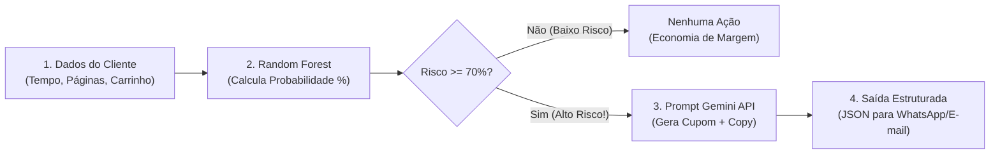

# 🛒 Atividade Prática: Pipeline Híbrido ML + GenAI — Predição de Churn e Cupons com Gemini

**Ambiente:** Google Colaboratory (`Python 3.10+`)  
**Modalidade:** Inteligência Artificial Híbrida (*Machine Learning Preditivo + LLM Generativa*)  
**Tempo Estimado:** 40 a 50 minutos  
**Dataset:** [`ecommerce_clientes.csv`](./ecommerce_clientes.csv) (100 clientes com histórico de navegação e compras)  
**Algoritmo / Modelos:** `RandomForestClassifier` (Scikit-Learn) + `gemini-1.5-flash` (Google Gemini API)

---

## 📋 1. ENUNCIADO DA ATIVIDADE (CONTEXTO DE NEGÓCIO)

> ### 🏬 Desafio: Retenção Ativa de Clientes no E-commerce InovaMarketplace
> O abandono de carrinho custa milhões de reais ao setor de e-commerce todos os anos. A equipe de marketing do **InovaMarketplace** enviava e-mails padronizados com 5% de desconto para todos os usuários, mas a taxa de conversão era mínima.
>
> A diretoria solicitou um **Pipeline Inteligente em Duas Etapas**:
> 1. **Etapa Preditiva (ML Clássico):** Um algoritmo supervisionado (`RandomForest`) analisa variáveis de navegação (tempo no site, páginas de produtos vistas, itens no carrinho, dias desde a última compra) e calcula a probabilidade matemática de abandono (*churn*).
> 2. **Etapa Generativa (GenAI):** Caso o risco de abandono seja alto ($\ge 70\%$), o pipeline aciona automaticamente a **API do Google Gemini** com um prompt estruturado, gerando em tempo real uma mensagem persuasiva hiperpersonalizada e um cupom exclusivo no formato JSON.
>
> **Sua Missão:**
> 1. Carregar o arquivo [`ecommerce_clientes.csv`](./ecommerce_clientes.csv) e treinar o classificador Random Forest.
> 2. Analisar a importância das variáveis (*Feature Importance*) para entender o que mais causa o abandono.
> 3. Integrar o modelo de Machine Learning à biblioteca `google-generativeai`.
> 4. Criar a função de disparo automatizado que converte a predição estatística em uma ação de marketing generativa.
> 5. Avaliar o comportamento da LLM sob diferentes temperaturas ($0.1$ vs. $1.0$).

---

## 🛠️ 2. PASSO A PASSO DETALHADO DO LABORATÓRIO



### Passo 1: Preparação das Dependências no Google Colab
Instale a biblioteca oficial do Google Gemini e faça o upload do arquivo `ecommerce_clientes.csv`:

```python
!pip install -q google-generativeai pandas scikit-learn matplotlib seaborn

import pandas as pd
import numpy as np
import matplotlib.pyplot as plt
import seaborn as sns

from sklearn.model_selection import train_test_split
from sklearn.ensemble import RandomForestClassifier
from sklearn.metrics import classification_report, accuracy_score
import google.generativeai as genai

# Carregamento do dataset de clientes
df = pd.read_csv('ecommerce_clientes.csv')
print("Visão geral dos clientes:")
print(df.head())
```

---

### Passo 2: Treinando o Modelo Preditivo (Random Forest)
Separamos as features de navegação da coluna alvo `abandonou_carrinho` ($1 = \text{sim}$, $0 = \text{não}$):

```python
# Atributos preditores e alvo
X = df[['tempo_no_site_minutos', 'paginas_visitadas', 'itens_no_carrinho', 'dias_sem_comprar', 'valor_carrinho_reais']]
y = df['abandonou_carrinho']

# Divisão Treino e Teste (80/20)
X_train, X_test, y_train, y_test = train_test_split(X, y, test_size=0.2, random_state=42, stratify=y)

# Treinamento com 100 árvores de decisão
rf_model = RandomForestClassifier(n_estimators=100, random_state=42)
rf_model.fit(X_train, y_train)

# Avaliação
y_pred = rf_model.predict(X_test)
print(f"Acurácia do Random Forest: {accuracy_score(y_test, y_pred) * 100:.2f}%\n")
print(classification_report(y_test, y_pred))
```

---

### Passo 3: Importância das Variáveis (*Feature Importance*)
Descobrimos qual métrica tem maior peso matemático para o abandono:

```python
importancias = rf_model.feature_importances_
colunas = X.columns

plt.figure(figsize=(8, 4))
sns.barplot(x=importancias, y=colunas, palette='Reds_r')
plt.title("O que mais influencia o abandono de carrinho? (Feature Importance)")
plt.xlabel("Peso Relativo")
plt.tight_layout()
plt.show()
```

---

### Passo 4: Conectando a IA Generativa (Google Gemini API)
Configure sua chave de API gratuita obtida no [Google AI Studio](https://aistudio.google.com/):

```python
import os

# Insira sua chave da API do Google AI Studio
API_KEY = "SUA_CHAVE_AQUI"
genai.configure(api_key=API_KEY)

# Instanciando o modelo
modelo_gemini = genai.GenerativeModel(
    model_name="gemini-1.5-flash",
    generation_config={
        "temperature": 0.4,
        "response_mime_type": "application/json"
    }
)
```

---

### Passo 5: O Pipeline Integrado (Gatilho de Disparo)
Criamos a função que recebe os dados do cliente, calcula o risco via Machine Learning e, se necessário, aciona a IA Generativa:

```python
import json

def avaliar_e_reter_cliente(dados_cliente):
    df_cliente = pd.DataFrame([dados_cliente])
    
    # 1. Predição probabilística com Random Forest
    prob_abandono = rf_model.predict_proba(df_cliente)[0][1]
    print(f"📊 Análise Preditiva: Probabilidade de Abandono = {prob_abandono * 100:.1f}%")
    
    # Gatilho de decisão de negócio
    if prob_abandono >= 0.70:
        print("🚨 ALTO RISCO DETECTADO! Acionando IA Generativa para resgate...")
        
        prompt = f"""
        Você é o motor de retenção inteligente do InovaMarketplace.
        O cliente está prestes a abandonar uma compra de R$ {dados_cliente['valor_carrinho_reais']:.2f}.
        Ele visitou {dados_cliente['paginas_visitadas']} páginas e colocou {dados_cliente['itens_no_carrinho']} itens no carrinho.
        
        Gere uma resposta estritamente em formato JSON com os seguintes campos:
        {{
            "acao": "CUPOM_EXCLUSIVO",
            "percentual_desconto": <inteiro entre 10 e 20>,
            "codigo_cupom": "<string em maiúsculas>",
            "mensagem_whatsapp": "<texto curto, caloroso, persuasivo e sem ser agressivo>",
            "tempo_expiracao_minutos": 15
        }}
        """
        
        resposta = modelo_gemini.generate_content(prompt)
        conteudo_json = json.loads(resposta.text)
        return {"status": "RESGATE_ENVIADO", "dados_campanha": conteudo_json}
    else:
        return {"status": "SEGURO", "mensagem": "Cliente com baixo risco de abandono."}
```

---

## 🧪 3. EXPERIMENTO CIENTÍFICO: TESTES DE ESTRESSE DA GENAI

Execute as **3 variações** no seu notebook:

1. **Teste 1 — Controle de Temperatura:** Altere a temperatura para `0.0` e depois para `1.2`. Observe a criatividade e estilo textual da mensagem.
2. **Teste 2 — Variação de Ticket:** Teste um carrinho de R$ 50,00 e outro de R$ 5.000,00.
3. **Teste 3 — Formato JSON Estrito:** Observe o comportamento com `response_mime_type="application/json"`.

---

## ✅ 4. ENTREGÁVEL DA ATIVIDADE (CHECKLIST DE CONCLUSÃO)

Para validar a conclusão deste laboratório, certifique-se de preencher os itens:
- [ ] Dataset `ecommerce_clientes.csv` carregado e analisado.
- [ ] Modelo `RandomForestClassifier` treinado com acurácia acima de 85%.
- [ ] Gráfico de *Feature Importance* gerado identificando o principal vetor de abandono.
- [ ] Conexão com a Google Gemini API validada com geração de saída em JSON estruturado.
- [ ] Resposta no caderno: *Qual a vantagem de combinar Machine Learning clássico com LLMs generativas em vez de usar apenas um ou outro isoladamente?*
