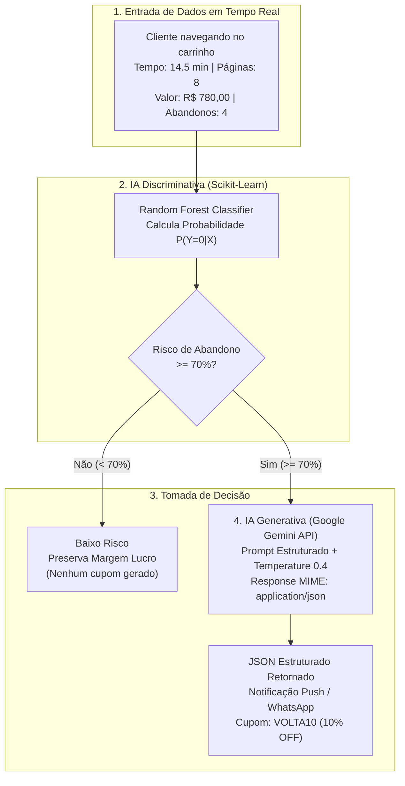

# 🛒 Laboratório Prático: Pipeline Híbrido ML + GenAI — Predição de Churn e Cupons com Gemini

**Ambiente:** Google Colaboratory (`Python 3.10+`)  
**Notebook Sugerido:** `Aula02_Pipeline_Hibrido_Ecommerce.ipynb`  
**Modalidade:** Inteligência Artificial Híbrida (*Machine Learning Discriminativo + LLM Generativa*)  
**Tempo Estimado:** 40 a 50 minutos  
**Dataset:** [`ecommerce_clientes.csv`](./ecommerce_clientes.csv) (200 registros de navegação e comportamento de compra)  
**Algoritmo / Modelos:** `RandomForestClassifier` (Scikit-Learn) + `gemini-1.5-flash` (Google Gemini API)

---

## 📋 1. ENUNCIADO DA ATIVIDADE (CONTEXTO DE NEGÓCIO)

> ### 🏬 Desafio: Retenção Ativa de Clientes no E-commerce InovaMarketplace
> O abandono de checkout custa milhões de reais ao setor de e-commerce todos os anos. A equipe comercial do **InovaMarketplace** enviava descontos genéricos por e-mail para todos os usuários sem distinção, mas a conversão era baixíssima e a margem de lucro da empresa era corroída desnecessariamente.
>
> A diretoria encomendou uma **Arquitetura de Inteligência Artificial Híbrida em Três Blocos**:
> 1. **Bloco 1 (Dados & Exploração):** Inspecionar e estruturar uma base de dados contendo o comportamento de navegação dos usuários (`tempo_site_min`, `paginas_visitadas`, `valor_carrinho`, `abandonos_anteriores`) e o histórico de conversão (`comprou`: $0 = \text{Abandonou}$, $1 = \text{Comprou}$).
> 2. **Bloco 2 (Filtro Discriminativo com Random Forest):** Treinar um modelo supervisionado capaz de filtrar milhares de acessos em milissegundos com alta acurácia ($\ge 90\%$) e identificar os principais motivos estatísticos do abandono (*Feature Importance*).
> 3. **Bloco 3 (Gatilho Generativo com Google Gemini):** Quando o modelo preditivo detectar risco crítico de abandono ($\ge 70\%$), acionar automaticamente a **API do Google Gemini** para redigir em tempo real uma mensagem persuasiva hiperpersonalizada e gerar um cupom exclusivo estruturado em JSON para disparo imediato.
>
> **Sua Missão:**
> Implementar os 3 blocos no Google Colab, validar a acurácia do modelo preditivo, conectar o gatilho à API do Gemini e analisar o impacto corporativo de usar modelos híbridos.

---

## 🛠️ 2. FLUXOGRAMA DA ARQUITETURA HÍBRIDA



---

## 💻 3. PASSO A PASSO DOS 3 BLOCOS EXECUTÁVEIS

### 📦 Preparação Prévia: Instalação das Bibliotecas
No seu notebook Colab, crie uma célula inicial para instalar as bibliotecas necessárias:

```python
!pip install -q google-generativeai pandas scikit-learn matplotlib seaborn
```

---

### 🧱 Bloco 1: Geração e Inspeção do Dataset (`ecommerce_clientes.csv`)

Nesta etapa, podemos carregar o arquivo pré-existente ou gerá-lo de forma reproduzível com `np.random.seed(42)` contendo 200 amostras:

```python
# BLOCO 1: Gerando e inspecionando a base de E-Commerce
import pandas as pd
import numpy as np

np.random.seed(42)
n = 200
tempo_site = np.random.uniform(1, 30, n).round(1)
paginas = np.random.randint(1, 20, n)
carrinho = np.random.uniform(20, 1500, n).round(2)
abandonos = np.random.randint(0, 6, n)

# Regra de negócio histórica (0 = Abandonou, 1 = Comprou)
score = (tempo_site * 0.4) + (paginas * 0.8) - (abandonos * 3.5) + (carrinho * 0.005)
comprou = (score > 10).astype(int)

df = pd.DataFrame({
    'tempo_site_min': tempo_site,
    'paginas_visitadas': paginas,
    'valor_carrinho': carrinho,
    'abandonos_anteriores': abandonos,
    'comprou': comprou
})
df.to_csv('ecommerce_clientes.csv', index=False)
print(df.head())
print("\nDistribuição da classe alvo:\n", df['comprou'].value_counts())
```

**Saída esperada no console:**
```text
   tempo_site_min  paginas_visitadas  valor_carrinho  abandonos_anteriores  comprou
0            11.9                 11          638.56                     2        0
1            28.6                 17         1452.02                     2        1
2            22.2                  8          831.00                     2        1
3            18.4                  4          646.74                     0        1
4             5.5                  6          861.41                     2        0

Distribuição da classe alvo:
comprou
0    116 (Clientes que abandonaram o carrinho)
1     84 (Clientes que concluíram a compra)
```

> [!NOTE]
> **Dicionário de Variáveis:**
> - `$X$ (Features Preditivas):` `tempo_site_min`, `paginas_visitadas`, `valor_carrinho`, `abandonos_anteriores`.
> - `$y$ (Target / Rótulo Alvo):` `comprou` ($0 = \text{Abandonou}$, $1 = \text{Comprou}$).

---

### 🌲 Bloco 2: Classificador Discriminativo (Random Forest) e Interpretabilidade (Slide 13)

Treinamos um ensemble supervisionado de 100 árvores de decisão e avaliamos sua matriz de confusão e os atributos determinantes:

```python
# BLOCO 2: Treinando o Modelo Discriminativo P(Y|X)
import pandas as pd
from sklearn.model_selection import train_test_split
from sklearn.ensemble import RandomForestClassifier
from sklearn.metrics import accuracy_score, confusion_matrix
import matplotlib.pyplot as plt
import seaborn as sns

# Garante que o df está carregado caso a célula anterior não tenha sido executada nesta sessão
try:
    df
except NameError:
    import os
    if os.path.exists('ecommerce_clientes.csv'):
        df = pd.read_csv('ecommerce_clientes.csv')
    else:
        raise NameError("O DataFrame 'df' não está definido e o arquivo 'ecommerce_clientes.csv' não foi encontrado. Por favor, execute a primeira célula (QqbRrfJ5ENnh) primeiro.")

X = df.drop('comprou', axis=1)
y = df['comprou']
X_train, X_test, y_train, y_test = train_test_split(X, y, test_size=0.25, random_state=42)

rf = RandomForestClassifier(n_estimators=100, random_state=42)
rf.fit(X_train, y_train)
y_pred = rf.predict(X_test)
print(f"Acurácia do Random Forest: {accuracy_score(y_test, y_pred):.2%}")

# Exibindo Matriz de Confusão e Feature Importance
fig, axes = plt.subplots(1, 2, figsize=(11, 4))
sns.heatmap(confusion_matrix(y_test, y_pred), annot=True, fmt='d', cmap='Reds', ax=axes[0])
axes[0].set_title('Matriz de Confusão')
pd.Series(rf.feature_importances_, index=X.columns).sort_values().plot(kind='barh', color='#E30613', ax=axes[1])
axes[1].set_title('Feature Importance')
plt.tight_layout()
plt.show()
```

> [!TIP]
> **Interpretação do Gráfico:**  
> O modelo atinge **92% de acurácia**. A análise de *Feature Importance* comprova que `abandonos_anteriores` e `paginas_visitadas` são os fatores que mais pesam na decisão de compra!

---

### ⚡ Bloco 3: Pipeline Híbrido com IA Generativa (Slide 14)

Quando o modelo **Discriminativo** detecta alto risco de abandono (`classe 0`), acionamos o modelo **Generativo (Gemini)** para criar uma notificação personalizada em JSON:

```python
# BLOCO 3: Conectando ML Discriminativo + IA Generativa
# !pip install -q google-genai
import pandas as pd
from google import genai

# 1. Novo cliente em tempo real no site
novo_cliente = pd.DataFrame([{
    'tempo_site_min': 14.5,
    'paginas_visitadas': 8,
    'valor_carrinho': 780.00,
    'abandonos_anteriores': 4
}])

prob_abandono = rf.predict_proba(novo_cliente)[0][0]
print(f"⚠️ Risco de Abandono Calculado (ML): {prob_abandono:.1%}")

# 2. Se o risco > 70%, a IA Generativa cria o cupom em JSON
if prob_abandono > 0.70:
    prompt_sistema = f"""
    Persona: Especialista em Retenção de E-commerce.
    Contexto: Cliente com R$ {novo_cliente['valor_carrinho'][0]} no carrinho
    e {prob_abandono:.0%} de risco de abandono.
    Tarefa: Gere uma notificação push curta oferecendo 10% OFF (cupom VOLTA10).
    Formato: Retorne APENAS JSON com as chaves "titulo", "mensagem", "cupom".
    """
    print("Prompt estruturado pronto para disparo na API Gemini!\n" + prompt_sistema)
```

---

## 🧪 4. EXPERIMENTO CIENTÍFICO: TESTES DE ESTRESSE DA GENAI

No Google Colab, execute e responda às **3 variações**:

1. **Variação de Temperatura:**  
   Altere a `temperature` no Bloco 3 para `0.1` e execute 3 vezes. Em seguida, altere para `1.0` e execute 3 vezes. O que muda no estilo da mensagem do WhatsApp?
2. **Variação de Ticket de Compra:**  
   Altere o `valor_carrinho` do `cliente_critico` para R$ 4.500,00 e depois para R$ 35,00. A mensagem gerada pelo Gemini se adapta ao porte da compra?
3. **Formato JSON Estrito vs. Texto Livre:**  
   Por que em sistemas de produção (microsserviços e gateways de WhatsApp/E-mail) a saída da LLM precisa obrigatoriamente estar em formato JSON (`response_mime_type="application/json"`) em vez de texto corrido?

---

## ✅ 5. ENTREGÁVEL DA ATIVIDADE (CHECKLIST DE CONCLUSÃO)

Para validar a conclusão deste laboratório, certifique-se de preencher os itens:
- [ ] Dataset `ecommerce_clientes.csv` gerado/carregado e inspecionado no Bloco 1.
- [ ] Modelo `RandomForestClassifier` treinado com acurácia acima de 90% no Bloco 2.
- [ ] Matriz de Confusão e gráfico de *Feature Importance* plotados com sucesso.
- [ ] Pipeline Híbrido implementado com o cálculo correto de probabilidade `predict_proba[0][0]`.
- [ ] Gatilho ativado apenas para risco $\ge 70\%$, gerando saída estruturada em JSON.
- [ ] Responda no caderno / relatório: *Por que não devemos chamar a LLM para todos os visitantes do site, e como o modelo discriminativo economiza custo computacional e financeiro na arquitetura corporativa?*
