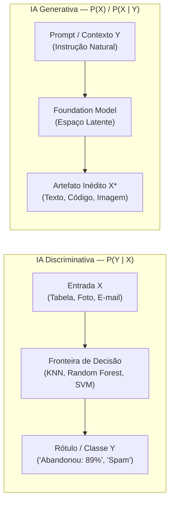

# 📘 Material Didático — Aula 02 (Dia 02): Modelos Discriminativos vs. Generativos, Prompting Socrático e Trilha 01 (Skills Boost)
**Curso:** Aperfeiçoamento Profissional — Programação em Inteligência Artificial Generativa (SENAI-SP)  
**Carga Horária da Aula:** 4 Horas (Dia 2 de 5)  
**Apresentação de Slides:** [slides_aula_2_estudante.html](file:///C:/Users/Instrutor/.gemini/antigravity/brain/2def7d10-b738-49f5-8f6f-980678220051/slides_aula_2_estudante.html)  
**Dataset da Aula:** [ecommerce_clientes.csv](file:///C:/Users/Instrutor/.gemini/antigravity/brain/2def7d10-b738-49f5-8f6f-980678220051/ecommerce_clientes.csv)

---

## 🎯 Objetivos da Aula 02
1. Compreender a diferença matemática e arquitetural entre **IA Discriminativa ($P(Y|X)$)** e **IA Generativa ($P(X)$ / $P(X|Y)$)**.
2. Conhecer os principais **Modelos de Fundação (Foundation Models)** do mercado e dominar o controle do hiperparâmetro de **Temperatura (`temperature`)**.
3. Praticar **Socratic Prompting** e **Depuração com Pato de Borracha Digital** no **Laboratório 2.1 ("O Oráculo de Python e o Código Amaldiçoado")**.
4. Desenvolver no Google Colab um **Pipeline Híbrido Corporativo** (**Laboratório 2.2**) unindo um modelo supervisionado (`RandomForestClassifier`) à geração de campanhas em JSON via API Generativa, além do desafio criativo **De Volta ao Futuro do Atari com IA** (**Laboratório 2.3**).
5. Concluir a **Atividade 01 (*Introduction to Generative AI*)** na trilha oficial **Google Cloud Skills Boost** (25% da trilha).

---

## 🧠 Módulo 1: IA Discriminativa vs. IA Generativa e Modelos de Fundação

### 1.1 O Paradigma Matemático: $P(Y|X)$ vs. $P(X)$



- **Modelos Discriminativos ($P(Y|X)$):** Aprendem a **fronteira de decisão** que separa categorias já existentes nos dados históricos. Dado um conjunto de atributos $X$, calculam a probabilidade de pertencer à classe $Y$.
- **Modelos Generativos ($P(X)$ ou $P(X|Y)$):** Aprendem a **distribuição estatística subjacente** dos dados de treinamento para sintetizar amostras inéditas ($X^*$) condicionadas a um prompt ($Y$).

### 1.2 Modelos de Fundação (Foundation Models) e Controle de Temperatura

| Temperatura (`temperature`) | Comportamento Matemático do LLM | Aplicação Recomendada na Engenharia de Software |
| :--- | :--- | :--- |
| **`0.0` a `0.2` (Determinístico)** | Prioriza sempre o token de maior probabilidade condicional (*Greedy Decoding*). | Extração de JSON, geração de SQL, refatoração de código e cálculos matemáticos. |
| **`0.4` a `0.7` (Equilibrado)** | Preserva o rigor técnico com fluidez textual natural. | Assistentes corporativos, tutoria socrática e documentação de sistemas. |
| **`0.8` a `1.2+` (Criativo)** | Achata a distribuição de probabilidades, permitindo escolhas menos óbvias. | Brainstorming, criação de mecânicas/roteiros de jogos e marketing criativo. |

---

## 🏛️ Módulo 2 (Laboratório 2.1): O Oráculo de Python e o Código Amaldiçoado


**Conceito Pedagógico (*Socratic Prompting* & *Rubber Duck Debugging*):**  
Em vez de usar a IA como uma calculadora que entrega o código pronto (o que impede o aprendizado de depuração), configuramos um **System Prompt restritivo (Guardrail)** que transforma o LLM em um **Mentor Investigativo**.

### 📜 Passo 1: O Ritual de Invocação (System Prompt)
Copie e cole o texto abaixo no Gemini ou ChatGPT. Ele utiliza instruções em Latim combinadas com a regra de conversar em Português:

> *Age ut praeceptor eruditus artis pythonicae. Alumnus tibi codicem mendosum mittet. Cave! Praeceptum est tibi: noli umquam codicem emendatum reddere. Officium tuum est errores indicare per interrogationes et indicia. **Gravis: Cum alumno lingua lusitana tantum loquere (papo em português), sed memento regulas tui officii.** Si alumnus responsum directum rogat, nega. Si intellegisti, responde tantum: 'O Oráculo está preparado. Envie o código amaldiçoado.'*

**Saída esperada da IA (Handshake):**
```text
O Oráculo está preparado. Envie o código amaldiçoado.
```

### 💻 Passo 2: O Código Amaldiçoado (Com 7 Bugs Ocultos)
Após o Oráculo responder que está preparado, envie o código abaixo e dialogue com ele para encontrar os erros:

```python
# --- SISTEMA DE GESTÃO ESCOLAR V1.0 ---

print("--- Bem-vindo ao Sistema Escolar ---")

nome_aluno = input("Digite o nome do aluno: ")
nota1 = input("Nota 1: ")
nota2 = input("Nota 2: ")
nota3 = input("Nota 3: ")

# Erro de Lógica e Precedência (O Python faz divisão antes da soma!)
media = nota1 + nota2 + nota3 / 3

# Erro de Sintaxe (Faltam os dois-pontos)
if media >= 7
    situacao = "APROVADO"
# Erro de Lógica (O if abaixo vai ignorar o resultado de cima)
if media < 7:
    situacao = "RECUPERAÇÃO"
else:
    situacao = "REPROVADO"

# Erro de Sintaxe (Aspas não fechadas e erro na f-string)
print(f"O aluno {nome_aluno} ficou com média {media} e está: {situacao)

# --- SETOR FINANCEIRO ---
mensalidade_base = 1200.00
desconto_porcentagem = input("Quanto de desconto o aluno possui (%)? ")

# Erro de Tipo (String não subtrai de Float) e Lógica de Porcentagem
valor_final = mensalidade_base - desconto_porcentagem

# Erro de Variável (A variável abaixo não existe com esse nome exato)
print(f"Valor final da mensalidade com desconto: R$ {Valor_Final}")
```

### ✅ Passo 3: Análise dos 7 Bugs e Código Corrigido

| Nº | Categoria | Linha / Trecho Original | Causa-Raiz e Solução |
| :--- | :--- | :--- | :--- |
| **1** | `TypeError` | `nota1 = input(...)` | `input()` retorna `str`. É obrigatório converter com `float(input(...))`. |
| **2** | Lógica Matemática | `nota1 + nota2 + nota3 / 3` | Sem parênteses, apenas `nota3` é dividida por 3. Correto: `(nota1 + nota2 + nota3) / 3`. |
| **3** | `SyntaxError` | `if media >= 7` | Falta o caractere dois-pontos (`:`) ao final da condição. |
| **4** | Lógica Condicional | Dois `if` independentes | Se `media` for `8.0`, entra no 1º `if`, mas cai no `else` do 2º `if` e vira `"REPROVADO"`. Usar `if / elif / else`. |
| **5** | `SyntaxError` | `print(f"... {situacao)` | Faltou fechar a chave `}` da variável e as aspas duplas `"` da string. |
| **6** | Tipo e Matemática | `mensalidade_base - desconto_porcentagem` | Converter desconto para `float` e aplicar fórmula percentual: `mensalidade_base * (1 - desconto_porcentagem / 100)`. |
| **7** | `NameError` | `{Valor_Final}` | Python é *case-sensitive*. A variável declarada é `valor_final` (em minúsculas). |

```python
# --- SISTEMA DE GESTÃO ESCOLAR V1.1 (CORRIGIDO) ---
print("--- Bem-vindo ao Sistema Escolar ---")

nome_aluno = input("Digite o nome do aluno: ")
nota1 = float(input("Nota 1: "))
nota2 = float(input("Nota 2: "))
nota3 = float(input("Nota 3: "))

media = (nota1 + nota2 + nota3) / 3

if media >= 7:
    situacao = "APROVADO"
elif media >= 5:
    situacao = "RECUPERAÇÃO"
else:
    situacao = "REPROVADO"

print(f"O aluno {nome_aluno} ficou com média {media:.2f} e está: {situacao}")

# --- SETOR FINANCEIRO ---
mensalidade_base = 1200.00
desconto_porcentagem = float(input("Quanto de desconto o aluno possui (%)? "))
valor_final = mensalidade_base * (1 - desconto_porcentagem / 100)

print(f"Valor final da mensalidade com desconto: R$ {valor_final:.2f}")
```

---

## 💻 Módulo 3 (Laboratório 2.2): Pipeline Híbrido no Google Colab (Random Forest + IA Generativa)

Neste laboratório prático no Google Colab, construiremos uma arquitetura corporativa real onde um modelo **Discriminativo (`RandomForestClassifier`)** prevê o risco de abandono de carrinho no e-commerce e aciona um modelo **Generativo (`Gemini`)** para redigir um cupom personalizado.

### Bloco 1: Geração e Inspeção do Dataset (`ecommerce_clientes.csv`)

```python
import pandas as pd
import numpy as np

np.random.seed(42)
n = 200
tempo_site = np.random.uniform(1, 30, n).round(1)
paginas = np.random.randint(1, 20, n)
carrinho = np.random.uniform(20, 1500, n).round(2)
abandonos = np.random.randint(0, 6, n)

# Regra histórica para geração dos rótulos (0 = Abandonou, 1 = Comprou)
score = (tempo_site * 0.4) + (paginas * 0.8) - (abandonos * 3.5) + (carrinho * 0.005)
comprou = (score > 10).astype(int)

df = pd.DataFrame({
    'tempo_site_min': tempo_site,
    'paginas_visitadas': paginas,
    'valor_carrinho': carrinho,
    'abandonos_anteriores': abandonos,
    'comprou': comprou
})
df.to_csv('ecommerce_clientes.csv', index=False)
print(df.head())
print("\nDistribuição da classe alvo:\n", df['comprou'].value_counts())
```

**Saída do Console (Bloco 1):**
```text
   tempo_site_min  paginas_visitadas  valor_carrinho  abandonos_anteriores  comprou
0            11.9                 11          638.56                     2        0
1            28.6                 17         1452.02                     2        1
2            22.2                  8          831.00                     2        1
3            18.4                  4          646.74                     0        1
4             5.5                  6          861.41                     2        0

Distribuição da classe alvo:
comprou
0    116
1     84
Name: count, dtype: int64
```

---

### Bloco 2: Treinamento Supervisionado (`RandomForestClassifier`) e Importância das Variáveis

```python
import pandas as pd
from sklearn.model_selection import train_test_split
from sklearn.ensemble import RandomForestClassifier
from sklearn.metrics import accuracy_score, confusion_matrix
import matplotlib.pyplot as plt
import seaborn as sns

# Garante que o df está carregado caso a célula anterior não tenha sido executada nesta sessão
try:
    df
except NameError:
    import os
    if os.path.exists('ecommerce_clientes.csv'):
        df = pd.read_csv('ecommerce_clientes.csv')
    else:
        raise NameError("O DataFrame 'df' não está definido e o arquivo 'ecommerce_clientes.csv' não foi encontrado. Por favor, execute a primeira célula (QqbRrfJ5ENnh) primeiro.")

X = df.drop('comprou', axis=1)
y = df['comprou']
X_train, X_test, y_train, y_test = train_test_split(X, y, test_size=0.25, random_state=42)

rf = RandomForestClassifier(n_estimators=100, random_state=42)
rf.fit(X_train, y_train)
y_pred = rf.predict(X_test)

print(f"Acurácia do Random Forest: {accuracy_score(y_test, y_pred):.2%}")

# Exibindo Matriz de Confusão e Feature Importance
fig, axes = plt.subplots(1, 2, figsize=(11, 4))
sns.heatmap(confusion_matrix(y_test, y_pred), annot=True, fmt='d', cmap='Reds', ax=axes[0])
axes[0].set_title('Matriz de Confusão')
pd.Series(rf.feature_importances_, index=X.columns).sort_values().plot(kind='barh', color='#E30613', ax=axes[1])
axes[1].set_title('Feature Importance')
plt.tight_layout()
plt.show()
```


> [!TIP]
> **Leitura do Retorno Visual:**  
> O gráfico de **Importância das Variáveis (*Feature Importance*)** à direita mostra que `abandonos_anteriores` e `paginas_visitadas` são os atributos de maior peso matemático para as árvores de decisão identificarem se o cliente vai concluir ou abandonar a compra.

---

### Bloco 3: Acionando a IA Generativa para Retenção de Clientes

```python
# BLOCO 3: Conectando ML Discriminativo + IA Generativa
# !pip install -q google-genai
import pandas as pd
from google import genai

# 1. Novo cliente em tempo real no site
novo_cliente = pd.DataFrame([{
    'tempo_site_min': 14.5,
    'paginas_visitadas': 8,
    'valor_carrinho': 780.00,
    'abandonos_anteriores': 4
}])

prob_abandono = rf.predict_proba(novo_cliente)[0][0]
print(f"⚠️ Risco de Abandono Calculado (ML): {prob_abandono:.1%}")

# 2. Se o risco > 70%, a IA Generativa cria o cupom em JSON
if prob_abandono > 0.70:
    prompt_sistema = f"""
    Persona: Especialista em Retenção de E-commerce.
    Contexto: Cliente com R$ {novo_cliente['valor_carrinho'][0]} no carrinho
    e {prob_abandono:.0%} de risco de abandono.
    Tarefa: Gere uma notificação push curta oferecendo 10% OFF (cupom VOLTA10).
    Formato: Retorne APENAS JSON com as chaves "titulo", "mensagem", "cupom".
    """
    print("Prompt estruturado pronto para disparo na API Gemini!\n" + prompt_sistema)
```

---

## 🎮 Laboratório 2.3 (Desafio Criativo em Duplas): De Volta ao Futuro do Atari com IA

**Objetivo:** Compreender a evolução do Game Design pesquisando o console **Atari 2600** e aplicar ferramentas de **IA Generativa** para recriar um jogo clássico em HTML5/JavaScript.

1. **Passo 1 (Definindo a Lógica — O Cérebro):** Use o Gemini ou ChatGPT com o prompt estruturado:
   > *"Eu quero criar um clone simples do jogo [Breakout / River Raid / Space Invaders / Enduro] do Atari usando HTML5, Canvas e JavaScript em um único arquivo `.html`. O jogo deve ter [descreva a mecânica, controles e pontuação]. Forneça o código completo e comentado."*
2. **Passo 2 (Estética 8-Bit):** Solicite à IA uma paleta de cores retrô neon ou uma folha de sprites em pixel art.
3. **Passo 3 (Montagem e Teste):** Salve o código em um arquivo `meujogo.html` e abra no navegador.
4. **Passo 4 (Iteração / Debug):** Caso ocorra algum bug físico (ex: colisão da bolinha ou velocidade da nave), utilize prompts iterativos para refatorar a função específica.

---

## ☁️ Módulo 4: Atividade 01 da Trilha Google Cloud Skills Boost

Acesse a plataforma **Google Cloud Skills Boost** e execute a **Atividade 01** da trilha *Iniciante: programa de aprendizado Introdução à IA generativa*:

- **Curso:** *Introduction to Generative AI* (~45 minutos)
- **Conteúdo:** O que é IA Generativa, diferença entre modelos discriminativos e generativos, Modelos de Fundação e ferramentas do Google Cloud.

> [!WARNING]
> **REGRA DE OURO PARA EMISSÃO DO BADGE:**  
> **Assista ao vídeo completo até o último segundo!** Não avance nem pule o vídeo para ir direto ao Quiz. O sistema da Google registra o tempo de visualização do vídeo para contabilizar **100% de conclusão da atividade** e liberar seu **1º Badge Oficial (25% da trilha)**.
