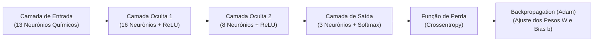

# 🧠 Atividade Prática: Redes Neurais Profundas com Keras — Do Perceptron ao Backpropagation

**Ambiente:** Google Colaboratory (`Python 3.10+` com GPU/CPU) & [Simulador Web de Redes Neurais](https://irineufrancisco.github.io/ExemploRedeNeural/)  
**Modalidade:** Aprendizado Profundo (*Deep Learning / Redes Neurais Artificiais Densas*)  
**Tempo Estimado:** 40 a 50 minutos  
**Dataset:** `sklearn.datasets.load_wine` (13 features físico-químicas)  
**Frameworks:** `TensorFlow`, `Keras` (`Sequential`, `Dense`, `Dropout`), `Scikit-Learn`

---

## 📋 1. ENUNCIADO DA ATIVIDADE (CONTEXTO DE NEGÓCIO)

> ### 🏭 Desafio: Superando Modelos Clássicos com Redes Neurais Artificiais
> Na Aula 01, nosso classificador supervisionado clássico (KNN) alcançou cerca de $72\%$ de acurácia no dataset de vinhos sem padronização. A diretoria da vinícola parceira do **InovaMarketplace** exige um nível de precisão superior a **$95\%$** para certificar safras de alto padrão para exportação.
>
> Para vencer as fronteiras não-lineares dos compostos químicos, você foi encarregado de projetar, compilar e treinar uma **Rede Neural Profunda (*Multilayer Perceptron — MLP*)** utilizando o framework industrial **Keras/TensorFlow**.
>
> **Sua Missão:**
> 1. Compreender o funcionamento biológico e matemático da sinapse artificial através do [Simulador Interativo Maçã vs. Laranja](https://irineufrancisco.github.io/ExemploRedeNeural/).
> 2. Construir uma arquitetura de rede neural densa com camadas ocultas (`Dense`) e funções de ativação não-lineares (`ReLU`).
> 3. Configurar a camada de saída com **Softmax** para gerar probabilidades entre as 3 safras de vinho.
> 4. Compilar o modelo com a função de perda `SparseCategoricalCrossentropy` e o otimizador adaptativo `Adam`.
> 5. Treinar a rede por 80 épocas, plotar as curvas de **Perda (*Loss*)** e **Acurácia**, e verificar a evolução do modelo até superar $96\%$ de acurácia!

---

## 🛠️ 2. PASSO A PASSO DETALHADO DO LABORATÓRIO



### Passo 1: Preparação e Padronização dos Dados
No Google Colab, importe o TensorFlow e prepare as amostras com `StandardScaler`:

```python
import numpy as np
import pandas as pd
import matplotlib.pyplot as plt

from sklearn.datasets import load_wine
from sklearn.model_selection import train_test_split
from sklearn.preprocessing import StandardScaler

import tensorflow as tf
from tensorflow import keras
from tensorflow.keras import layers

# Carga e divisão dos dados
wine = load_wine()
X, y = wine.data, wine.target

X_train, X_test, y_train, y_test = train_test_split(
    X, y, test_size=0.2, random_state=42, stratify=y
)

# Padronização obrigatória para Redes Neurais
scaler = StandardScaler()
X_train_scaled = scaler.fit_transform(X_train)
X_test_scaled = scaler.transform(X_test)

print(f"Formato dos dados de treino: {X_train_scaled.shape}")
```

---

### Passo 2: Construção da Arquitetura Densa no Keras
Projetamos uma rede sequencial com 13 entradas, duas camadas densas com ReLU e 3 neurônios de saída com Softmax:

```python
tf.random.set_seed(42)

modelo = keras.Sequential([
    layers.Dense(16, activation='relu', input_shape=(13,), name="Camada_Oculta_1"),
    layers.Dropout(0.1),
    layers.Dense(8, activation='relu', name="Camada_Oculta_2"),
    layers.Dense(3, activation='softmax', name="Camada_Saida_Softmax")
])

modelo.summary()
```

---

### Passo 3: Compilação e Treinamento
Configuramos a função de perda, o otimizador e treinamos por 80 épocas:

```python
modelo.compile(
    optimizer=keras.optimizers.Adam(learning_rate=0.01),
    loss='sparse_categorical_crossentropy',
    metrics=['accuracy']
)

historico = modelo.fit(
    X_train_scaled, y_train,
    epochs=80,
    batch_size=16,
    validation_split=0.2,
    verbose=0
)

print("Treinamento concluído com sucesso!")
```

---

### Passo 4: Avaliação Final e Plotagem das Curvas de Aprendizado
```python
loss_teste, acc_teste = modelo.evaluate(X_test_scaled, y_test, verbose=0)
print(f"Acurácia no Teste: {acc_teste * 100:.2f}% | Perda (Loss): {loss_teste:.4f}")

plt.figure(figsize=(12, 4))
plt.subplot(1, 2, 1)
plt.plot(historico.history['loss'], label='Treino', color='#E30613')
plt.plot(historico.history['val_loss'], label='Validação', color='#1A73E8', linestyle='--')
plt.title('Curva de Perda (Loss)')
plt.xlabel('Épocas')
plt.legend()
plt.grid(True, alpha=0.3)

plt.subplot(1, 2, 2)
plt.plot(historico.history['accuracy'], label='Treino', color='#10B981')
plt.plot(historico.history['val_accuracy'], label='Validação', color='#F59E0B', linestyle='--')
plt.title('Curva de Acurácia (%)')
plt.xlabel('Épocas')
plt.legend()
plt.grid(True, alpha=0.3)
plt.tight_layout()
plt.show()
```

---

## 🧪 3. EXPERIMENTO CIENTÍFICO: TESTES NO SIMULADOR E HIPERPARÂMETROS

1. **Teste 1 — Calibração Manual no Simulador de Sinapses:**  
   Acesse: 👉 **[https://irineufrancisco.github.io/ExemploRedeNeural/](https://irineufrancisco.github.io/ExemploRedeNeural/)** e calibre os pesos manualmente.
2. **Teste 2 — Variação da Taxa de Aprendizado (*Learning Rate*):**  
   Altere para `learning_rate=1.0` (muito alto) e `learning_rate=0.00001` (muito baixo).

---

## ✅ 4. ENTREGÁVEL DA ATIVIDADE (CHECKLIST DE CONCLUSÃO)

Para validar a conclusão deste laboratório, certifique-se de preencher os itens:
- [ ] Exercício executado no simulador interativo web com compreensão de pesos e bias.
- [ ] Rede neural construída no Keras com camadas densas e funções de ativação.
- [ ] Treinamento finalizado superando a marca de 95% de acurácia nos dados de teste.
- [ ] Gráfico com as curvas de aprendizado (Loss e Acurácia) gerado e analisado.
- [ ] Resposta no caderno: *Qual a função da ativação Softmax na última camada e por que a soma das suas saídas é sempre igual a 100%?*
