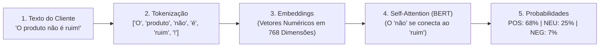

# 💬 Atividade Prática: Análise de Sentimentos com BERT & PLN — Monitorando a Voz do Cliente

**Ambiente:** Google Colaboratory (`Python 3.10+`)  
**Modalidade:** Processamento de Linguagem Natural Profundo (*Deep Learning / Transformers / BERT*)  
**Tempo Estimado:** 35 a 45 minutos  
**Biblioteca / Modelo:** `pysentimiento` (Modelo RoBERTa / BERT especializado em língua portuguesa)  
**Classes de Sentimento:** `POS` (Positivo), `NEG` (Negativo) e `NEU` (Neutro)

---

## 📋 1. ENUNCIADO DA ATIVIDADE (CONTEXTO DE NEGÓCIO)

> ### 📢 Desafio: Monitoramento de Reputação e SAC Automatizado (InovaMarketplace)
> O setor de atendimento ao cliente do **InovaMarketplace** recebe mais de 20 mil comentários, tweets e avaliações de produtos diariamente. A diretoria necessita de um sistema de Inteligência Artificial capaz de analisar instantaneamente o sentimento das mensagens recebidas e priorizar casos de clientes revoltados para o time humano de retenção.
>
> Algoritmos antigos baseados em contagem simples de palavras (*Bag of Words*) falham miseravelmente diante de **negações** (*"Não achei nada bom"*), **emojis** (*"A entrega demorou 😡"*), **gírias** e, principalmente, **ironia/sarcasmo** (*"Maravilha, o produto chegou todo quebrado!"*).
>
> **Sua Missão:**
> 1. Configurar um pipeline de PLN moderno no Google Colab utilizando o modelo **BERT / RoBERTa** da biblioteca `pysentimiento`.
> 2. Compreender os 3 pilares técnicos: **Tokenização por subpalavras**, **Embeddings Vetoriais** e o mecanismo de **Auto-Atenção (*Self-Attention*)**.
> 3. Construir uma função de análise de sentimentos interativa que extraia a classe dominante e a distribuição percentual de probabilidades.
> 4. Submeter a IA aos **4 testes de estresse linguísticos** (Inversão de contexto, Emojis, Neutralidade e Sarcasmo).
> 5. Interpretar as limitações dos modelos de linguagem e sugerir boas práticas para mitigação de falsos diagnósticos.

---

## 🛠️ 2. PASSO A PASSO DETALHADO DO LABORATÓRIO



### Passo 1: Instalação e Carregamento do Cérebro BERT
No Google Colab, instale a biblioteca `pysentimiento`:

```python
!pip install -q pysentimiento

from pysentimiento import create_analyzer
import matplotlib.pyplot as plt

print("Carregando o modelo BERT treinado em Português...")
analisador = create_analyzer(task="sentiment", lang="pt")
print("✅ Motor de PLN pronto para análise!")
```

---

### Passo 2: Criando a Função de Diagnóstico Visual
```python
def analisar_sentimento_completo(texto):
    resultado = analisador.predict(texto)
    sentimento = resultado.output
    probabilidades = resultado.probas
    
    mapa_rotulos = {'POS': 'Positivo 😊', 'NEG': 'Negativo 😡', 'NEU': 'Neutro 😐'}
    
    print("\n" + "="*50)
    print(f"Frase Analisada: \"{texto}\"")
    print(f"Diagnóstico da IA: {mapa_rotulos[sentimento]}")
    print(f"Confiança: {probabilidades[sentimento]*100:.2f}%")
    print("="*50)
    
    # Gráfico de barras das probabilidades
    classes = list(mapa_rotulos.values())
    valores = [probabilidades['POS'], probabilidades['NEG'], probabilidades['NEU']]
    
    plt.figure(figsize=(6, 3))
    plt.bar(classes, [v*100 for v in valores], color=['#10B981', '#EF4444', '#64748B'])
    plt.ylabel("Probabilidade (%)")
    plt.title("Distribuição de Certeza do Modelo BERT")
    plt.ylim(0, 100)
    plt.tight_layout()
    plt.show()

# Teste inicial
analisar_sentimento_completo("Adorei o produto, entrega super rápida e excelente acabamento!")
```

---

## 🧪 3. EXPERIMENTO CIENTÍFICO: OS 4 TESTES DE ESTRESSE LINGUÍSTICOS

Submeta o modelo aos **4 desafios fundamentais da linguagem humana** e registre as probabilidades no seu relatório:

1. **Desafio 1 — Inversão de Contexto e Negação:** `"Este filme não é ruim!"`
2. **Desafio 2 — O Poder dos Emojis:** `"Chegou hoje 😍"` vs `"Chegou hoje 😡"`
3. **Desafio 3 — A Linha Tênue da Neutralidade:** `"O pedido foi entregue na portaria às 14h30 pelo carteiro."`
4. **Desafio 4 — Ironia e Sarcasmo:** `"Parabéns pelo atendimento maravilhoso! Esperando há apenas 4 horas na fila."`

---

## ✅ 4. ENTREGÁVEL DA ATIVIDADE (CHECKLIST DE CONCLUSÃO)

Para validar a conclusão deste laboratório, certifique-se de preencher os itens:
- [ ] Biblioteca `pysentimiento` instalada e modelo BERT carregado no Colab.
- [ ] Função de diagnóstico visual executada com gráfico de probabilidades.
- [ ] Os 4 testes de estresse (Negação, Emojis, Neutralidade e Sarcasmo) executados.
- [ ] Análise documentada: *Por que modelos clássicos de contagem de palavras falham com negações e como a arquitetura Transformer soluciona esse problema?*
