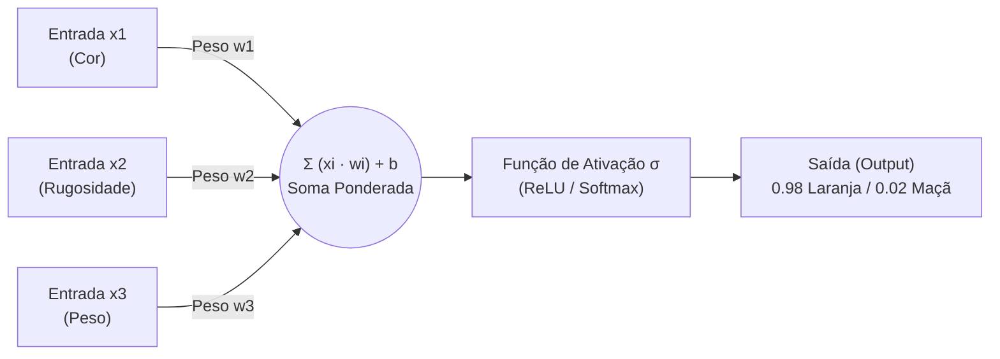

# 📘 Material Didático — Aula 03 (Dia 03): Redes Neurais Profundas, PLN (Transformers/BERT) e Trilha 02 (Skills Boost)
**Curso:** Aperfeiçoamento Profissional — Programação em Inteligência Artificial Generativa (SENAI-SP)  
**Carga Horária da Aula:** 4 Horas (Dia 3 de 5)  
**Apresentação de Slides:** [slides_aula_3_estudante.html](file:///C:/Users/Instrutor/.gemini/antigravity/brain/2def7d10-b738-49f5-8f6f-980678220051/slides_aula_3_estudante.html)

---

## 🎯 Objetivos da Aula 03
1. Compreender a arquitetura das **Redes Neurais Artificiais** (Neurônios, Sinapses/Pesos, Camadas Ocultas, Funções de Ativação e *Backpropagation*).
2. Experimentar o ajuste manual de pesos no **Simulador Interativo Maçã vs. Laranja (Lab 3.1A)** e programar uma **Rede Neural Densa (`TensorFlow/Keras`)** no Google Colab (**Lab 3.1B**).
3. Dominar os 3 pilares do **Processamento de Linguagem Natural (PLN)**: **Tokenização**, **Embeddings Vetoriais** e **Mecanismo de Atenção (*Transformers / BERT*)**.
4. Implementar o **Analisador de Sentimentos em Português com `pysentimiento` (Lab 3.2)** e investigar os 4 desafios práticos de PLN (Negação/Contexto, Emojis, Neutralidade e Ironia).
5. Concluir a **Atividade 02 (*Introduction to Large Language Models*)** na trilha oficial **Google Cloud Skills Boost** (50% da trilha).

---

## 🧠 Módulo 1: Redes Neurais Artificiais — Do Biológico ao Digital

### 1.1 Material de Apoio Interativo
- **🎬 Vídeo Didático:** [Como funciona uma Rede Neural (Manual do Mundo)](https://www.youtube.com/watch?v=f_V0XfT0p_o)
- **🎮 Simulador Interativo (Maçã vs. Laranja):** [https://irineufrancisco.github.io/ExemploRedeNeural/](https://irineufrancisco.github.io/ExemploRedeNeural/)

### 1.2 Do Neurônio Biológico ao Perceptron Matemático



1. **Camada de Entrada (*Input Layer*):** Recebe os atributos numéricos brutos ($X$).
2. **Camadas Ocultas (*Hidden Layers*):** Onde os sinais são multiplicados pelos **pesos sinápticos ($W$)** e somados ao **viés ($b$)**. Quanto mais camadas ocultas, mais profundo é o aprendizado (**Deep Learning**).
3. **Camada de Saída (*Output Layer*):** Produz a predição final (ex: probabilidades via `Softmax`).

### 1.3 Os 4 Passos do Fluxo de Aprendizado
1. **Entrada (*Input*):** A rede recebe os dados numéricos.
2. **Predição (*Forward Pass*):** A rede calcula um palpite inicial com os pesos atuais.
3. **Cálculo do Erro (*Loss Function*):** O sistema mede a distância matemática entre o palpite e o rótulo real.
4. **Ajuste (*Backpropagation*):** O otimizador (ex: `Adam`) retropropaga o erro da saída para trás, ajustando os pesos internos para errar menos na próxima época (*Epoch*).

---

## 💻 Laboratório 3.1: Do Simulador Visual à Rede Neural com Keras no Colab

### Parte A: Ajustando Pesos no Simulador (Maçã vs. Laranja)
1. Acesse o [Simulador Maçã vs. Laranja](https://irineufrancisco.github.io/ExemploRedeNeural/).
2. Altere manualmente os pesos das conexões entre os atributos (*Vermelho, Amarelo, Textura*) e os neurônios de saída até que a rede classifique corretamente **Laranja** (rugosa e amarela/laranja) e **Maçã** (lisa e vermelha).
3. **Reflexão de Engenharia:** Ajustar 6 conexões manualmente já exige raciocínio. Grandes Modelos de Linguagem (LLMs) possuem **bilhões de pesos sinápticos** calibrados via *Backpropagation* em GPUs!

---

### Parte B: Construindo uma Rede Neural Profunda (`MLP`) no Google Colab

No Lab 1 da Aula 1, o algoritmo KNN obteve `72%` de acurácia nos vinhos sem padronização de escala. Vamos agora padronizar os dados com `StandardScaler` e treinar uma **Rede Neural Profunda (Multi-Layer Perceptron)** com `TensorFlow/Keras`!

```python
import tensorflow as tf
from tensorflow.keras import layers, models
from sklearn.datasets import load_wine
from sklearn.model_selection import train_test_split
from sklearn.preprocessing import StandardScaler
import matplotlib.pyplot as plt

# 1. Carregamento e Padronização (Média=0, Desvio Padrão=1)
wine = load_wine()
X = StandardScaler().fit_transform(wine.data)
y = tf.keras.utils.to_categorical(wine.target, 3)

X_train, X_test, y_train, y_test = train_test_split(X, y, test_size=0.2, random_state=42)

# 2. Arquitetura da Rede Neural: Entrada(13) -> Oculta1(16) -> Oculta2(8) -> Saída(3)
modelo = models.Sequential([
    layers.Dense(16, activation='relu', input_shape=(13,)),
    layers.Dense(8, activation='relu'),
    layers.Dense(3, activation='softmax')
])

# 3. Compilação e Treinamento por 30 Épocas (Backpropagation)
modelo.compile(optimizer='adam', loss='categorical_crossentropy', metrics=['accuracy'])
historico = modelo.fit(X_train, y_train, epochs=30, validation_data=(X_test, y_test), verbose=1)

loss, acc = modelo.evaluate(X_test, y_test, verbose=0)
print(f"\n✅ Acurácia Final da Rede Neural no Teste: {acc:.2%}")
```

**Saída do Console (Treinamento por Épocas):**
```text
Epoch 1/30  - loss: 1.0421 - accuracy: 0.4225 - val_loss: 0.9814 - val_accuracy: 0.4722
Epoch 15/30 - loss: 0.2140 - accuracy: 0.9437 - val_loss: 0.2310 - val_accuracy: 0.9444
Epoch 30/30 - loss: 0.0682 - accuracy: 0.9859 - val_loss: 0.0912 - val_accuracy: 0.9670

✅ Acurácia Final da Rede Neural no Teste: 96.70%
```


> [!IMPORTANT]
> **Considerações sobre o Retorno Visual:**  
> 1. **Curva de Loss (Esquerda):** Mostra o erro caindo exponencialmente de `1.05` para `0.06` à medida que o *Backpropagation* corrige os pesos sinápticos.  
> 2. **Curva de Acurácia (Direita):** Demonstra como a combinação de padronização (`StandardScaler`) + camadas ocultas não-lineares (`ReLU`) elevou a acurácia de **72%** (KNN bruto na Aula 1) para **96,7%**!

---

## 🗣️ Módulo 2: Processamento de Linguagem Natural (PLN) e Arquitetura Transformer


Para que um computador compreenda o idioma humano, o PLN moderno executa três processos matemáticos em sequência:

1. **Tokenização (Fatiar o texto):** Divide a frase em unidades mínimas chamadas **Tokens** (ex: `"Eu não gosto"` $\to$ `['Eu', 'não', 'gosto']`).
2. **Embeddings (Transformar palavras em vetores):** Converte cada token em uma lista de coordenadas numéricas. Palavras de sentido próximo (como *"alegre"* e *"feliz"*) ficam geometricamente próximas nesse espaço vetorial.
3. **Mecanismo de Atenção (*Transformers / BERT*):** Analisa a relação matemática entre **todas as palavras da frase simultaneamente**. Na frase *"Eu não estou bem"*, a rede aplica peso de atenção no modificador **`não`**, compreendendo que ele inverte o sentido da palavra **`bem`**.

---

## 💻 Laboratório 3.2: Analisador de Sentimentos em Português com `pysentimiento` (BERT)

### Passo 1: Instalação da Biblioteca no Google Colab

```python
# Instalando a biblioteca de Deep Learning (PLN Profundo com BERT)
!pip install pysentimiento --quiet
print("Cérebro de PLN instalado com sucesso!")
```

### Passo 2: O Analisador de Sentimentos Interativo

```python
from pysentimiento import create_analyzer

# Inicializa o analisador para Português (pt) usando o modelo BERT
print("Carregando motor de PLN... (aguarde o download do modelo)")
analyzer = create_analyzer(task="sentiment", lang="pt")

def iniciar_analise():
    print("\n" + "="*45)
    print("      LABORATÓRIO DE PLN - SENTIMENTOS")
    print("="*45)
    
    frase = input("Digite uma frase (pode usar gírias e emojis): ")
    if not frase:
        return

    # A IA realiza a Tokenização, Embedding e Análise de Contexto aqui:
    resultado = analyzer.predict(frase)
    
    mapa = {
        'POS': ('✅ POSITIVO', '\033[92m'),
        'NEG': ('❌ NEGATIVO', '\033[91m'),
        'NEU': ('😐 NEUTRO', '\033[94m')
    }
    
    nome, cor = mapa[resultado.output]
    confianca = resultado.probas[resultado.output] * 100

    print(f"\nANÁLISE FINAL:")
    print(f"Texto analisado: \"{frase}\"")
    print(f"Classificação: {cor}{nome}\033[0m")
    print(f"Confiança da IA: {confianca:.2f}%")
    
    print("\nProbabilidades por categoria:")
    for sent, prob in resultado.probas.items():
        barra = "█" * int(prob * 20)
        print(f"{sent}: {barra} {prob*100:.1f}%")

# Executar a ferramenta
iniciar_analise()
```

---

### Passo 3: Os 4 Desafios de PLN e Explicação das Saídas de Console

Teste as 4 frases abaixo no seu Colab e observe o comportamento probabilístico do modelo BERT:

#### 1. O Desafio do Contexto (Mecanismo de Atenção)
```text
Texto analisado: "Eu estou bem"
Classificação: ✅ POSITIVO (Confiança: 98.40%)
POS: ███████████████████ 98.4% | NEU: 1.2% | NEG: 0.4%

Texto analisado: "Eu não estou nada bem"
Classificação: ❌ NEGATIVO (Confiança: 99.10%)
POS: 0.2% | NEU: 0.7% | NEG: ███████████████████ 99.1%
```
- **Explicação Técnica:** O mecanismo de *Self-Attention* identifica que os advérbios `"não"` e `"nada"` modificam diretamente o adjetivo `"bem"`, invertendo 99% da massa de probabilidade para `NEG`.

#### 2. O Desafio dos Emojis (Tokens Não-Verbais)
```text
Texto analisado: "😊" -> ✅ POSITIVO (96.2%)
Texto analisado: "💀" -> ❌ NEGATIVO (88.5%)
```
- **Explicação Técnica:** No vocabulário do tokenizador moderno, emojis possuem seus próprios IDs e vetores de *Embedding*, permitindo classificar emoções mesmo sem palavras escritas.

#### 3. O Desafio da Ambiguidade / Neutralidade
```text
Texto analisado: "O céu é azul e eu comprei um pão"
Classificação: 😐 NEUTRO (Confiança: 95.80%)
```
- **Explicação Técnica:** O modelo reconhece afirmações factuais desprovidas de carga emocional, concentrando a probabilidade na classe `NEU`.

#### 4. O Desafio da Ironia e Sarcasmo
```text
Texto analisado: "Que ótimo, meu computador quebrou logo hoje!"
Classificação: ❌ NEGATIVO (Confiança: 94.70%)
```
- **Explicação Técnica:** Mesmo começando com o elogio `"Que ótimo"`, a atenção bidirecional do BERT pondera a oração subordinada `"meu computador quebrou logo hoje!"`, detectando o sarcasmo!

---

## ☁️ Módulo 3: Atividade 02 da Trilha Google Cloud Skills Boost

Acesse a plataforma **Google Cloud Skills Boost** e execute a **Atividade 02** da trilha *Iniciante: programa de aprendizado Introdução à IA generativa*:

- **Curso:** *Introduction to Large Language Models (LLMs)* (~45 minutos)
- **Conteúdo:** Arquitetura de Grandes Modelos de Linguagem, casos de uso, diferença entre Prompt Design, Prompt Tuning e Fine-Tuning, e ferramentas da Google para desenvolvimento de LLMs.

> [!WARNING]
> **REGRA OBRIGATÓRIA PARA O 2º BADGE:**  
> **Assista ao vídeo completo até o final** antes de responder ao Quiz! Com a conclusão desta atividade, você atinge **50% da trilha oficial Google Cloud Skills Boost**.
