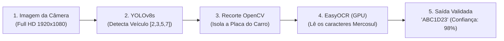

# 🚗 Atividade Prática: Visão Computacional de Ponta a Ponta — Sistema ALPR de Leitura de Placas

**Ambiente:** Google Colaboratory (`Python 3.10+` com Aceleração por GPU T4 ativada)  
**Modalidade:** Visão Computacional Aplicada (*Detecção de Objetos + Segmentação ROI + OCR*)  
**Tempo Estimado:** 40 a 50 minutos  
**Modelos & Ferramentas:** `Ultralytics YOLOv8` (`yolov8s.pt`), `OpenCV` (`cv2`), `EasyOCR`  
**Notebook de Apoio:** [`Detectar placa de carro_v3 (2).ipynb`](./Detectar%20placa%20de%20carro_v3%20(2).ipynb)

---

## 📋 1. ENUNCIADO DA ATIVIDADE (CONTEXTO DE NEGÓCIO)

> ### 🅿️ Desafio: Controle de Acesso e Cancelas Inteligentes (InovaMarketplace)
> O centro logístico do **InovaMarketplace** opera com um fluxo de mais de 800 caminhões, furgões e motocicletas de entrega por dia. A conferência manual de placas por vigias na guarita gera longas filas, atrasos e falhas humanas de digitação.
>
> A diretoria encomendou o desenvolvimento de um **Sistema ALPR (*Automatic License Plate Recognition*)** industrial, semelhante aos pedágios *Free Flow* e cancelas da *Sem Parar*.
>
> O sistema opera como uma **esteira de visão computacional em 3 etapas**:
> 1. **Detecção Veicular:** O modelo `YOLOv8` localiza a *bounding box* do veículo na imagem em alta resolução.
> 2. **Recorte Inteligente (ROI):** O `OpenCV` isola a região de interesse (*Region of Interest*), eliminando fundos poluídos.
> 3. **Reconhecimento Óptico de Caracteres:** O `EasyOCR` lê os caracteres da placa padrão Mercosul e valida a consistência alfanumérica.
>
> **Sua Missão:**
> 1. Ativar a GPU no Google Colab e instalar as bibliotecas `ultralytics` e `easyocr`.
> 2. Carregar o modelo `yolov8s.pt` e filtrar apenas as classes veiculares da base COCO (`2: carro`, `3: moto`, `5: ônibus`, `7: caminhão`).
> 3. Implementar o recorte de ROI com `OpenCV` e enviar o corte para inferência no `EasyOCR`.
> 4. Desenhar a caixa delimitadora verde e escrever o texto da placa lida diretamente sobre a imagem final.
> 5. Avaliar os desafios práticos de iluminação, ruído e a distinção entre caracteres como a letra `O` e o número `0`.

---

## 🛠️ 2. PASSO A PASSO DETALHADO DO LABORATÓRIO



### Passo 1: Preparação do Ambiente com GPU
```python
!pip install -q ultralytics easyocr opencv-python

import cv2
import easyocr
import numpy as np
from ultralytics import YOLO
from google.colab.patches import cv2_imshow
from google.colab import files

detector = YOLO('yolov8s.pt')
leitor_ocr = easyocr.Reader(['en', 'pt'], gpu=True)
print("✅ YOLOv8 e EasyOCR inicializados na GPU!")
```

---

### Passo 2: O Algoritmo de Detecção e Recorte de ROI
```python
uploaded = files.upload()
nome_imagem = list(uploaded.keys())[0]

imagem = cv2.imread(nome_imagem)
imagem_anotada = imagem.copy()

resultados = detector.predict(nome_imagem, conf=0.45)
classes_alvo = [2, 3, 5, 7]

for item in resultados[0].boxes:
    classe_id = int(item.cls[0])
    
    if classe_id in classes_alvo:
        x1, y1, x2, y2 = map(int, item.xyxy[0])
        
        # Recorte da metade inferior onde fica a placa
        altura_carro = y2 - y1
        y_placa_inicio = int(y1 + (altura_carro * 0.55))
        roi_placa = imagem[y_placa_inicio:y2, x1:x2]
        
        leituras = leitor_ocr.readtext(roi_placa)
        for (bbox, texto, confianca) in leituras:
            texto_limpo = "".join([c for c in texto if c.isalnum()]).upper()
            
            if len(texto_limpo) >= 6 and confianca >= 0.40:
                print(f"Placa Encontrada: {texto_limpo} ({confianca*100:.1f}%)")
                cv2.rectangle(imagem_anotada, (x1, y1), (x2, y2), (0, 255, 0), 3)
                cv2.putText(imagem_anotada, texto_limpo, (x1, y1 - 10),
                            cv2.FONT_HERSHEY_SIMPLEX, 0.9, (0, 255, 0), 2)

cv2_imshow(imagem_anotada)
```

---

## 🧪 3. EXPERIMENTO CIENTÍFICO: TESTES DE ESTRESSE EM VISÃO COMPUTACIONAL

1. **Teste 1 — Ângulo Extremo:** Teste uma foto tirada na diagonal ($45^\circ$).
2. **Teste 2 — Resolução Noturna:** Teste uma foto noturna com farol aceso e reflexo.
3. **Teste 3 — Ambiguidade de Caracteres:** Verifique se o OCR confunde `0` com `O`, ou `1` com `I`.

---

## ✅ 4. ENTREGÁVEL DA ATIVIDADE (CHECKLIST DE CONCLUSÃO)

Para validar a conclusão deste laboratório, certifique-se de preencher os itens:
- [ ] Ambiente Colab configurado com GPU T4 ativa.
- [ ] Modelo YOLOv8 executando detecção de veículos nas classes `[2, 3, 5, 7]`.
- [ ] Recorte de Região de Interesse (ROI) implementado com sucesso via OpenCV.
- [ ] Leitura de placa realizada pelo EasyOCR com taxa de confiança documentada.
- [ ] Imagem final exibindo a caixa delimitadora e a anotação da placa na tela.
