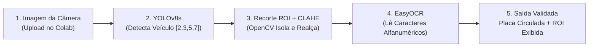

# 🚗 Atividade Prática: Visão Computacional de Ponta a Ponta — Sistema ALPR de Leitura de Placas

**Módulo:** Módulo 03 • Laboratório 4.2 (Google Colab)  
**Ambiente:** Google Colaboratory (`Python 3.10+` com suporte automático a GPU T4 ou CPU)  
**Modalidade:** Visão Computacional Aplicada (*Detecção de Objetos + Segmentação ROI + OCR*)  
**Tempo Estimado:** 40 a 50 minutos  
**Modelos & Ferramentas:** `Ultralytics YOLOv8` (`yolov8s.pt`), `OpenCV` (`cv2`), `EasyOCR`  
**Notebook de Apoio:** [`Lab_4_2_ALPR_Aluno.ipynb`](file:///C:/Users/Instrutor/.gemini/antigravity/scratch/alpr-detector-placas/Lab_4_2_ALPR_Aluno.ipynb)

---

## 📋 1. ENUNCIADO DA ATIVIDADE (CONTEXTO DE NEGÓCIO)

> ### 🅿️ Desafio: Controle de Acesso e Cancelas Inteligentes (InovaMarketplace)
> O centro logístico do **InovaMarketplace** opera com um fluxo de mais de 800 caminhões, furgões e motocicletas de entrega por dia. A conferência manual de placas por vigias na guarita gera longas filas, atrasos e falhas humanas de digitação.
>
> A diretoria encomendou o desenvolvimento de um **Sistema ALPR (*Automatic License Plate Recognition*)** industrial, semelhante aos pedágios *Free Flow* e cancelas da *Sem Parar*.
>
> O sistema opera como uma **esteira de visão computacional em 3 etapas**:
> 1. **Detecção Veicular:** O modelo `YOLOv8` (`yolov8s.pt`) localiza a *bounding box* do veículo na imagem em alta resolução.
> 2. **Recorte Inteligente (ROI) e Realce:** O `OpenCV` isola a região de interesse (*Region of Interest*), aplica equalização adaptativa de contraste (`CLAHE`) eliminando fundos poluídos e **circula a placa detectada**.
> 3. **Reconhecimento Óptico de Caracteres:** O `EasyOCR` lê os caracteres da placa (padrão Mercosul e Cinza) e valida a consistência alfanumérica.
>
> **Sua Missão:**
> 1. Configurar o ambiente no Google Colab (com detecção automática de GPU/CPU) e instalar as bibliotecas `ultralytics`, `easyocr`, `opencv-python-headless` e `matplotlib`.
> 2. Carregar o modelo `yolov8s.pt` e filtrar apenas as classes veiculares da base COCO (`2: carro`, `3: moto`, `5: ônibus`, `7: caminhão`).
> 3. Implementar o recorte de ROI com `OpenCV`, aplicar realce de contraste (`CLAHE`) e enviar o recorte para inferência no `EasyOCR`.
> 4. Desenhar a caixa delimitadora do veículo, **circular a placa em verde (`cv2.ellipse`)**, escrever o texto lido sobre a imagem final e exibir o recorte exclusivo da placa.
> 5. Avaliar os desafios práticos de iluminação, ruído e a distinção entre caracteres como a letra `O` e o número `0`.

---

## 🛠️ 2. PASSO A PASSO DETALHADO DO LABORATÓRIO



### Passo 1: Instalação e Importação das Bibliotecas (Célula 1)
```python
!pip install -q ultralytics easyocr opencv-python-headless matplotlib

import cv2
import re
import torch
import numpy as np
import matplotlib.pyplot as plt
from google.colab import files
from ultralytics import YOLO
import easyocr

print(f"✅ Ambiente configurado! GPU ativa: {torch.cuda.is_available()}")
```

---

### Passo 2: Inicialização do YOLOv8s e EasyOCR (Célula 2)
```python
# 1. Modelo YOLOv8 Small pré-treinado no COCO
modelo_yolo = YOLO("yolov8s.pt")

# 2. Leitor EasyOCR (Português e Inglês) com detecção automática de GPU/CPU
leitor_ocr = easyocr.Reader(['pt', 'en'], gpu=torch.cuda.is_available())

# IDs de veículos no dataset COCO: 2=car, 3=motorcycle, 5=bus, 7=truck
CLASSES_VEICULOS = [2, 3, 5, 7]
print("✅ YOLOv8s e EasyOCR prontos para uso!")
```

---

### Passo 3: Pré-processamento de ROI (OpenCV), Detecção, Círculo na Placa e Upload (Célula 3)
```python
def limpar_placa(texto_bruto):
    """Remove caracteres especiais e mantém apenas letras maiúsculas e números."""
    texto = re.sub(r'[^A-Za-z0-9]', '', texto_bruto).upper()
    if len(texto) > 7 and texto.startswith("BR"):
        texto = texto[2:]
    return texto

def eh_placa_valida(texto):
    """Filtra strings entre 5 e 8 caracteres que contenham letras e números."""
    if texto in ("BRASIL", "MERCOSUL") or len(texto) < 5 or len(texto) > 8:
        return False
    return any(c.isalpha() for c in texto) and any(c.isdigit() for c in texto)

def preprocessar_roi(roi_bgr):
    """Converte a ROI para escala de cinza e melhora o contraste com CLAHE (OpenCV)."""
    cinza = cv2.cvtColor(roi_bgr, cv2.COLOR_BGR2GRAY)
    clahe = cv2.createCLAHE(clipLimit=2.0, tileGridSize=(8, 8))
    return clahe.apply(cinza)

def detectar_e_ler_placa(caminho_imagem):
    img_bgr = cv2.imread(caminho_imagem)
    if img_bgr is None:
        print("❌ Erro ao carregar imagem!")
        return []

    img_anotada = img_bgr.copy()
    altura_img, largura_img = img_bgr.shape[:2]

    # ETAPA 1: YOLOv8s (Detecção de Veículos)
    resultados = modelo_yolo(img_bgr, classes=CLASSES_VEICULOS, conf=0.25, verbose=False)
    caixas_veiculos = resultados[0].boxes.xyxy.cpu().numpy().astype(int)

    # Fallback caso a foto seja muito próxima apenas da placa
    if len(caixas_veiculos) == 0:
        caixas_veiculos = [[0, 0, largura_img, altura_img]]

    placas_lidas = []

    # ETAPA 2: OpenCV (Recorte da ROI do Veículo)
    for (vx1, vy1, vx2, vy2) in caixas_veiculos:
        if not (vx1 == 0 and vy1 == 0 and vx2 == largura_img and vy2 == altura_img):
            cv2.rectangle(img_anotada, (vx1, vy1), (vx2, vy2), (255, 140, 0), 2)

        roi_veiculo = img_bgr[vy1:vy2, vx1:vx2]
        roi_cinza = preprocessar_roi(roi_veiculo)

        # ETAPA 3: EasyOCR (Leitura Alfanumérica na ROI)
        deteccoes_ocr = leitor_ocr.readtext(
            roi_cinza,
            allowlist='ABCDEFGHIJKLMNOPQRSTUVWXYZ0123456789-'
        )

        for (bbox, texto_bruto, conf) in deteccoes_ocr:
            placa = limpar_placa(texto_bruto)
            if conf >= 0.20 and eh_placa_valida(placa):
                pts = np.array(bbox, dtype=np.int32)
                px1, py1 = np.min(pts, axis=0) + [vx1, vy1]
                px2, py2 = np.max(pts, axis=0) + [vx1, vy1]

                # Circular a placa com OpenCV (cv2.ellipse)
                cx, cy = int((px1 + px2) / 2), int((py1 + py2) / 2)
                rx = max(int((px2 - px1) / 2 * 1.3), 25)
                ry = max(int((py2 - py1) / 2 * 1.5), 18)
                cv2.ellipse(img_anotada, (cx, cy), (rx, ry), 0, 0, 360, (0, 255, 0), 4)

                # Exibir texto da placa acima do círculo
                cv2.putText(
                    img_anotada, f"Placa: {placa} ({conf:.0%})",
                    (max(px1, 10), max(py1 - 15, 25)),
                    cv2.FONT_HERSHEY_SIMPLEX, 0.75, (0, 255, 0), 2, cv2.LINE_AA
                )

                roi_placa = img_bgr[
                    max(0, py1 - 10):min(altura_img, py2 + 10),
                    max(0, px1 - 10):min(largura_img, px2 + 10)
                ]
                placas_lidas.append((placa, conf, roi_placa))

    # Exibir Foto Anotada e Recortes das Placas
    plt.figure(figsize=(12, 7))
    plt.imshow(cv2.cvtColor(img_anotada, cv2.COLOR_BGR2RGB))
    plt.title(f"Resultado ALPR: {caminho_imagem}", fontsize=14, fontweight="bold")
    plt.axis("off")
    plt.show()

    for idx, (placa_txt, conf, crop) in enumerate(placas_lidas):
        print(f"✅ Placa {idx+1} reconhecida: {placa_txt} (Confiança: {conf:.1%})")
        plt.figure(figsize=(4, 2))
        plt.imshow(cv2.cvtColor(crop, cv2.COLOR_BGR2RGB))
        plt.title(f"ROI Placa: {placa_txt}", fontweight="bold")
        plt.axis("off")
        plt.show()

    return [p[0] for p in placas_lidas]

# Solicitar o upload da foto do carro no Google Colab
print("📤 Envie uma ou mais fotos de carros do seu computador:")
enviados = files.upload()

for nome in enviados.keys():
    detectar_e_ler_placa(nome)
```

---

## 🧪 3. EXPERIMENTO CIENTÍFICO: TESTES DE ESTRESSE EM VISÃO COMPUTACIONAL

1. **Teste 1 — Ângulo Extremo:** Teste uma foto tirada na diagonal ($45^\circ$).
2. **Teste 2 — Resolução Noturna:** Teste uma foto noturna com farol aceso e reflexo, observando como o filtro `CLAHE` do OpenCV auxilia no contraste.
3. **Teste 3 — Ambiguidade de Caracteres:** Verifique se o OCR confunde `0` com `O`, `1` com `I`, ou `8` com `B` nas posições da placa Mercosul (`LLLNLNN`).

---

## ✅ 4. ENTREGÁVEL DA ATIVIDADE (CHECKLIST DE CONCLUSÃO)

Para validar a conclusão deste laboratório, certifique-se de preencher os itens:
- [ ] Ambiente Colab configurado com bibliotecas instaladas (`ultralytics`, `easyocr`, `opencv`).
- [ ] Modelo `yolov8s.pt` executando detecção de veículos nas classes `[2, 3, 5, 7]`.
- [ ] Recorte de Região de Interesse (ROI) e realce `CLAHE` implementados com sucesso via OpenCV.
- [ ] Leitura alfanumérica da placa realizada pelo EasyOCR com taxa de confiança documentada.
- [ ] Imagem final exibindo o veículo detectado, **a placa circulada em verde** e o recorte individual da placa na tela.
