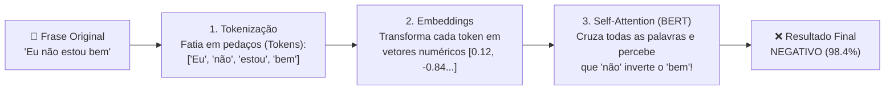

# 💬 Aula & Laboratório (Code): Análise de Sentimentos e os Segredos do PLN

**Curso:** Aperfeiçoamento Profissional em Programação em Inteligência Artificial Generativa (SENAI-SP)  
**Unidade / Aula:** Aula 03 — Processamento de Linguagem Natural (PLN / NLP) e Arquitetura *Transformer*  
**Ambiente:** Google Colaboratory (`Python 3.10+`)  
**Biblioteca / Modelo:** `pysentimiento` (Modelo **BERTimbau / RoBERTa** pré-treinado em milhões de frases em Português)  
**Objetivo:** Explorar na prática como a Inteligência Artificial utiliza o **Processamento de Linguagem Natural (PLN)** para compreender não apenas palavras isoladas, mas o contexto, a negação, os emojis e até a ironia em frases em Português.

---

## 📚 Parte 1: O que é PLN e como o Computador "Lê" Textos?

O **Processamento de Linguagem Natural (PLN)** — ou **NLP (*Natural Language Processing*)** — é o ramo da Inteligência Artificial que dá aos computadores a capacidade de ler, interpretar e extrair significado das línguas humanas.

Para que o código que você vai executar no Google Colab funcione, a Rede Neural executa **3 processos matemáticos fundamentais** em frações de segundo:



### 🔹 1. Tokenização (Fatiar o Texto)
O computador não lê uma frase inteira de uma só vez. Primeiro, ele a "fatia" em pequenas peças chamadas **Tokens** (que podem ser palavras inteiras, sílabas ou até emojis!).
* **Exemplo:** `"Eu não gosto"` vira a lista `['Eu', 'não', 'gosto']`. Isso permite que a IA processe cada peça antes de montar o quebra-cabeça do significado.

### 🔹 2. *Embeddings* (Transformar Palavras em Coordenadas Numéricas)
Processadores só entendem números! O PLN utiliza uma técnica chamada **Word Embeddings** para converter cada token em um vetor (uma lista de centenas de números que funciona como um "GPS semântico").
* Nesse mapa geométrico multidimensional, palavras com sentidos semelhantes (como `"alegre"`, `"feliz"` e `"contente"`) ficam localizadas **muito próximas umas das outras**, permitindo que a IA compreenda sinônimos automaticamente!

### 🔹 3. Mecanismo de Atenção e Contexto (*Transformers / BERT*)
Esta é a revolução que deu origem à IA Generativa moderna (*"Attention Is All You Need"*, Google, 2017). O modelo que usaremos (**BERT**) utiliza o mecanismo de **Auto-Atenção (*Self-Attention*)**, que analisa a relação entre **todas as palavras da frase ao mesmo tempo**.
* **Por que isso muda tudo?** Na frase *"Eu **não** estou **bem**"*, um sistema antigo de regras (`if/else`) veria a palavra `"bem"` e classificaria como Positivo. Já o **BERT** presta atenção na ligação entre **`não`** e **`bem`**, compreendendo que o modificador inverte completamente a polaridade da frase!

---

## 💻 Parte 2: Mão no Código (Laboratório no Google Colab)

Abra um novo notebook no Google Colab e execute os dois blocos abaixo para colocar o motor neural de PLN em ação:

### 🔹 Passo 1: Instalação do Motor de Deep Learning (`pysentimiento`)
O comando `!pip install` instala no ambiente do Colab a biblioteca `pysentimiento`, que traz modelos *Transformers* de última geração calibrados para a língua portuguesa:

```python
# Instalando a biblioteca de Deep Learning (PLN Profundo)
!pip install pysentimiento --quiet
print("✅ Cérebro de PLN instalado com sucesso!")
```

#### 🖥️ Saída do Passo 1 no Console:
```text
✅ Cérebro de PLN instalado com sucesso!
```

---

### 🔹 Passo 2: O Analisador de Sentimentos Interativo com Barras de Probabilidade
Neste bloco, baixamos os pesos neurais do modelo em Português (`lang="pt"`) e criamos uma interface interativa que exibe tanto o veredito final quanto a **distribuição de probabilidades (`probas`)** — permitindo enxergar o "pensamento" matemático da IA:

```python
from pysentimiento import create_analyzer

# Inicializa o analisador para Português (pt)
# Ele carregará o modelo Transformer/BERT treinado com milhões de frases reais
print("⏳ Carregando motor de PLN... (aguarde o download do modelo na 1ª execução)")
analyzer = create_analyzer(task="sentiment", lang="pt")

def iniciar_analise():
    print("\n" + "="*50)
    print("      🧠 LABORATÓRIO DE PLN - SENTIMENTOS")
    print("="*50)
    
    frase = input("Digite uma frase (pode usar gírias e emojis): ")
    
    if not frase:
        return

    # A IA realiza a Tokenização, Embedding e Análise de Atenção (Self-Attention) aqui:
    resultado = analyzer.predict(frase)
    
    # Mapeamento visual com cores ANSI para o terminal
    mapa = {
        'POS': ('✅ POSITIVO', '\033[92m'),
        'NEG': ('❌ NEGATIVO', '\033[91m'),
        'NEU': ('😐 NEUTRO', '\033[94m')
    }
    
    nome, cor = mapa[resultado.output]
    confianca = resultado.probas[resultado.output] * 100

    print(f"\n📊 ANÁLISE FINAL:")
    print(f"Texto analisado: \"{frase}\"")
    print(f"Classificação: {cor}{nome}\033[0m")
    print(f"Confiança da IA: {confianca:.2f}%")
    
    # Visualizando a distribuição de probabilidade (o 'pensamento' da IA)
    print("\n📈 Probabilidades por categoria:")
    for sent, prob in resultado.probas.items():
        barra = "█" * int(prob * 20)
        print(f"  {sent}: {barra:<20} {prob*100:.1f}%")

# Executar a ferramenta
iniciar_analise()
```

#### 🖥️ Exemplo de Saída Real no Console do Colab:
```text
==================================================
      🧠 LABORATÓRIO DE PLN - SENTIMENTOS
==================================================
Digite uma frase (pode usar gírias e emojis): O produto chegou super rápido, mas veio com a tela trincada!

📊 ANÁLISE FINAL:
Texto analisado: "O produto chegou super rápido, mas veio com a tela trincada!"
Classificação: ❌ NEGATIVO
Confiança da IA: 96.80%

📈 Probabilidades por categoria:
  NEG: ███████████████████  96.8%
  NEU:                      2.3%
  POS:                      0.9%
```

---

## ✍️ Parte 3: Os 4 Desafios Experimentais de PLN (Bateria de Testes)

Execute a célula do Passo 2 repetidas vezes (basta clicar no botão **▶ Play** da célula) para submeter o modelo BERT aos **4 Testes de Fogo da Linguística Computacional** e anote os resultados:

| # | Desafio | O que digitar no `input`? | O que observar e responder? |
| :---: | :--- | :--- | :--- |
| **1** | **Desafio do Contexto e Negação** | 1º: `"Eu estou bem"`<br>2º: `"Eu não estou nada bem"` | Veja como a barra salta de `POS` para `NEG` (>98%) apenas pela presença do modificador `"não"`. É o mecanismo de **Atenção (*Self-Attention*)** em ação! |
| **2** | **Desafio dos Emojis Não-Verbais** | Digite **apenas emojis**, sem nenhuma palavra:<br>1º: `😊❤️`<br>2º: `💀😭` | *Pergunta:* O PLN consegue entender sentimentos sem nenhuma palavra escrita? Como os emojis foram tratados na etapa de **Tokenização**? |
| **3** | **Desafio da Ambiguidade / Neutralidade** | Digite fatos objetivos:<br>`"O céu é azul"` ou `"Eu comprei um pão hoje"` | Observe como a barra **`NEU` (Neutro)** domina! Em sistemas de e-commerce, saber filtrar mensagens neutras evita acionar alertas falsos de suporte. |
| **4** | **Desafio da Ironia e Sarcasmo** | Tente enganar a IA:<br>`"Que ótimo, meu computador quebrou logo hoje!"` | *Pergunta:* Mesmo começando com o elogio `"Que ótimo"`, o modelo BERT percebeu que quebrar o computador torna a frase **Negativa (`NEG`)**? |

---

## 🏁 Conclusão

O **Processamento de Linguagem Natural (PLN)** é a ponte que permite que máquinas compreendam a comunicação humana com todas as suas nuances. O que você executou hoje não é uma lista rígida de `if "ótimo" in frase:`, mas sim uma **Rede Neural Transformer** que aprendeu a gramática, as gírias, os emojis e o contexto do Português através de milhões de exemplos reais!
