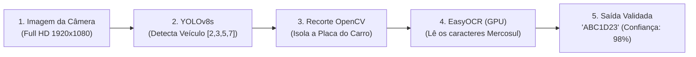

# 🚗 Laboratório Prático: Visão Computacional de Ponta a Ponta — Sistema ALPR de Leitura de Placas

**Ambiente:** Google Colaboratory (`Python 3.10+` com Aceleração por GPU T4 ativada)  
**Modalidade:** Visão Computacional Aplicada (*Detecção de Objetos + Segmentação ROI + OCR*)  
**Tempo Estimado:** 40 a 50 minutos  
**Modelos & Ferramentas:** `Ultralytics YOLOv8` (`yolov8s.pt`), `OpenCV` (`cv2`), `EasyOCR`

---

## 📋 1. ENUNCIADO DA ATIVIDADE (CONTEXTO DE NEGÓCIO)

> ### 🅿️ Desafio: Controle de Acesso e Cancelas Inteligentes (InovaMarketplace)
> O centro logístico do **InovaMarketplace** opera com um fluxo de mais de 800 caminhões, furgões e motocicletas de entrega por dia. A conferência manual de placas por vigias na guarita gera longas filas, atrasos e falhas humanas de digitação.
>
> A diretoria encomendou o desenvolvimento de um **Sistema ALPR (*Automatic License Plate Recognition*)** industrial, semelhante aos pedágios *Free Flow* e cancelas da *Sem Parar*.
>
> O sistema não pode depender de um único modelo milagroso; ele precisa operar como uma **esteira de visão computacional em 3 etapas**:
> 1. **Detecção Veicular:** O modelo `YOLOv8` localiza a *bounding box* do veículo na imagem em alta resolução.
> 2. **Recorte Inteligente (ROI):** O `OpenCV` isola a região de interesse (*Region of Interest*), eliminando fundos poluídos (árvores, asfalto, prédios).
> 3. **Reconhecimento Óptico de Caracteres:** O `EasyOCR` lê os caracteres da placa padrão Mercosul e valida a consistência alfanumérica.
>
> **Sua Missão:**
> 1. Ativar a GPU no Google Colab e instalar as bibliotecas `ultralytics` e `easyocr`.
> 2. Carregar o modelo `yolov8s.pt` e filtrar apenas as classes veiculares da base COCO (`2: carro`, `3: moto`, `5: ônibus`, `7: caminhão`).
> 3. Implementar o recorte de ROI com `OpenCV` e enviar o corte para inferência no `EasyOCR`.
> 4. Desenhar a caixa delimitadora verde e escrever o texto da placa lida diretamente sobre a imagem final.
> 5. Avaliar os desafios práticos de iluminação, ruído e a distinção entre caracteres como a letra `O` e o número `0`.

---

## 🛠️ 2. PASSO A PASSO DETALHADO DO LABORATÓRIO



### Passo 1: Preparação do Ambiente com Aceleração por GPU
No Google Colab:
1. Vá no menu: `Ambiente de Execução` $\to$ `Alterar tipo de ambiente de execução` $\to$ **GPU T4**.
2. Execute a instalação dos pacotes:

```python
!pip install -q ultralytics easyocr opencv-python

import cv2
import easyocr
import numpy as np
import matplotlib.pyplot as plt
from ultralytics import YOLO
from google.colab.patches import cv2_imshow
from google.colab import files

print("Instalando motores neurais...")
# Carregamos o modelo YOLOv8 versão Small (ótimo equilíbrio entre velocidade e precisão)
detector = YOLO('yolov8s.pt')

# Inicializamos o EasyOCR com GPU
leitor_ocr = easyocr.Reader(['en', 'pt'], gpu=True)
print("✅ YOLOv8 e EasyOCR inicializados com sucesso na GPU!")
```

---

### Passo 2: Classes Veiculares no Dataset COCO
O modelo YOLOv8 vem pré-treinado no dataset COCO com 80 categorias. Vamos monitorar apenas os 4 IDs de transporte:

| ID | Classe em Inglês | Tradução |
| :---: | :--- | :--- |
| **`2`** | `car` | Carro de passeio |
| **`3`** | `motorcycle` | Motocicleta |
| **`5`** | `bus` | Ônibus |
| **`7`** | `truck` | Caminhão de carga |

---

### Passo 3: O Algoritmo de Detecção e Recorte de Região de Interesse (ROI)
Suba a foto de um carro para teste e execute o pipeline:

```python
# Upload da foto do veículo
uploaded = files.upload()
nome_imagem = list(uploaded.keys())[0]

# Carrega a imagem via OpenCV (matriz de pixels em BGR)
imagem = cv2.imread(nome_imagem)
imagem_anotada = imagem.copy()

# 1. Inferência com YOLOv8
resultados = detector.predict(nome_imagem, conf=0.45)
classes_alvo = [2, 3, 5, 7]

placas_encontradas = []

for item in resultados[0].boxes:
    classe_id = int(item.cls[0])
    
    if classe_id in classes_alvo:
        # Coordenadas da Bounding Box do veículo
        x1, y1, x2, y2 = map(int, item.xyxy[0])
        
        # 2. Recorte da Região Inferior do Veículo (onde fica a placa)
        altura_carro = y2 - y1
        y_placa_inicio = int(y1 + (altura_carro * 0.55))  # Pega a metade inferior
        roi_placa = imagem[y_placa_inicio:y2, x1:x2]
        
        # 3. Leitura dos Caracteres com EasyOCR
        leituras = leitor_ocr.readtext(roi_placa)
        
        for (bbox, texto, confianca) in leituras:
            texto_limpo = "".join([c for c in texto if c.isalnum()]).upper()
            
            # Filtro de tamanho de placa Mercosul (geralmente 7 caracteres)
            if len(texto_limpo) >= 6 and confianca >= 0.40:
                placas_encontradas.append((texto_limpo, confianca))
                
                # 4. Desenha na Imagem Original
                cv2.rectangle(imagem_anotada, (x1, y1), (x2, y2), (0, 255, 0), 3)
                label = f"PLACA: {texto_limpo} ({confianca*100:.1f}%)"
                cv2.putText(imagem_anotada, label, (x1, y1 - 12),
                            cv2.FONT_HERSHEY_SIMPLEX, 0.8, (0, 255, 0), 2)

print("\n=== PLACAS REGISTRADAS ===")
for placa, conf in placas_encontradas:
    print(f" Placa: {placa} | Certeza da Leitura: {conf*100:.2f}%")

# Exibição do resultado
cv2_imshow(imagem_anotada)
```

---

## 🧪 3. EXPERIMENTO CIENTÍFICO: TESTES DE ESTRESSE EM VISÃO COMPUTACIONAL

Execute os **3 testes operacionais** abaixo com fotos reais:

1. **Teste 1 — Ângulo Extremo (*Skewing*):**  
   Envie a foto de um veículo tirada na diagonal ($45^\circ$). O EasyOCR conseguiu ler a placa ou os caracteres ficaram distorcidos na perspectiva?
2. **Teste 2 — Resolução e Granulação Noturna:**  
   Envie uma foto granulada tirada à noite com farol aceso. O ofuscamento (*glare*) prejudicou o OCR? Como um filtro de contraste do OpenCV (`cv2.equalizeHist`) poderia ajudar?
3. **Teste 3 — Ambiguidade de Caracteres Alfanuméricos:**  
   Observe se o OCR confunde o número `0` com a letra `O`, ou o número `1` com o `I`.  
   *Regra Mercosul:* O padrão brasileiro é `LLLNLNN` (3 letras, 1 número, 1 letra, 2 números). Como essa regra de máscara resolve a ambiguidade?

---

## 💻 4. CÓDIGO FONTE COMPLETO (EXECUTÁVEL NO GOOGLE COLAB)

```python
# ==============================================================================
# SISTEMA COMPLETO DE ALPR (YOLOV8 + OPENCV + EASYOCR)
# SENAI-SP & Infoeste — Trilha Google Cloud Skills Boost
# ==============================================================================

import cv2
import easyocr
from ultralytics import YOLO
from google.colab.patches import cv2_imshow

detector = YOLO('yolov8s.pt')
ocr = easyocr.Reader(['en'], gpu=True)

def processar_veiculo_alpr(caminho_foto):
    img = cv2.imread(caminho_foto)
    dets = detector(caminho_foto, conf=0.5)[0]
    
    for box in dets.boxes:
        if int(box.cls[0]) in [2, 3, 5, 7]:
            x1, y1, x2, y2 = map(int, box.xyxy[0])
            corte = img[y1:y2, x1:x2]
            
            textos = ocr.readtext(corte)
            for _, txt, conf in textos:
                limpo = "".join([c for c in txt if c.isalnum()]).upper()
                if len(limpo) >= 6:
                    print(f" Veículo Detectado! Placa: {limpo} (Confiança: {conf*100:.1f}%)")
                    cv2.rectangle(img, (x1, y1), (x2, y2), (0, 255, 0), 3)
                    cv2.putText(img, limpo, (x1, y1-10), cv2.FONT_HERSHEY_SIMPLEX, 0.9, (0,255,0), 2)
    cv2_imshow(img)
```

---

## ✅ 5. ENTREGÁVEL DA ATIVIDADE (CHECKLIST DE CONCLUSÃO)

Para validar a conclusão deste laboratório, certifique-se de preencher os itens:
- [ ] Ambiente Colab configurado com GPU T4 ativa.
- [ ] Modelo YOLOv8 executando detecção de veículos nas classes `[2, 3, 5, 7]`.
- [ ] Recorte de Região de Interesse (ROI) implementado com sucesso via OpenCV.
- [ ] Leitura de placa realizada pelo EasyOCR com taxa de confiança documentada.
- [ ] Imagem final exibindo a caixa delimitadora e a anotação da placa na tela.
