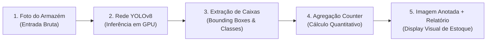

# 🎯 Laboratório Prático: Detecção e Contagem de Objetos com Ultralytics YOLOv8

**Ambiente:** Google Colaboratory (`Python 3.10+` com Aceleração por GPU T4)  
**Modalidade:** Visão Computacional Aplicada (*Object Detection & Contagem Automatizada*)  
**Tempo Estimado:** 35 a 45 minutos  
**Modelo:** `Ultralytics YOLOv8` (`yolov8s.pt` / `yolov8n.pt` pré-treinado no COCO Dataset)  
**Notebook de Apoio:** [`Detectar_objetos_em_fotos_v2.ipynb`](./Detectar_objetos_em_fotos_v2.ipynb)

---

## 📋 1. ENUNCIADO DA ATIVIDADE (CONTEXTO DE NEGÓCIO)

> ### 📦 Desafio: Auditoria e Inventário Visual de Cargas no Armazém Inteligente
> No centro de distribuição do **InovaMarketplace**, milhares de caixas, pallets, empilhadeiras e operadores transitam simultaneamente. A conferência visual de mercadorias descarregadas por caminhões era realizada com pranchetas de papel, gerando gargalos e divergências de estoque.
>
> A gerência de operações solicitou um **Sistema de Auditoria por Visão Computacional**:
> As câmeras de segurança devem capturar imagens das áreas de carga, detectar automaticamente todos os objetos presentes, traçar as caixas delimitadoras (*bounding boxes*), rotular as categorias com a taxa de certeza (*confidence score*) e gerar um **relatório consolidado de contagem quantitativa**.
>
> **Sua Missão:**
> 1. Configurar o ambiente Colab com a biblioteca `ultralytics` e carregar os pesos da rede neural `yolov8s.pt`.
> 2. Executar a inferência de detecção em fotos de cenários reais (animais, veículos, pessoas, pacotes).
> 3. Extrair programaticamente os metadados de cada detecção: coordenadas cartesianas `[x1, y1, x2, y2]`, classe prevista e confiança ($0.0$ a $1.0$).
> 4. Utilizar a estrutura de dados `collections.Counter` para gerar um sumário automático de contagem (*ex: 3 cachorros, 1 bicicleta, 1 caminhão*).
> 5. Realizar testes de sensibilidade variando o limiar de corte (*threshold* de confiança) de $10\%$ a $85\%$.

---

## 🛠️ 2. PASSO A PASSO DETALHADO DO LABORATÓRIO



### Passo 1: Instalação e Verificação de GPU
No Google Colab, execute:

```python
!pip install -q ultralytics

import torch
from ultralytics import YOLO
from google.colab.patches import cv2_imshow
from google.colab import files
from collections import Counter
import cv2

print(f"CUDA (GPU) Disponível: {torch.cuda.is_available()}")
if torch.cuda.is_available():
    print(f"Placa de Vídeo Detectada: {torch.cuda.get_device_name(0)}")

# Carrega o modelo YOLOv8 Small
modelo_yolo = YOLO('yolov8s.pt')
print("✅ Cérebro YOLOv8 inicializado com sucesso!")
```

---

### Passo 2: Executando a Detecção em Imagem de Teste
Faça o upload de uma imagem e execute a predição:

```python
# Upload de imagem
uploaded = files.upload()
caminho_foto = list(uploaded.keys())[0]

# Inferência com limiar de confiança de 50%
resultados = modelo_yolo.predict(source=caminho_foto, conf=0.50, save=False)
resultado_principal = resultados[0]

print(f"\nTotal de objetos detectados com >= 50% de confiança: {len(resultado_principal.boxes)}")
```

---

### Passo 3: Contagem e Extração Estruturada dos Dados
Processamos cada detecção e montamos um inventário visual:

```python
nomes_classes = resultado_principal.names
lista_detectados = []

print("\n--- DETALHAMENTO DE DETECÇÃO INDIVIDUAL ---")
for i, caixa in enumerate(resultado_principal.boxes):
    classe_id = int(caixa.cls[0])
    nome_objeto = nomes_classes[classe_id]
    certeza = float(caixa.conf[0])
    x1, y1, x2, y2 = map(int, caixa.xyxy[0])
    
    lista_detectados.append(nome_objeto)
    print(f"Objeto #{i+1}: {nome_objeto} | Confiança: {certeza*100:.1f}% | Bounding Box: [{x1}, {y1}, {x2}, {y2}]")

# Contagem agregada usando Counter
inventario = Counter(lista_detectados)

print("\n========================================")
print("📦 RELATÓRIO CONSOLIDADO DE ESTOQUE/CARGA")
print("========================================")
for item, quantidade in inventario.items():
    print(f" - {item.upper()}: {quantidade} unidade(s)")
print("========================================\n")

# Renderização gráfica com as caixas e labels oficiais
imagem_plotada = resultado_principal.plot()
cv2_imshow(imagem_plotada)
```

---

## 🧪 3. EXPERIMENTO CIENTÍFICO: TESTES DE SENSIBILIDADE DO MODELO

Execute os **3 experimentos** analíticos:

1. **Teste 1 — Limiar Ultrabaixo (`conf=0.10`):**  
   Diminua a confiança para 10%. Observe o surgimento de **Falsos Positivos** (a IA começa a achar pessoas e objetos onde há apenas manchas de sombra ou texturas de parede).
2. **Teste 2 — Limiar Rigoroso (`conf=0.85`):**  
   Eleve a confiança para 85%. O modelo comete **Falsos Negativos** (deixa de contar objetos reais que estão parcialmente encobertos)?
3. **Teste 3 — Oclusão Parcial (Um Objeto na Frente do Outro):**  
   Teste uma foto onde uma pessoa está montada em uma bicicleta ou um cachorro atrás de um carro. O algoritmo conseguiu detectar ambos separadamente?

---

## 💻 4. CÓDIGO FONTE COMPLETO (EXECUTÁVEL NO GOOGLE COLAB)

```python
# ==============================================================================
# PIPELINE COMPLETO DE DETECÇÃO E CONTAGEM (ULTRALYTICS YOLOV8)
# SENAI-SP & Infoeste — Trilha Google Cloud Skills Boost
# ==============================================================================

from ultralytics import YOLO
from collections import Counter
from google.colab.patches import cv2_imshow

def auditar_imagem_yolo(caminho_imagem, threshold=0.5):
    yolo = YOLO('yolov8s.pt')
    res = yolo.predict(caminho_imagem, conf=threshold)[0]
    
    classes = [res.names[int(b.cls[0])] for b in res.boxes]
    contagem = Counter(classes)
    
    print(f"=== INVENTÁRIO DO ARMAZÉM ({caminho_imagem}) ===")
    for k, v in contagem.items():
        print(f"  • {k.capitalize()}: {v}")
        
    cv2_imshow(res.plot())

# Exemplo: auditar_imagem_yolo('amostra.jpg')
```

---

## ✅ 5. ENTREGÁVEL DA ATIVIDADE (CHECKLIST DE CONCLUSÃO)

Para validar a conclusão deste laboratório, certifique-se de preencher os itens:
- [ ] Modelo `yolov8s.pt` carregado e executado em GPU no Google Colab.
- [ ] Relatório consolidado gerado via `Counter` listando as quantidades de cada classe.
- [ ] Imagem anotada exibida com as *bounding boxes* coloridas.
- [ ] Teste de variação de *threshold* (`conf=0.10` vs `conf=0.85`) documentado.
- [ ] Resposta no caderno: *Como o YOLO consegue detectar dezenas de objetos em uma única passagem pela rede (Single Shot), diferindo dos modelos em duas etapas como R-CNN?*
