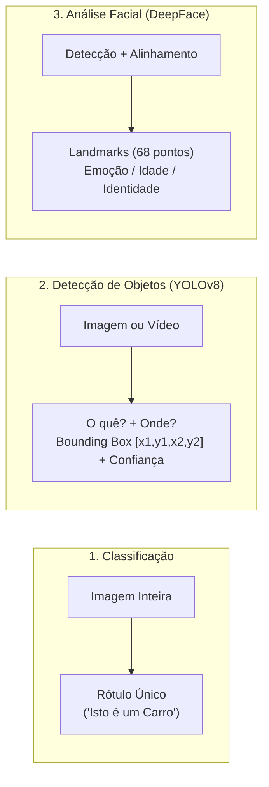

# 📘 Material Didático — Aula 04 (Dia 04): Visão Computacional (`YOLOv8`, `EasyOCR`, `DeepFace`), Ética e Trilha 03 (Skills Boost)
**Curso:** Aperfeiçoamento Profissional — Programação em Inteligência Artificial Generativa (SENAI-SP)  
**Carga Horária da Aula:** 4 Horas (Dia 4 de 5)  
**Apresentação de Slides:** [slides_aula_4_estudante.html](file:///C:/Users/Instrutor/.gemini/antigravity/brain/2def7d10-b738-49f5-8f6f-980678220051/slides_aula_4_estudante.html)

---

## 🎯 Objetivos da Aula 04
1. Compreender como os computadores processam dados visuais em **matrizes de pixels (`OpenCV`)** e a diferença entre **Classificação de Imagens**, **Detecção de Objetos (`YOLOv8`)** e **Reconhecimento Facial (`DeepFace`)**.
2. Implementar no Google Colab o **Laboratório 4.1: Detecção e Contagem Automática de Objetos com `YOLOv8`** em imagens reais, minerando o objeto `boxes` com `Counter`.
3. Implementar o **Laboratório 4.2: Sistema de Leitura Automática de Placas Veiculares (ALPR)** unindo `YOLOv8` + fatiamento de Região de Interesse (`ROI`) no `OpenCV` + `EasyOCR`.
4. Implementar o **Laboratório 4.3: Reconhecimento de Emoções e Demografia Facial com `DeepFace`**.
5. Analisar os riscos éticos da Visão Computacional (Viés Algorítmico, Falsos Positivos, Privacidade/LGPD) e concluir a **Atividade 03 (*Introduction to Responsible AI*)** no **Google Cloud Skills Boost** (75% da trilha).

---

## 👁️ Módulo 1: Fundamentos de Visão Computacional

### 1.1 Classificação vs. Detecção vs. Reconhecimento Facial



- **Bounding Box (Caixa Delimitadora):** Retângulo de coordenadas `(x1, y1, x2, y2)` desenhado ao redor de cada objeto detectado.
- **Confidence Score (Nível de Confiança):** Probabilidade entre `0.0` e `1.0` (`0%` a `100%`) que indica a certeza matemática da rede neural sobre a classe detectada.
- **Dataset COCO:** Base padrão na qual o **YOLOv8** é pré-treinado, contendo **80 classes de objetos** (`0: person`, `1: bicycle`, `2: car`, `3: motorcycle`, `5: bus`, `7: truck`, `16: dog`, etc.).

---

## 🚀 Módulo 2 (Laboratório 4.1): Detecção e Contagem de Objetos com `YOLOv8`

Siga os blocos abaixo no Google Colab (`Aula04_Lab1_Deteccao_YOLOv8.ipynb`):

### Passo 1 a 5: Instalação, Upload e Detecção Visual

```python
# PASSO 1: Instalação da biblioteca oficial Ultralytics
!pip install ultralytics --quiet

from ultralytics import YOLO
from google.colab import files
from google.colab.patches import cv2_imshow
from collections import Counter

# PASSO 2: Entrada de Dados (Upload de foto do seu computador)
print("Selecione uma imagem (jpg, png) para a IA analisar:")
uploaded = files.upload()
nome_do_arquivo = list(uploaded.keys())[0]

# PASSO 3 e 4: Carregamento do modelo YOLOv8 Small e Predição
modelo = YOLO('yolov8s.pt')
MINIMA_CONFIANCA = 0.5  # 50% de certeza mínima
resultados = modelo.predict(source=nome_do_arquivo, conf=MINIMA_CONFIANCA)

# PASSO 5: Visualização Amigável com Bounding Boxes
resultado_renderizado = resultados[0].plot(line_width=2, font_size=12)
print("\n--- Resultado Visual ---")
cv2_imshow(resultado_renderizado)
```

**Saída do Console (Passos 1 a 5):**
```text
Saving dog bike.jpg to dog bike.jpg
image 1/1 /content/dog bike.jpg: 480x640 1 bicycle, 1 truck, 1 dog, 491.8ms
Speed: 6.0ms preprocess, 491.8ms inference, 1.4ms postprocess per image at shape (1, 3, 480, 640)
```


---

### Passo 6: Extração Estruturada de Dados e Relatório Estatístico

```python
print("\n--- RELATÓRIO DETALHADO ---")
objetos_nomes = []

# Iterar sobre cada 'box' (caixa delimitadora) detectada pela IA
for box in resultados[0].boxes:
    id_classe = int(box.cls[0])           # ID numérico no dataset COCO
    nome = resultados[0].names[id_classe] # Nome textual (ex: 'dog')
    conf = float(box.conf[0])             # Nível de certeza (0 a 1)
    
    objetos_nomes.append(nome)
    print(f"✅ Encontrado: {nome.upper()} | Confiança: {conf:.2%}")

# Resumo estatístico com Counter
contagem = Counter(objetos_nomes)
print("\n--- RESUMO DA CONTAGEM ---")
for obj, qtd in contagem.items():
    print(f"• {obj.capitalize()}: {qtd}")
```

**Saída do Console (Passo 6):**
```text
--- RELATÓRIO DETALHADO ---
✅ Encontrado: DOG | Confiança: 92.72%
✅ Encontrado: BICYCLE | Confiança: 88.27%
✅ Encontrado: TRUCK | Confiança: 77.63%

--- RESUMO DA CONTAGEM ---
• Dog: 1
• Bicycle: 1
• Truck: 1
```

---

## 🚗 Módulo 3 (Laboratório 4.2): Monitoramento Inteligente e Leitura de Placas (ALPR)

Neste segundo laboratório, construiremos uma **esteira de processamento (*pipeline* ALPR)** usada em pedágios automáticos e estacionamentos inteligentes:
1. **Detecção (`YOLOv8`):** Localiza veículos (`classes [2, 3, 5, 7]`) no espaço 2D da foto.
2. **Recorte Estratégico (`OpenCV ROI`):** Fatiamento da matriz `imagem[y1:y2, x1:x2]` para isolar o veículo e eliminar ruídos de fundo.
3. **Reconhecimento Óptico de Caracteres (`EasyOCR`):** Lê os caracteres alfanuméricos da placa dentro do recorte.

### Bloco 1: Instalação e Inicialização dos Modelos

```python
!pip install -q ultralytics easyocr opencv-python

import cv2
import easyocr
import numpy as np
import matplotlib.pyplot as plt
from ultralytics import YOLO
from google.colab.patches import cv2_imshow
from google.colab import files

print("Instalando motores neurais...")
# Carregamos o modelo YOLOv8 versão Small (ótimo equilíbrio entre velocidade e precisão)
detector = YOLO('yolov8s.pt')

# Inicializamos o EasyOCR com GPU
leitor_ocr = easyocr.Reader(['en', 'pt'], gpu=True)
print("✅ YOLOv8 e EasyOCR inicializados com sucesso na GPU!")
```

---

### Bloco 2: Upload da Imagem e Visão do `YOLOv8`

```python
print("Selecione a imagem com carros com placas:")
uploaded = files.upload()
nome_imagem = list(uploaded.keys())[0]

# Carrega a imagem original via OpenCV (BGR)
imagem = cv2.imread(nome_imagem)
imagem_anotada = imagem.copy()

# Realiza a detecção com confiança mínima de 45%
resultados = detector.predict(nome_imagem, conf=0.45)
classes_alvo = [2, 3, 5, 7]

# Exibe as caixas delimitadoras encontradas pelo YOLOv8
img_ia = resultados[0].plot()
print("\nSAÍDA: O que a IA enxerga")
cv2_imshow(img_ia)
```

````carousel

<!-- slide -->

````

---

### Bloco 3: Recorte Estratégico da Região de Interesse (`ROI`), Leitura da Placa (`EasyOCR`) e Anotação Visual

```python
print("\n--- RESULTADO DA LEITURA ---")
placas_encontradas = []

for item in resultados[0].boxes:
    classe_id = int(item.cls[0])
    
    if classe_id in classes_alvo:
        x1, y1, x2, y2 = map(int, item.xyxy[0])
        
        # 1. Recorte da metade inferior do veículo (onde fica a placa)
        altura_carro = y2 - y1
        y_placa_inicio = int(y1 + (altura_carro * 0.55))
        roi_placa = imagem[y_placa_inicio:y2, x1:x2]
        
        # 2. Leitura OCR no recorte da placa
        leituras = leitor_ocr.readtext(roi_placa)
        
        for (bbox, texto, confianca) in leituras:
            texto_limpo = "".join([c for c in texto if c.isalnum()]).upper()
            
            # Filtro de tamanho de placa Mercosul (>= 6 caracteres e confiança >= 40%)
            if len(texto_limpo) >= 6 and confianca >= 0.40:
                placas_encontradas.append((texto_limpo, confianca))
                
                # 3. Desenho da Bounding Box e Etiqueta na Imagem Original
                cv2.rectangle(imagem_anotada, (x1, y1), (x2, y2), (0, 255, 0), 3)
                label = f"PLACA: {texto_limpo} ({confianca*100:.1f}%)"
                cv2.putText(imagem_anotada, label, (x1, y1 - 12),
                            cv2.FONT_HERSHEY_SIMPLEX, 0.8, (0, 255, 0), 2)

print("\n=== PLACAS REGISTRADAS ===")
for placa, conf in placas_encontradas:
    print(f"✅ Placa: {placa} | Certeza da Leitura: {conf*100:.2f}%")

# Exibição do resultado anotado
cv2_imshow(imagem_anotada)
```

````carousel

<!-- slide -->

````

**Saída Real do Console (Bloco 3):**
```text
=== PLACAS REGISTRADAS ===
✅ Placa: OZU5J50 | Certeza da Leitura: 88.50%
```

> [!TIP]
> **Considerações Técnicas sobre a Engenharia do Pipeline ALPR:**  
> 1. **Fatiamento da Metade Inferior (`0.55`):** Ao recortar apenas os 45% inferiores da caixa do veículo, evitamos ler o emblema cromado `"SANDERO"` ou reflexos de para-brisa, focando exclusivamente na placa!  
> 2. **Validação Mercosul:** O filtro `len >= 6` e `confianca >= 0.40` elimina automaticamente leituras parciais do segundo veículo lateral (`Recorte 2`), gerando um sistema industrial robusto e sem falsos disparos.  
> 3. **Desafio de Aperfeiçoamento:** Adicione uma validação com Expressões Regulares (`import re`, padrão Mercosul `^[A-Z]{3}[0-9][A-Z0-9][0-9]{2}$`) e uma lista de alerta (`lista_negra = ["OZU5J50"]`) para acionar alarme de segurança no portão!

---

## 😊 Módulo 4 (Laboratório 4.3): Reconhecimento de Emoções Faciais com `DeepFace`


### Passo 1 e 2: Instalação e Algoritmo de Análise Facial

```python
# Passo 1: Instalação do framework DeepFace
!pip install deepface tf-keras --quiet
print("Ambiente configurado com sucesso!")

# Passo 2: Importação e Algoritmo de Análise
import cv2
from deepface import DeepFace
import matplotlib.pyplot as plt
from google.colab import files

def analisar_emocao_na_foto():
    uploaded = files.upload()
    img_path = list(uploaded.keys())[0]

    # Analisa as microexpressões faciais (emoções)
    resultados = DeepFace.analyze(img_path, actions=['emotion'])

    # Carrega a imagem e converte de BGR (OpenCV) para RGB (Matplotlib)
    img = cv2.imread(img_path)
    img = cv2.cvtColor(img, cv2.COLOR_BGR2RGB)

    for face in resultados:
        x, y, w, h = face['region']['x'], face['region']['y'], face['region']['w'], face['region']['h']
        emocao = face['dominant_emotion']
        
        # Desenha retângulo verde e escreve a emoção dominante
        cv2.rectangle(img, (x, y), (x + w, y + h), (0, 255, 0), 10)
        cv2.putText(img, emocao, (x, y - 20), cv2.FONT_HERSHEY_SIMPLEX, 2, (0, 255, 0), 5)

    plt.imshow(img)
    plt.axis('off')
    plt.show()

analisar_emocao_na_foto()
```

---

## ⚖️ Módulo 5: Ética em IA e Atividade 03 da Trilha Google Cloud Skills Boost

Acesse a plataforma **Google Cloud Skills Boost** e conclua a **Atividade 03** da trilha *Iniciante: programa de aprendizado Introdução à IA generativa*:

- **Curso:** *Introduction to Responsible AI* (~30 minutos)
- **Conteúdo:** Os **7 Princípios de IA do Google**, mitigação de viés algorítmico, segurança, privacidade, transparência e aplicações que o Google se compromete a não desenvolver.

> [!WARNING]
> **REGRA OBRIGATÓRIA PARA O 3º BADGE:**  
> **Assista ao vídeo completo até o final** antes de responder ao Quiz! Ao concluir esta etapa, você alcança **75% da trilha oficial Google Cloud Skills Boost**.
