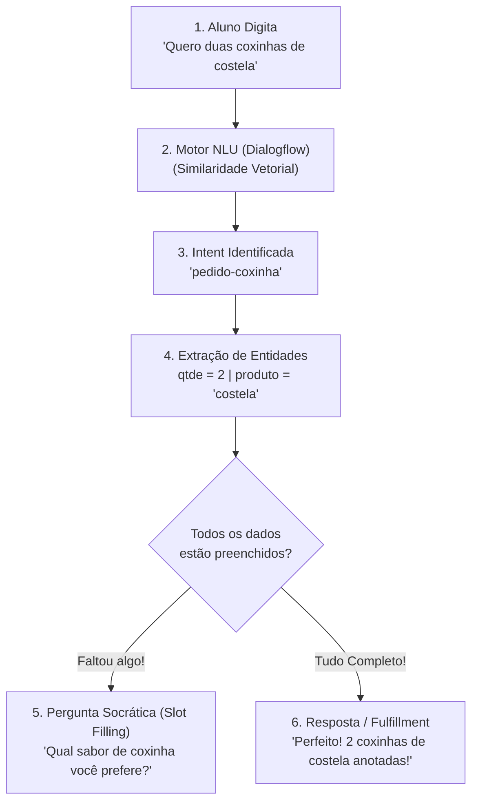

# 🤖 Atividade Prática: Interfaces Conversacionais com Google Dialogflow ES

**Plataforma:** [Google Dialogflow ES](https://dialogflow.cloud.google.com/)  
**Modalidade:** Processamento de Linguagem Natural Aplicado (*NLU / Chatbots / Agentes Inteligentes*)  
**Tempo Estimado:** 40 a 50 minutos  
**Requisitos:** Conta Google ativa e Navegador Web (Chrome/Edge)  
**Projeto:** Agente Conversacional da Cantina SENAI (`SENAIBOT`)

---

## 📋 1. ENUNCIADO DA ATIVIDADE (CONTEXTO DE NEGÓCIO)

> ### 🥪 Desafio: Fim das Filas no Recreio — O Chatbot da Cantina SENAI
> Durante o intervalo das aulas no **SENAI-SP**, centenas de estudantes descem simultaneamente para a cantina. As filas para pedir coxinhas, salgados e refrigerantes chegam a 20 minutos, gerando atrasos no retorno às salas e estresse no atendimento.
>
> A direção da escola solicitou a criação de um **Agente Conversacional com NLU (Compreensão de Linguagem Natural)** no Google Dialogflow. O bot deve atender os alunos pelo celular antes do sinal tocar, compreender pedidos em linguagem informal, extrair os dados essenciais (quantidade e sabor) e encaminhar o pedido para a cozinha.
>
> **Sua Missão:**
> 1. Criar o agente inteligente `Cantina_SENAI_Bot` no Dialogflow ES configurado para o idioma `Portuguese (pt-br)`.
> 2. Construir uma **Entidade Personalizada (`@produto`)** com sabores e sinônimos populares (*coxinha de frango*, *costela*, *pastel*).
> 3. Criar a **Intent Principal (`pedido-coxinha`)** com pelo menos 10 frases de treinamento realistas.
> 4. Configurar os parâmetros `qtde` (`@sys.number`) e `produto` (`@produto`) com **Preenchimento Obrigatório (*Slot Filling*)**, fazendo o bot insistir na pergunta caso o aluno esqueça de informar o sabor ou a quantidade.
> 5. Habilitar a integração visual com o **Dialogflow Messenger** para teste web interativo.

---

## 🛠️ 2. PASSO A PASSO DETALHADO DO LABORATÓRIO

### Passo 1: Criar o Agente no Console
1. Acesse: **[https://dialogflow.cloud.google.com/](https://dialogflow.cloud.google.com/)**
2. Crie um novo agente com o nome `Cantina_SENAI_Bot` e idioma `Portuguese (pt-br)`.

---

### Passo 2: Criando a Entidade Personalizada (`@produto`)
Vá em **Entities** $\to$ **Create Entity** e cadastre:
* `coxinha de frango` (sinônimos: frango, tradicional, de galinha)
* `coxinha de costela` (sinônimos: costela, de carne, especial)
* `pastel de queijo` (sinônimos: queijo, pastel frito)
* `suco natural` (sinônimos: suco, refrigerante, refri)

---

### Passo 3: Criando a Intent de Atendimento (`pedido-coxinha`)
1. Em **Intents**, crie a intent `pedido-coxinha`.
2. Adicione pelo menos 10 **Training Phrases** (*"Quero 2 coxinhas de frango"*, *"Me vê uma de costela"*...).
3. Configure os parâmetros `qtde` e `produto` como **REQUIRED** com perguntas socráticas de *Slot Filling*.

---

### Passo 4: Resposta de Confirmação e Ativação do Messenger
1. Em **Responses**, cadastre a resposta:  
   > *"Pedido registrado com sucesso! Anotei aqui: $qtde $produto. Já estamos preparando na cantina! 🥪✨"*
2. Em **Integrations**, ative o **Dialogflow Messenger** para teste web.

---

## 🧪 3. EXPERIMENTO CIENTÍFICO: TESTES DE ESTRESSE DO NLU

1. **Teste 1 — Frase Incompleta (Slot Filling):** Digite apenas `"Quero coxinha"` e veja a IA insistir no sabor e quantidade.
2. **Teste 2 — Variações Informais Inéditas:** Digite `"Desce duas de galinha aí chefia"`.
3. **Teste 3 — Default Fallback Intent:** Teste assuntos fora de escopo.

---

## ✅ 4. ENTREGÁVEL DA ATIVIDADE (CHECKLIST DE CONCLUSÃO)

Para validar a conclusão deste laboratório, certifique-se de preencher os itens:
- [ ] Agente `Cantina_SENAI_Bot` criado no console do Dialogflow ES em português.
- [ ] Entidade `@produto` configurada com pelo menos 3 sabores e sinônimos.
- [ ] Intent `pedido-coxinha` criada com frases de treino variadas.
- [ ] Parâmetros `qtde` e `produto` configurados como *Required* com *Prompts* ativos.
- [ ] Teste no painel *Try it now* comprovando o funcionamento do *Slot Filling*.
