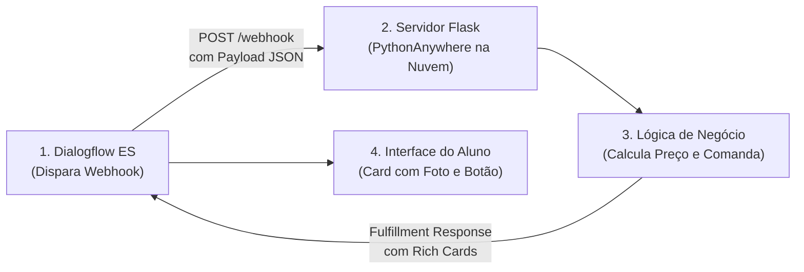

# ☁️ Atividade Prática: Cloud Deployment e Webhooks com Flask no PythonAnywhere

**Plataforma:** [PythonAnywhere](https://www.pythonanywhere.com/) & [Google Dialogflow ES](https://dialogflow.cloud.google.com/)  
**Modalidade:** Engenharia de Software para IA & Nuvem (*Deploy de Webhook, Endpoints REST e Fulfillment JSON*)  
**Tempo Estimado:** 40 a 50 minutos  
**Requisitos:** Conta gratuita no PythonAnywhere e Navegador Web  
**Arquivo de Apoio:** [`flask_app.py`](./flask_app.py)

---

## 📋 1. ENUNCIADO DA ATIVIDADE (CONTEXTO DE NEGÓCIO)

> ### 🚀 Desafio: Integração da Cozinha em Tempo Real e Hospedagem em Nuvem Pública
> O chatbot da Cantina SENAI já compreende o pedido dos alunos, mas as mensagens ainda ficavam "presas" dentro da interface do Dialogflow. A cozinha precisava receber os pedidos em um banco de dados real e enviar confirmações personalizadas com número de comanda e cartões ricos (*Rich Content Cards*).
>
> Para transformar o protótipo em uma aplicação de mercado, você foi contratado para **publicar um servidor web Flask na nuvem pública** através da plataforma **PythonAnywhere**. O servidor deve operar ininterruptamente com certificado SSL (**HTTPS**), atender às requisições do Dialogflow via rota `POST /webhook` e renderizar a página do cliente na rota `GET /`.
>
> **Sua Missão:**
> 1. Criar uma conta no **PythonAnywhere** e configurar um novo Web App com **Flask** em Python 3.10.
> 2. Implementar o arquivo [`flask_app.py`](./flask_app.py) com rotas para o portal web e o webhook de atendimento.
> 3. Habilitar o redirecionamento forçado para **HTTPS (*Force HTTPS*)**.
> 4. Conectar a URL pública do seu servidor (`https://seunome.pythonanywhere.com/webhook`) no console de **Fulfillment** do Dialogflow.
> 5. Realizar um pedido de coxinha pelo chat e validar a geração dinâmica da resposta com *Rich Content Cards* em JSON!

---

## 🛠️ 2. PASSO A PASSO DETALHADO DO LABORATÓRIO

### Passo 1: Criando o Web App no PythonAnywhere
1. Acesse: **[https://www.pythonanywhere.com/](https://www.pythonanywhere.com/)** e crie uma conta gratuita.
2. Na aba **Web**, clique em **"Add a new web app"**.
3. Selecione o framework **Flask** com **Python 3.10**.
4. Na aba **Web**, ative a opção **Force HTTPS**.

---

### Passo 2: Estrutura de Pastas e Imagens
1. Na aba **Files**, vá em `/home/seunome/mysite/`.
2. Crie a pasta `static/images/` e envie um ícone `robot.png`.

---

### Passo 3: Implementando o Servidor Flask e Recarregando
Abra o arquivo [`flask_app.py`](./flask_app.py) (ou consulte o gabarito no arquivo [`cod.md`](./cod.md)), configure seu `agent-id` e clique no botão verde **"Reload seunome.pythonanywhere.com"**.

---

### Passo 4: Conectando o Fulfillment no Dialogflow
1. No console do Dialogflow, clique em **Fulfillment**.
2. Ative o **Webhook** para **ENABLED**.
3. Cole a URL pública: `https://seunome.pythonanywhere.com/webhook` e salve.
4. Na intent `pedido-coxinha`, ative a opção **Enable webhook call for this intent**.

---

## 🧪 3. EXPERIMENTO CIENTÍFICO: TESTES DE ESTRESSE DO WEBHOOK

1. **Teste 1 — Inspeção de Logs:** Na aba Web, acesse o *Server log* e observe os disparos `POST /webhook` retornando código `200 OK`.
2. **Teste 2 — Simulação de Queda do Servidor:** Desative temporariamente o app e veja o comportamento do fallback no chat.
3. **Teste 3 — Parâmetros Nulos:** Teste a robustez do método `.get('qtde', 1)`.

---

## ✅ 4. ENTREGÁVEL DA ATIVIDADE (CHECKLIST DE CONCLUSÃO)

Para validar a conclusão deste laboratório, certifique-se de preencher os itens:
- [ ] Servidor web Flask publicado com sucesso no PythonAnywhere.
- [ ] Chave **Force HTTPS** ativada no painel de controle.
- [ ] Rota `GET /` renderizando o portal web com o Dialogflow Messenger.
- [ ] Rota `POST /webhook` conectada ao Fulfillment do Dialogflow.
- [ ] Pedido realizado no chat com resposta do Rich Content Card e cálculo de comanda.
