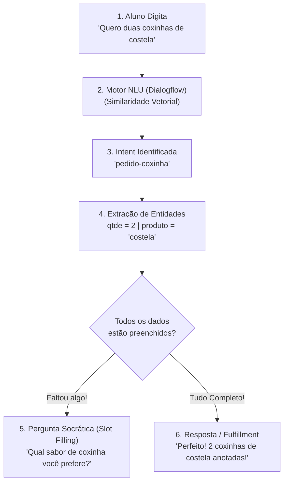

# 🤖 Laboratório Prático: Interfaces Conversacionais com Google Dialogflow ES

**Plataforma:** [Google Dialogflow ES](https://dialogflow.cloud.google.com/)  
**Modalidade:** Processamento de Linguagem Natural Aplicado (*NLU / Chatbots / Agentes Inteligentes*)  
**Tempo Estimado:** 40 a 50 minutos  
**Requisitos:** Conta Google ativa e Navegador Web (Chrome/Edge)  
**Projeto:** Agente Conversacional da Cantina SENAI (`SENAIBOT`)

---

## 📋 1. ENUNCIADO DA ATIVIDADE (CONTEXTO DE NEGÓCIO)

> ### 🥪 Desafio: Fim das Filas no Recreio — O Chatbot da Cantina SENAI
> Durante o intervalo das aulas no **SENAI-SP**, centenas de estudantes descem simultaneamente para a cantina. As filas para pedir coxinhas, salgados e refrigerantes chegam a 20 minutos, gerando atrasos no retorno às salas e estresse no atendimento.
>
> A direção da escola solicitou a criação de um **Agente Conversacional com NLU (Compreensão de Linguagem Natural)** no Google Dialogflow. O bot deve atender os alunos pelo celular antes do sinal tocar, compreender pedidos em linguagem informal, extrair os dados essenciais (quantidade e sabor) e encaminhar o pedido para a cozinha.
>
> **Sua Missão:**
> 1. Criar o agente inteligente `Cantina_SENAI_Bot` no Dialogflow ES configurado para o idioma `Portuguese (pt-br)`.
> 2. Construir uma **Entidade Personalizada (`@produto`)** com sabores e sinônimos populares (*coxinha de frango*, *costela*, *pastel*).
> 3. Criar a **Intent Principal (`pedido-coxinha`)** com pelo menos 10 frases de treinamento realistas.
> 4. Configurar os parâmetros `qtde` (`@sys.number`) e `produto` (`@produto`) com **Preenchimento Obrigatório (*Slot Filling*)**, fazendo o bot insistir na pergunta caso o aluno esqueça de informar o sabor ou a quantidade.
> 5. Habilitar a integração visual com o **Dialogflow Messenger** para teste web interativo.

---

## 🛠️ 2. PASSO A PASSO DETALHADO DO LABORATÓRIO

### Passo 1: Acessar a Plataforma e Criar o Agente
1. Acesse o console oficial: **[https://dialogflow.cloud.google.com/](https://dialogflow.cloud.google.com/)**
2. Faça login com sua conta Google.
3. No menu lateral esquerdo, clique no menu suspenso de agentes e selecione **"Create New Agent"**.
4. Configure os campos:
   * **Agent Name:** `Cantina_SENAI_Bot`
   * **Default Language:** `Portuguese (pt-br)`
   * **Default Time Zone:** `America/Sao_Paulo (GMT-3)`
5. Clique no botão azul **"Create"** no canto superior direito.

---

### Passo 2: Criando a Entidade Personalizada (`@produto`)
As entidades ensinam a IA quais são os substantivos do seu domínio de negócio:
1. No menu lateral, clique em **Entities** $\to$ **Create Entity**.
2. Nome da Entidade: `produto`.
3. Preencha os valores e seus respectivos sinônimos:

| Valor de Referência (*Reference Value*) | Sinônimos (*Synonyms*) |
| :--- | :--- |
| `coxinha de frango` | frango, tradicional, de galinha, coxinha simples |
| `coxinha de costela` | costela, de carne, costela desfiada, especial |
| `pastel de queijo` | queijo, pastel frito, pastelzinho de queijo |
| `suco natural` | suco de laranja, suco, refrigerante, refri, bebida |

4. Clique no botão **"Save"**.

---

### Passo 3: Criando a Intent de Atendimento (`pedido-coxinha`)
1. No menu lateral, clique em **Intents** $\to$ **Create Intent**.
2. Nome da Intent: `pedido-coxinha`.
3. Na seção **Training Phrases** (Frases de Treino), adicione exemplos variados:
   * *"Quero 2 coxinhas de frango"*
   * *"Me vê uma de costela"*
   * *"Vou querer 3 coxinhas tradicionais"*
   * *"Tô com fome, quero pedir salgado"*
   * *"Me manda cinco coxinhas de carne desfiada"*
4. Observe que o Dialogflow grifará automaticamente as palavras:
   * Números em amarelo: `@sys.number` (parâmetro `qtde`).
   * Produtos em laranja: `@produto` (parâmetro `produto`).

---

### Passo 4: Configurando o Preenchimento Obrigatório (*Slot Filling*)
Na seção **Action and Parameters**:
1. Marque a caixa de seleção **REQUIRED** para os parâmetros `qtde` e `produto`.
2. Clique em **Define prompts...** ao lado de cada parâmetro para cadastrar a pergunta que o bot fará caso o dado não seja informado:
   * Prompt de `qtde`: *"Quantas unidades você gostaria de pedir?"*
   * Prompt de `produto`: *"Qual é o sabor da coxinha que você deseja (frango ou costela)?"*

---

### Passo 5: Cadastrando a Resposta de Confirmação (*Responses*)
Na seção **Responses** na parte inferior:
1. Adicione a mensagem de confirmação usando as variáveis capturadas:
   > *"Pedido registrado com sucesso! Anotei aqui: $qtde $produto. Seu pedido já está sendo preparado pela equipe da cantina SENAI! 🥪✨"*
2. Se for integrar com Webhook na nuvem, ative a opção **Fulfillment** $\to$ **Enable webhook call for this intent**.
3. Clique em **Save** no topo da página.

---

## 🧪 3. EXPERIMENTO CIENTÍFICO: TESTES DE ESTRESSE DO NLU

No painel de testes à direita (**Try it now**), execute os **3 testes**:

1. **Teste 1 — Frase Incompleta (Slot Filling em Ação):**  
   Digite apenas: `"Quero coxinha"`.  
   *O que observar:* O bot não finaliza o pedido; ele detecta a intent e pergunta a quantidade e o sabor pendentes!
2. **Teste 2 — Variações Informais Inéditas:**  
   Digite: `"Desce duas de galinha aí chefia"`.  
   *O que observar:* Graças aos sinônimos e à similaridade semântica vetorial, o NLU entende perfeitamente que "duas de galinha" significa `2` unidades de `coxinha de frango`!
3. **Teste 3 — Mensagem Fora de Domínio (*Default Fallback Intent*):**  
   Digite: `"Qual a previsão do tempo para amanhã?"`.  
   *O que observar:* O bot direciona para o Fallback, demonstrando que não se confunde com assuntos aleatórios.

---

## 💻 4. ATIVAÇÃO DO WIDGET WEB (DIALOGFLOW MESSENGER)

Para testar o bot com interface moderna como no WhatsApp/Web:
1. No menu lateral do Dialogflow, clique em **Integrations**.
2. Localize o card **Dialogflow Messenger** e clique em **Enable**.
3. O Dialogflow exibirá uma janela com a tag HTML `<df-messenger>` e um botão **"Try It Now"**.
4. Teste a conversa diretamente na janela flutuante no canto inferior direito!

---

## ✅ 5. ENTREGÁVEL DA ATIVIDADE (CHECKLIST DE CONCLUSÃO)

Para validar a conclusão deste laboratório, certifique-se de preencher os itens:
- [ ] Agente `Cantina_SENAI_Bot` criado no console do Dialogflow ES em português.
- [ ] Entidade `@produto` configurada com pelo menos 3 sabores e sinônimos.
- [ ] Intent `pedido-coxinha` criada com frases de treino variadas.
- [ ] Parâmetros `qtde` e `produto` configurados como *Required* com *Prompts* ativos.
- [ ] Teste no painel *Try it now* comprovando o funcionamento do *Slot Filling*.
