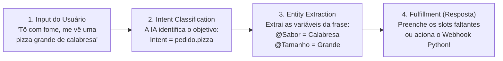

# 🤖 Aula & Laboratório: Interfaces Conversacionais e NLU com Google Dialogflow ES

**Curso:** Aperfeiçoamento Profissional em Programação em Inteligência Artificial Generativa (SENAI-SP)  
**Unidade / Aula:** Aula 05 — Agentes Conversacionais, Compreensão de Linguagem Natural (*NLU*) e *Slot Filling*  
**Plataforma:** [Google Dialogflow ES Console](https://dialogflow.cloud.google.com/)  
**Objetivo:** Compreender a arquitetura de **NLU (*Natural Language Understanding*)** e construir Agentes Virtuais Inteligentes para automação de pedidos (**Delivery "IA-Pizza"**) e agendamentos (**Barbearia "IA-Style"**).

---

## 🧠 1. A Base Teórica: O que acontece por trás do Chat?

Antes de clicarmos nos botões da plataforma, é fundamental compreender que o **Google Dialogflow** não é uma árvore engessada de `if/else` ("Digite 1 para X, Digite 2 para Y"). Ele é movido por **NLU (*Natural Language Understanding*)**, um ramo do Processamento de Linguagem Natural que interpreta a intenção humana mesmo quando o cliente usa gírias, inverte a ordem das palavras ou envia todas as informações em uma única frase!

### 🔄 O Fluxo da Inteligência Conversacional (Em 4 Estágios)

---

## 🛠️ 2. Glossário Técnico: Os 5 Pilares do Dialogflow

| Pilar Técnico | Analogia Gramatical | Como funciona na prática? |
| :--- | :--- | :--- |
| **1. *Intents* (Intenções)** | **O Verbo (A Ação)** | Representa **o objetivo** do usuário naquele momento (ex.: `pedido.pizza`, `agendamento.servico`, `cancelar.compra`). É o mapa de habilidades do robô. |
| **2. *Training Phrases* (Frases de Treino)** | **Os Exemplos** | Exemplos variados de como humanos reais falam. A IA usa *Embeddings* vetoriais para generalizar e entender frases que você nunca cadastrou! |
| **3. *Entities* (Entidades)** | **Os Substantivos (Variáveis)** | Dados estruturados extraídos da frase (ex.: `@Sabor`, `@Tamanho`, `@Servico` ou entidades prontas do Google como `@sys.date-time` e `@sys.address`). |
| **4. *Slot Filling* (Parâmetros Obrigatórios)** | **O Checklist** | Se o cliente disser apenas *"Quero uma pizza"*, o bot percebe que faltam os parâmetros obrigatórios (`Required`) e pergunta automaticamente pelo sabor, tamanho e endereço! |
| **5. *Contexts* (Contextos)** | **A Memória de Curto Prazo** | Mantém o estado da conversa ativo por $N$ interações (*lifespan*). Graças ao contexto, quando o usuário responde apenas *"Sim"*, o bot sabe que ele está confirmando o pedido de pizza! |

---

## 🍕 3. Laboratório Prático Opção A: Sistema de Delivery `"IA-Pizza"`

### 🔹 Passo 1: Criando o Agente na Nuvem do Google
1. Acesse o console oficial: **[dialogflow.cloud.google.com](https://dialogflow.cloud.google.com/)** logado com sua conta Google.
2. No menu lateral esquerdo, clique em **Create Agent**.
3. Preencha:
   * **Agent Name:** `Pizzaria_IA_Bot`
   * **Default Language:** `Portuguese - pt` (Locale: `pt-br`)
4. Clique no botão azul **Create**.

---

### 🔹 Passo 2: Construindo o Vocabulário do Negócio (`Entities`)
No menu esquerdo, vá em **Entities $\rightarrow$ Create Entity** e cadastre as 3 entidades abaixo (lembre-se de clicar em **Save** após criar cada uma):

| Nome da Entidade | Valores Principais (Reference Value) | Sinônimos (Synonyms) |
| :--- | :--- | :--- |
| **`@Sabor`** | `Calabresa` `Mussarela` `Margherita` | `linguiça, calabresa acebolada, tradicional` `queijo, muçarela` `marguerita, manjericão` |
| **`@Tamanho`** | `Broto` `Média` `Grande` | `pequena, individual, 4 fatias, P` `6 fatias, M` `família, gigante, 8 fatias, G` |
| **`@FormaPagamento`** | `PIX` `Cartão` `Dinheiro` | `chave pix, transferência` `crédito, débito, visa, master, maquininha` `espécie, cédula, troco` |

---

### 🔹 Passo 3: Criando a Intenção Principal (`pedido.pizza`)
1. Vá em **Intents $\rightarrow$ Create Intent** e dê o nome **`pedido.pizza`**.
2. Na seção **Training Phrases**, adicione pelo menos **10 frases variadas** (selecione as palavras-chave caso queira vincular manualmente às entidades):
   * *"Quero pedir uma pizza"*
   * *"Tô com fome, me vê uma grande de calabresa"*
   * *"Quero uma mussarela média no PIX"*
   * *"Vocês entregam uma pizza família de margherita na Avenida Paulista 1000?"*

---

### 🔹 Passo 4: Configurando Parâmetros Obrigatórios (*Slot Filling*)
Role até a seção **Action and parameters** e configure os 4 dados indispensáveis para fechar o pedido:

| Required (✅) | Parameter Name | Entity | Value | Prompt (Pergunta caso o cliente não tenha informado) |
| :---: | :--- | :--- | :--- | :--- |
| ✅ | `sabor` | `@Sabor` | `$sabor` | *"Qual sabor de pizza você deseja hoje?"* |
| ✅ | `tamanho` | `@Tamanho` | `$tamanho` | *"Qual será o tamanho? (Broto, Média ou Grande)"* |
| ✅ | `pagamento` | `@FormaPagamento` | `$pagamento` | *"Qual será a forma de pagamento? (PIX, Cartão ou Dinheiro)"* |
| ✅ | `endereco` | `@sys.address` / `@sys.any` | `$endereco` | *"Para qual endereço completo devemos enviar sua pizza?"* |

> [!TIP]
> **O Poder das *System Entities* (`@sys.`):**  
> Entidades iniciadas por `@sys.` (como `@sys.date-time`, `@sys.number`, `@sys.phone-number` e `@sys.address`) já vêm pré-treinadas pelo Google para reconhecer números, datas e locais automaticamente!

---

### 🔹 Passo 5: Contexto de Memória e Resposta Dinâmica
1. No topo da Intent `pedido.pizza`, clique em **Contexts** e adicione no campo **Output Context** a tag `pedido-em-andamento` (com *lifespan* `5`).
2. Role até a seção **Responses** e escreva a mensagem final interpolando as variáveis capturadas com `$`:
   > *"Ótima escolha! 🍕 Já registrei na cozinha sua pizza de **$sabor** (tamanho **$tamanho**). Nosso motoboy entregará em **$endereco** e o pagamento será via **$pagamento**. Posso confirmar o envio?"*
3. Clique no botão azul **Save** no topo direito e aguarde a engrenagem do treinamento finalizar!

---

## ✂️ 4. Laboratório Prático Opção B: Sistema de Agendamento `"IA-Style"` (Barbearia / Salão)

Quer aplicar o mesmo conceito em um sistema de prestação de serviços? Veja a especificação completa do Agente **`IA-Style`**:

### 🔹 1. Entidades Personalizadas (`Entities`)
| Entidade | Valores Principais | Sinônimos |
| :--- | :--- | :--- |
| **`@Servico`** | `Corte de Cabelo` / `Barba` / `Combo Completo` | `navalhado, aparar, corte social, degradê` / `fazer a barba, bigode` / `cabelo e barba` |
| **`@Profissional`** | `Ricardo` / `Marcos` / `Qualquer um` | `o dono, mestre Ricardo` / `barbeiro Marcos` / `primeiro disponível, tanto faz` |
| **`@Periodo`** | `Manhã` / `Tarde` / `Noite` | `cedo, antes do almoço, matutino` / `depois do almoço, vespertino` / `fim do dia, após as 18h` |

### 🔹 2. Intent `agendamento.servico` & *Slot Filling*
* **Output Context:** `agendamento-em-andamento`
* **Frases de Treino:** *"Quero dar um tapa no visual"*, *"Preciso cortar o cabelo com o Ricardo amanhã de manhã"*, *"Tem vaga pra fazer a barba hoje à tarde?"*
* **Parâmetros Obrigatórios (`Required`):**
  * `servico` (`@Servico`) $\rightarrow$ Prompt: *"Qual serviço você deseja realizar?"*
  * `barbeiro` (`@Profissional`) $\rightarrow$ Prompt: *"Com qual de nossos profissionais você gostaria de agendar?"*
  * `data_hora` (`@sys.date-time`) $\rightarrow$ Prompt: *"Para qual dia e horário você prefere?"*
  * `contato` (`@sys.phone-number`) $\rightarrow$ Prompt: *"Pode me informar seu WhatsApp/telefone para confirmação?"*
* **Resposta Dinâmica (`Responses`):**
  > *"Perfeito! ✂️ Agendei seu **$servico** com o profissional **$barbeiro** para **$data_hora**. Caso haja qualquer imprevisto, avisaremos no número **$contato**. Tudo certo?"*

---

## 🚀 5. Testando sob Estresse e Publicando com *Dialogflow Messenger*

### 🧪 Teste de Estresse no Simulador (`Try it now`)
No painel lateral direito do Dialogflow, faça dois testes para comprovar a inteligência do *Slot Filling*:
1. **Teste Passo a Passo:** Digite apenas `"Tô com fome"` ou `"Quero agendar"`. Veja o bot conduzir a conversa fazendo uma pergunta por vez até preencher todos os slots!
2. **Teste "Tudo de Uma Vez" (*One-Shot*):** Digite `"Quero uma pizza grande de calabresa no PIX para entregar na Rua Vergueiro 500"`. Veja o bot extrair todas as 4 variáveis de uma só vez, pular todas as perguntas intermediárias e já exibir o resumo final!

### 🌐 Publicação Moderna: Ativando o *Dialogflow Messenger*
1. No menu esquerdo do Dialogflow, clique em **Integrations**.
2. Localize o card **Dialogflow Messenger** (no topo da lista) e clique em **Enable**.
3. Uma janela exibirá a tag `<script>` e `<df-messenger>` pronta para ser colada em qualquer site HTML!
4. Clique no botão **Try it now** dentro da janela modal para testar o balão flutuante de chat no canto inferior direito da tela!

---

## 📝 6. Desafios de Fixação para os Alunos

- [ ] **1. Expansão de Entidade:** Adicione o parâmetro opcional `@Bebida` (`Coca-Cola`, `Guaraná`, `Suco`) na intent de pedido.
- [ ] **2. Tratamento de Erros Humanizado (`Default Fallback Intent`):** Edite a *Fallback Intent* para que, quando o usuário digitar algo fora do contexto, o robô oriente educadamente: *"Desculpe, não consegui entender. Eu sou o assistente virtual e posso anotar seu pedido, consultar o cardápio ou informar nosso horário de atendimento!"*
- [ ] **3. Intent de FAQ (`horario_funcionamento`):** Crie uma nova Intent para responder automaticamente qual é o horário de funcionamento e o endereço físico do estabelecimento.
