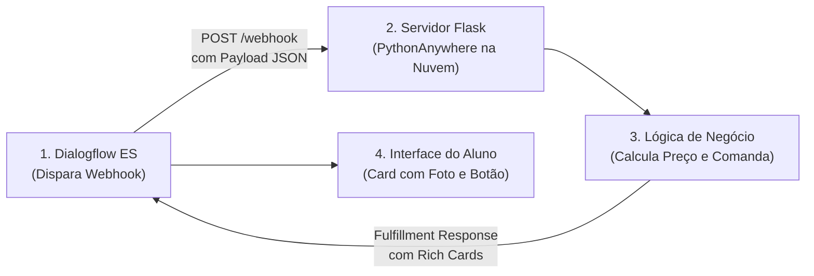

# ☁️ Laboratório Prático: Cloud Deployment e Webhooks com Flask no PythonAnywhere

**Plataforma:** [PythonAnywhere](https://www.pythonanywhere.com/) & [Google Dialogflow ES](https://dialogflow.cloud.google.com/)  
**Modalidade:** Engenharia de Software para IA & Nuvem (*Deploy de Webhook, Endpoints REST e Fulfillment JSON*)  
**Tempo Estimado:** 40 a 50 minutos  
**Requisitos:** Conta gratuita no PythonAnywhere e Navegador Web  
**Arquivo de Código:** [`flask_app.py`](./flask_app.py)

---

## 📋 1. ENUNCIADO DA ATIVIDADE (CONTEXTO DE NEGÓCIO)

> ### 🚀 Desafio: Integração da Cozinha em Tempo Real e Hospedagem em Nuvem Pública
> O chatbot da Cantina SENAI já compreende o pedido dos alunos, mas as mensagens ainda ficavam "presas" dentro da interface do Dialogflow. A cozinha precisava receber os pedidos em um banco de dados real e enviar confirmações personalizadas com número de comanda e cartões ricos (*Rich Content Cards*).
>
> Para transformar o protótipo em uma aplicação de mercado, você foi contratado para **publicar um servidor web Flask na nuvem pública** através da plataforma **PythonAnywhere**. O servidor deve operar ininterruptamente com certificado SSL (**HTTPS**), atender às requisições do Dialogflow via rota `POST /webhook` e renderizar a página do cliente na rota `GET /`.
>
> **Sua Missão:**
> 1. Criar uma conta no **PythonAnywhere** e configurar um novo Web App com **Flask** em Python 3.10.
> 2. Implementar o arquivo [`flask_app.py`](./flask_app.py) com rotas para o portal web e o webhook de atendimento.
> 3. Habilitar o redirecionamento forçado para **HTTPS (*Force HTTPS*)**.
> 4. Conectar a URL pública do seu servidor (`https://seunome.pythonanywhere.com/webhook`) no console de **Fulfillment** do Dialogflow.
> 5. Realizar um pedido de coxinha pelo chat e validar a geração dinâmica da resposta com *Rich Content Cards* em JSON!

---

## 🛠️ 2. PASSO A PASSO DETALHADO DO LABORATÓRIO



### Passo 1: Criando o Web App no PythonAnywhere
1. Acesse: **[https://www.pythonanywhere.com/](https://www.pythonanywhere.com/)** e crie sua conta gratuita (*Beginner*).
2. No painel de controle (*Dashboard*), clique na aba **Web** no menu superior.
3. Clique no botão azul **"Add a new web app"**.
4. Siga o assistente:
   * Seu domínio será: `seunome.pythonanywhere.com`.
   * Selecione o framework **Flask**.
   * Selecione a versão do Python: **Python 3.10**.
   * Caminho padrão: aceite o `/home/seunome/mysite/flask_app.py`.
5. Na aba **Web**, ative a chave **Force HTTPS** (O Dialogflow exige HTTPS com certificado válido para autorizar webhooks).

---

### Passo 2: Estrutura de Pastas e Imagens
1. No menu superior, clique na aba **Files**.
2. Navegue até a pasta `/home/seunome/mysite/`.
3. Crie a pasta `static` e, dentro dela, a pasta `images`.
4. Faça o upload de um ícone de robô chamado `robot.png` dentro de `/home/seunome/mysite/static/images/`.

---

### Passo 3: Implementando o Código do Servidor (`flask_app.py`)
Abra o arquivo `/home/seunome/mysite/flask_app.py` no editor do PythonAnywhere e cole o código:

```python
from flask import Flask, request, jsonify, make_response

app = Flask(__name__)

# Memória temporária de pedidos
pedidos_cozinha = []

# ==============================================================================
# ROTA 1: PORTAL WEB DO ALUNO (HTML + DIALOGFLOW MESSENGER)
# ==============================================================================
@app.route('/', methods=["GET"])
def home():
    # OBS: Substitua 'SEU-AGENT-ID' pelo seu ID oficial do Dialogflow Messenger
    return """
    <!DOCTYPE html>
    <html lang="pt-BR">
    <head>
        <meta charset="UTF-8">
        <meta name="viewport" content="width=device-width, initial-scale=1.0">
        <title>Cantina SENAI — Pedidos Online</title>
        <link href="https://fonts.googleapis.com/css2?family=Montserrat:wght@400;700;900&display=swap" rel="stylesheet">
        <style>
            body { font-family: 'Montserrat', sans-serif; background: #F8FAFC; text-align: center; padding: 40px 20px; }
            .card { background: white; max-width: 500px; margin: 0 auto; padding: 30px; border-radius: 16px; box-shadow: 0 4px 20px rgba(0,0,0,0.08); border-top: 5px solid #E30613; }
            h1 { color: #0F172A; margin-bottom: 10px; }
            p { color: #64748B; font-size: 0.95rem; line-height: 1.6; }
            df-messenger {
                --df-messenger-bot-message: #F1F5F9;
                --df-messenger-button-titlebar-color: #E30613;
                --df-messenger-chat-background-color: #FFFFFF;
                --df-messenger-user-message: #FEE2E2;
            }
        </style>
    </head>
    <body>
        <div class="card">
            <h1>Cantina SENAI 🥪</h1>
            <p>Faça seu pedido antecipado com o nosso atendente inteligente e retire sem pegar filas!</p>
            <p><em>Clique no ícone de chat no canto inferior direito para começar.</em></p>
        </div>

        <script src="https://www.gstatic.com/dialogflow-console/fast/messenger/bootstrap.js?v=1"></script>
        <df-messenger
            intent="WELCOME"
            chat-title="SENAIBOT — Cantina"
            agent-id="SEU-AGENT-ID"
            language-code="pt-br"
        ></df-messenger>
    </body>
    </html>
    """

# ==============================================================================
# ROTA 2: WEBHOOK DO DIALOGFLOW (FULFILLMENT JSON)
# ==============================================================================
@app.route('/webhook', methods=['POST'])
def webhook():
    requisicao = request.get_json(silent=True, force=True)
    query_result = requisicao.get('queryResult', {})
    parametros = query_result.get('parameters', {})
    
    # Extração das variáveis preenchidas pelo Slot Filling
    qtde = parametros.get('qtde', 1)
    produto = parametros.get('produto', 'salgado')
    
    # Preços da Cantina
    precos = {'coxinha de frango': 7.50, 'coxinha de costela': 9.00, 'pastel de queijo': 8.00}
    preco_unitario = precos.get(produto, 7.00)
    total = float(qtde) * preco_unitario
    
    comanda = len(pedidos_cozinha) + 101
    pedidos_cozinha.append({'comanda': comanda, 'qtde': qtde, 'produto': produto, 'total': total})
    
    # Resposta com Rich Card em JSON
    resposta = {
        "fulfillmentMessages": [
            {
                "card": {
                    "title": f"Comanda #{comanda} Confirmada! 🥪",
                    "subtitle": f"{qtde}x {produto.title()} — Total: R$ {total:.2f}\nRetirada em 10 minutos na bancada 2.",
                    "imageUri": "https://images.unsplash.com/photo-1541592106381-b31e9677c0e5?w=500&auto=format&fit=crop",
                    "buttons": [
                        {
                            "text": "Ver Status da Cozinha",
                            "postback": "status-pedido"
                        }
                    ]
                }
            }
        ]
    }
    
    return make_response(jsonify(resposta))

if __name__ == '__main__':
    app.run(debug=True)
```

---

### Passo 4: Recarregando o Servidor na Nuvem
1. Volte na aba **Web** no PythonAnywhere.
2. Clique no grande botão verde **"Reload seunome.pythonanywhere.com"**.
3. Acesse sua URL no navegador (`https://seunome.pythonanywhere.com/`) e confirme se a página com o widget da Cantina SENAI carregou!

---

### Passo 5: Conectando o Dialogflow ao seu Webhook
1. No console do Dialogflow, clique em **Fulfillment** no menu lateral.
2. Ative a chave **Webhook** para **ENABLED**.
3. No campo **URL**, cole o endereço HTTPS público da sua rota:  
   👉 `https://seunome.pythonanywhere.com/webhook`
4. Role até o rodapé e clique em **Save**.
5. No painel de testes à direita, digite: *"Quero 2 coxinhas de costela"* e veja a mágica do Rich Card surgir!

---

## 🧪 3. EXPERIMENTO CIENTÍFICO: TESTES DE ESTRESSE DO WEBHOOK

1. **Teste 1 — Inspeção de Logs em Tempo Real:**  
   No PythonAnywhere, vá na aba **Web** $\to$ clique em **Server log**. Observe cada requisição `POST /webhook` chegando com código HTTP `200 OK`.
2. **Teste 2 — Simulação de Queda do Servidor:**  
   Pressione temporariamente *Pause/Disable* no PythonAnywhere e mande uma mensagem no Dialogflow. O bot trava ou cai na mensagem de fallback padrão?
3. **Teste 3 — Parâmetros com Valores Nulos:**  
   O que acontece se o Dialogflow enviar `qtde = None`? Como a linha `parametros.get('qtde', 1)` protege seu código contra o clássico erro `KeyError`?

---

## 💻 4. CÓDIGO FONTE PRONTO PARA PRODUÇÃO

O arquivo completo já está disponível no seu repositório local em:  
📁 [Aula_05/flask_app.py](file:///c:/Apps/IAInfoeste/Trilha%20Skill%20Boost/Aula_05/flask_app.py)

---

## ✅ 5. ENTREGÁVEL DA ATIVIDADE (CHECKLIST DE CONCLUSÃO)

Para validar a conclusão deste laboratório, certifique-se de preencher os itens:
- [ ] Servidor web Flask publicado com sucesso no PythonAnywhere.
- [ ] Chave **Force HTTPS** ativada no painel de controle.
- [ ] Rota `GET /` renderizando o portal web com o Dialogflow Messenger.
- [ ] Rota `POST /webhook` conectada ao Fulfillment do Dialogflow.
- [ ] Pedido realizado no chat com resposta do Rich Content Card e cálculo de comanda.
