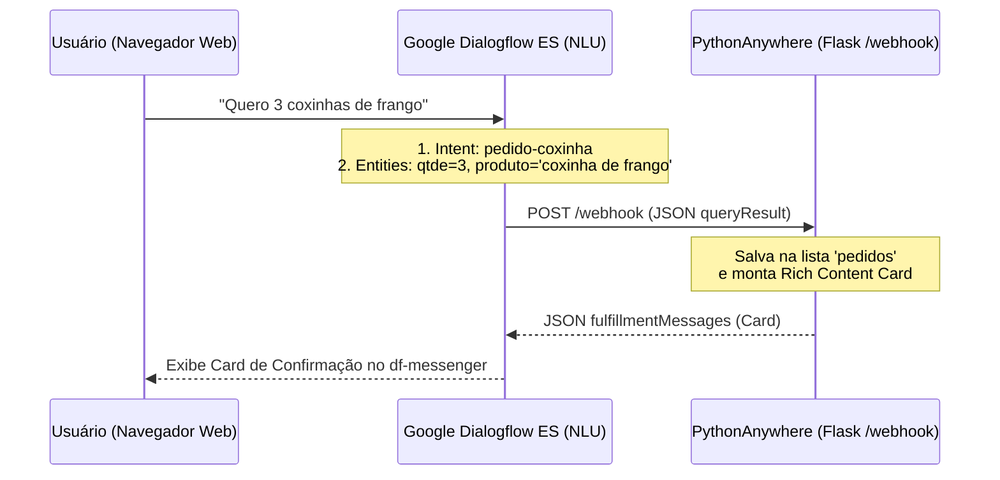

# 📘 Material Didático — Aula 05 (Dia 05): Chatbots com Google Dialogflow ES, Deploy Cloud no PythonAnywhere e Conclusão da Trilha Skills Boost
**Curso:** Aperfeiçoamento Profissional — Programação em Inteligência Artificial Generativa (SENAI-SP)  
**Carga Horária da Aula:** 4 Horas (Dia 5 de 5 — Aula Final)  
**Apresentação de Slides:** [slides_aula_5_estudante.html](file:///C:/Users/Instrutor/.gemini/antigravity/brain/2def7d10-b738-49f5-8f6f-980678220051/slides_aula_5_estudante.html)

---

## 🎯 Objetivos da Aula 05
1. Compreender a arquitetura de **Natural Language Understanding (NLU)** no **Google Dialogflow ES** (*Intents*, *Training Phrases*, *Entities*, *Slot Filling*, *Contextos* e *Fulfillment*).
2. Construir no **Laboratório 5.1** o cérebro conversacional do agente (**Cantina SENAI / Pizzaria IA** ou **Sistema de Agendamento IA-Style**).
3. Realizar no **Laboratório 5.2** o **Cloud Deployment** de uma API backend em **Flask** hospedada no servidor **PythonAnywhere**, integrando o widget `<df-messenger>` e a rota `/webhook` com retorno de *Rich Content Cards*.
4. Formalizar a entrega do **Projeto Final SIMI (*TechVision Smart Store*)** e concluir a **Atividade 04 (100% da Trilha)** na plataforma **Google Cloud Skills Boost**.

---

## 🤖 Módulo 1: Interfaces Conversacionais e Arquitetura NLU no Google Dialogflow ES



### Glossário Técnico (Os 4 Pilares do Dialogflow)
- **Intents (Intenções):** O objetivo/verbo do usuário (ex: `pedido-coxinha`, `pedido.pizza`, `agendamento.servico`). Utiliza *Training Phrases* para generalizar frases inéditas por similaridade vetorial.
- **Entities (Entidades):** As variáveis/substantivos extraídos da frase. Podem ser **Customizadas** (`@produto`, `@Sabor`, `@Servico`) ou **System Entities** pré-treinadas pelo Google (`@sys.number`, `@sys.address`, `@sys.date-time`, `@sys.phone-number`).
- **Slot Filling (Preenchimento de Lacunas):** Quando marcamos um parâmetro como **Required (Obrigatório)**, o próprio Dialogflow faz perguntas automáticas (*Prompts*) caso o usuário esqueça de informar a quantidade ou o sabor.
- **Contextos (*Input/Output Contexts*):** A memória de curto prazo do bot (controlada pelo número de interações ou *Lifespan*).

---

## 🛠️ Módulo 2 (Laboratório 5.1): Configurando o Cérebro no Dialogflow ES

### Opção Guiada A: Bot da Cantina SENAI (`pedido-coxinha`)
1. Acesse [Dialogflow ES Console](https://dialogflow.cloud.google.com/) e clique em **Create Agent**.
   - **Agent Name:** `SENAIBOT` | **Default Language:** `Portuguese - pt-br` | Clique em **Create**.
2. **Criar Entidade (`@produto`):**
   - Vá em **Entities $\to$ Create Entity** e nomeie como `produto`.
   - Adicione as entradas: `coxinha de frango` e `coxinha de costela` (adicione sinônimos como `frango`, `costela`). Clique em **Save**.
3. **Criar a Intent de Pedido (`pedido-coxinha`):**
   - Vá em **Intents $\to$ Create Intent** e nomeie exatamente como **`pedido-coxinha`**.
   - Em **Training Phrases**, adicione exemplos variados:
     - *"Quero 2 coxinhas de frango"*
     - *"Vou querer 5 de costela"*
     - *"Me vê 3 coxinhas de frango por favor"*
4. **Configurar Parâmetros e Slot Filling (`Action and Parameters`):**

| Required | Parameter Name | Entity | Value | Prompt (Se o usuário esquecer) |
| :---: | :--- | :--- | :--- | :--- |
| ✅ | `qtde` | `@sys.number` | `$qtde` | *"Quantas coxinhas você deseja?"* |
| ✅ | `produto` | `@produto` | `$produto` | *"Qual sabor você prefere: coxinha de frango ou de costela?"* |

5. **Ativar o Webhook na Intent:**
   - Role até o final da página da Intent `pedido-coxinha`, abra a seção **Fulfillment** e marque a caixa **Enable webhook call for this intent**. Clique em **Save**.
6. **Ativar o Dialogflow Messenger:**
   - No menu lateral esquerdo, clique em **Integrations $\to$ Dialogflow Messenger $\to$ Enable**. Copie o `agent-id` exibido no código HTML!

---

### Opção B (Variação para Prática em Duplas): Agendamento "IA-Style" ou Pizzaria IA


---

## ☁️ Módulo 3 (Laboratório 5.2): Deploy Cloud no PythonAnywhere (Flask + Webhook)

### Passo 1: Criar Conta e Web App Flask
1. Acesse [pythonanywhere.com](https://www.pythonanywhere.com/) e crie uma conta gratuita (**Beginner — Free**).
2. No Dashboard, clique na aba **Web $\to$ Add a new web app**.
3. Clique em *Next*, selecione o framework **Flask** e a versão do **Python (ex: Python 3.10)**.
4. Na aba **Web**, role até a seção **Security**, ative a opção **Force HTTPS** e confira o arquivo **WSGI configuration file**:

```python
import sys
path = '/home/SEU_USUARIO/mysite'
if path not in sys.path:
    sys.path.append(path)

from flask_app import app as application
```

---

### Passo 2: Organizar Pastas e Implementar o `flask_app.py`
1. Na aba **Files**, dentro de `/home/SEU_USUARIO/mysite/`, crie a pasta `static` e, dentro dela, a pasta `images`.
2. Faça upload de um ícone `robot.png` dentro de `/home/SEU_USUARIO/mysite/static/images/`.
3. Abra o arquivo `/home/SEU_USUARIO/mysite/flask_app.py`, substitua o `agent-id` pelo ID do seu agente do Dialogflow e salve:

```python
from flask import Flask, url_for, make_response, request, jsonify

app = Flask(__name__)

pedidos = []

@app.route('/', methods=["GET"])
def website():
    # OBS: Substitua o agent-id pelo seu ID do Dialogflow
    return """
    <html>
    <head>
        <meta name="viewport" content="width=device-width, initial-scale=1">
        <style>
            df-messenger {
                --df-messenger-bot-message: #b3a89d;
                --df-messenger-button-titlebar-color: #E30613;
                --df-messenger-chat-background-color: #F2F2F2;
                --df-messenger-font-color: white;
                --df-messenger-send-icon: #E30613;
                --df-messenger-user-message: #2B2B2B;
            }
        </style>
    </head>
    <body>
    <h2>Cantina Inteligente SENAI-SP</h2>
    <h4>Integração Google Dialogflow ES + Flask PythonAnywhere</h4>

    <script src="https://www.gstatic.com/dialogflow-console/fast/messenger/bootstrap.js?v=1"></script>
    <df-messenger
        intent="WELCOME"
        chat-title="SENAIBOT"
        agent-id="1ae8127a-34d0-4866-88f3-b523b9060b73"
        language-code="pt-br"
        chat-icon='%s'>
    </df-messenger>
    </body>
    </html>
    """ % url_for('static', filename='images/robot.png')

@app.route('/webhook', methods=["POST"])
def processarIntent():
    payload = request.get_json()
    intent = payload.get('queryResult', {}).get('intent', {})
    
    if intent:
        if intent.get('displayName') == 'pedido-coxinha':
            # Identifica a origem (Console do Dialogflow ou Web Messenger)
            source = payload.get("originalDetectIntentRequest", {}).get("source")
            resposta = {"fulfillmentMessages": []}
            
            parametro = payload.get('queryResult', {}).get('parameters', {})
            qtde = parametro.get("qtde")
            prod = parametro.get("produto")

            # Salva na lista global de pedidos em memória
            dict_prod = {"produto": prod, "qtde": qtde}
            global pedidos
            pedidos.append(dict_prod)

            msg = f"Ok, seu pedido de {qtde:.0f} {prod} foi realizado com sucesso!"
            return enviarCards(msg, source, resposta)
    
    return make_response(jsonify({"fulfillmentText": "Intent não reconhecida pelo Webhook."}))

def enviarCards(msg, source, resposta):
    if source == "DIALOGFLOW_CONSOLE" or source == "telegram":
        cardMsg = obterCardMsg(msg, tipo='custom')
        for card in cardMsg:
            resposta['fulfillmentMessages'].append(card)
    else:
        # Formato para Dialogflow Messenger (Rich Content)
        cardMsg = obterCardMsg(msg, tipo='messenger')
        resposta["fulfillmentMessages"].append({
            "payload": {
                "richContent": [cardMsg]
            }
        })
    return make_response(jsonify(resposta))

def obterCardMsg(msg, tipo="custom"):
    if tipo == "custom":
        return [{
            "card": {
                "title": "Mensagem de Confirmação",
                "subtitle": msg,
                "buttons": [
                    {"text": "Sair", "postback": "sair"}
                ]
            }
        }]
    elif tipo == "messenger":
        return [{
            "type": "info",
            "title": "Confirmação de Pedido",
            "subtitle": msg,
            "image": {"src": {"rawUrl": ""}},
            "actionLink": ""
        }]

if __name__ == '__main__':
    app.run()
```

---

### Passo 3: Vinculando o Fulfillment e Entendendo a Saída JSON
1. Na aba **Web** do PythonAnywhere, clique no botão verde **Reload**.
2. Copie o endereço público com `/webhook` ao final: `https://seuusuario.pythonanywhere.com/webhook`.
3. No **Dialogflow**, vá em **Fulfillment**, ative a chave **Webhook (Enabled)**, cole a URL no campo **URL** e clique em **Save**.

**Saída Real de Comunicação JSON (`/webhook`):**
```json
// 1. Payload enviado pelo Dialogflow via POST para o Flask:
{
  "queryResult": {
    "queryText": "Quero 3 coxinhas de frango",
    "parameters": { "qtde": 3.0, "produto": "coxinha de frango" },
    "intent": { "displayName": "pedido-coxinha" }
  }
}

// 2. Resposta JSON devolvida pela função enviarCards() ao Dialogflow Messenger:
{
  "fulfillmentMessages": [{
    "payload": {
      "richContent": [[{
        "type": "info",
        "title": "Confirmação de Pedido",
        "subtitle": "Ok, seu pedido de 3 coxinha de frango foi realizado com sucesso!"
      }]]
    }
  }]
}
```

> [!TIP]
> **Como Depurar Erros (*Troubleshooting* no PythonAnywhere):**  
> Se o chatbot não responder pelo Webhook ou exibir erro `500 Internal Server Error`, acesse a aba **Web** no PythonAnywhere, role até a seção **Log files** e abra o **`error.log`**. As últimas linhas mostram exatamente qualquer erro de sintaxe ou indentação no Python!

---

## 🏆 Módulo 4: Protocolo do Projeto Final SIMI & Conclusão 100% da Trilha Skills Boost

### 4.1 Checklist de Entrega do Projeto Final SIMI (*TechVision Global*)
Cada dupla deverá apresentar e documentar:
1. **Link 1 (Módulo de Visão Computacional — Google Colab):** Notebook da Aula 04 (`YOLOv8` / `EasyOCR` / `DeepFace`) com print das detecções.
2. **Link 2 (Design do Agente Conversacional — Dialogflow ES):** Print das *Intents*, *Entities* e *Fulfillment* configurado.
3. **Link 3 (Cloud Deployment — PythonAnywhere):** URL pública ativa (`https://seuusuario.pythonanywhere.com/`) com print do código `flask_app.py` e do chat respondendo em tempo real.

### 4.2 Atividade 04 e Certificação Completa no Google Cloud Skills Boost
Conclua a **4ª e última atividade** da trilha *Iniciante: programa de aprendizado Introdução à IA generativa*:

> [!WARNING]
> **VERIFICAÇÃO FINAL DE 100% DA TRILHA:**  
> Certifique-se de que **todos os vídeos das 4 atividades foram assistidos até o último segundo** e que todos os 4 *Badges* foram emitidos no seu perfil público do Google Cloud Skills Boost!
