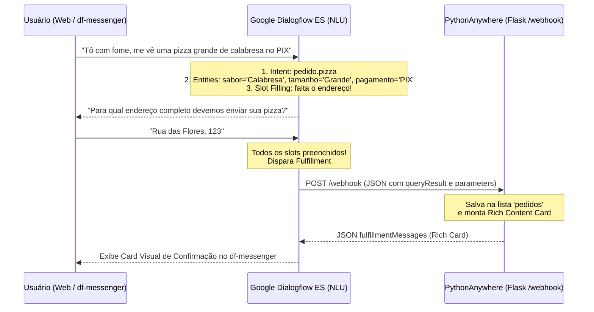
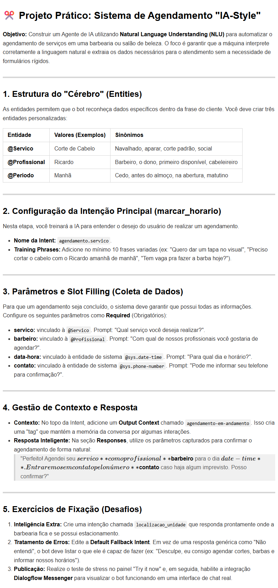

# 📘 Material Didático — Aula 05 (Dia 05): Chatbots com Google Dialogflow ES, Deploy Cloud no PythonAnywhere e Conclusão da Trilha Skills Boost

**Curso:** Aperfeiçoamento Profissional — Programação em Inteligência Artificial Generativa (SENAI-SP)  
**Carga Horária da Aula:** 4 Horas (Dia 5 de 5 — Grande Final & Deploy em Nuvem)  
**Apresentação de Slides:** [slide_aula_05.html](./slide_aula_05.html)  
**Roteiro Oficial do Projeto:** [DialogFlow.md](./DialogFlow.md)  

---

## 🎯 Objetivos da Aula 05

1. Compreender a arquitetura de **Natural Language Understanding (NLU)** no **Google Dialogflow ES** (*Intents*, *Training Phrases*, *Entities*, *Slot Filling*, *Contextos* e *Fulfillment*).
2. Construir no **Laboratório 5.1** o projeto oficial especificado em [DialogFlow.md](./DialogFlow.md):
   - **Opção A (Principal):** Sistema Inteligente de Delivery **`Pizzaria_IA_Bot`** com a intent `pedido.pizza`, entidades personalizadas (`@Sabor`, `@Tamanho`, `@FormaPagamento`), entidades de sistema (`@sys.address`, `@sys.number`), *Slot Filling* com perguntas socráticas e contexto de memória (`pedido-em-andamento`).
   - **Opção B (Variação para Serviços):** Sistema de Agendamento **`IA-Style`** (Barbearia/Salão) com intent `agendamento.servico` e entidades `@Servico`, `@Profissional`, `@Periodo`.
3. Realizar no **Laboratório 5.2** o **Cloud Deployment** de uma API backend em **Flask** hospedada no servidor **PythonAnywhere**, integrando o widget `<df-messenger>` e a rota `/webhook` para processar a intent `pedido.pizza` e retornar *Rich Content Cards* interativos.
4. Formalizar a entrega do **Projeto Final SIMI (*TechVision Smart Store*)** integrando Visão Computacional (Aula 04) + Chatbot NLU + Servidor em Nuvem.
5. Concluir a **Atividade 04 (100% da Trilha Oficial)** na plataforma **Google Cloud Skills Boost**, conquistando os 4 *Badges* oficiais internacionais.

---

## 🤖 Módulo 1: Interfaces Conversacionais e Arquitetura NLU no Google Dialogflow ES

Diferente de menus numéricos e árvores rígidas de `if/else` ("Digite 1 para isso, 2 para aquilo"), o **Google Dialogflow ES** é movido por **NLU (*Natural Language Understanding*)**, ramo do Processamento de Linguagem Natural que compreende linguagem humana espontânea, gírias, variações gramaticais e informações enviadas fora de ordem.

### 🔄 O Fluxo da Inteligência Conversacional (Projeto `DialogFlow.md` + Nuvem)



### 🛠️ Glossário Técnico: Os 5 Pilares do Dialogflow

| Pilar Técnico | Analogia Gramatical | Papel no Projeto `DialogFlow.md` |
| :--- | :--- | :--- |
| **1. *Intents* (Intenções)** | **O Verbo / Ação** | Representa o objetivo do cliente (ex.: `pedido.pizza`, `agendamento.servico`). Mapeia a capacidade do bot de atender a uma solicitação. |
| **2. *Training Phrases*** | **Os Exemplos Reais** | Frases de exemplo em linguagem natural. A IA usa *embeddings* e similaridade vetorial para generalizar frases inéditas que o aluno nunca cadastrou. |
| **3. *Entities* (Entidades)** | **Os Substantivos / Variáveis** | Dados estruturados extraídos da frase. Criamos **Custom Entities** (`@Sabor`, `@Tamanho`, `@FormaPagamento`) e usamos **System Entities** do Google (`@sys.address`, `@sys.number`, `@sys.date-time`). |
| **4. *Slot Filling* (Lacunas)** | **O Checklist Obrigatório** | Se o usuário diz apenas *"Quero uma pizza"*, marcamos os parâmetros essenciais como `Required` e a IA faz perguntas automáticas (*prompts*) até coletar tudo. |
| **5. *Contexts* (Contextos)** | **A Memória de Curto Prazo** | Mantém viva a linha de raciocínio por $N$ interações (*lifespan*). Permite que o cliente responda apenas *"Sim"* ou *"Confirmo"* sem esquecer o pedido. |

---

## 🛠️ Módulo 2 (Laboratório 5.1): Criando o Agente do Projeto `DialogFlow.md`

O roteiro detalhado completo encontra-se no arquivo [DialogFlow.md](./DialogFlow.md). Abaixo estão os passos essenciais para a construção prática guiada em sala de aula.

### 🍕 Opção A (Principal): Sistema de Delivery `"IA-Pizza"` (`Pizzaria_IA_Bot`)

#### Passo 1: Criando o Agente na Nuvem do Google
1. Acesse o console oficial: **[https://dialogflow.cloud.google.com/](https://dialogflow.cloud.google.com/)** logado com sua conta Google.
2. No menu lateral esquerdo, clique em **Create Agent**.
3. Preencha as configurações:
   - **Agent Name:** `Pizzaria_IA_Bot`
   - **Default Language:** `Portuguese - pt` (Locale: `pt-br`)
   - **Default Time Zone:** `America/Sao_Paulo (GMT-3)`
4. Clique no botão azul **Create**.

---

#### Passo 2: Construindo o Vocabulário do Negócio (`Entities`)
No menu lateral esquerdo, vá em **Entities $\rightarrow$ Create Entity** e cadastre as 3 entidades abaixo (clique em **Save** após salvar cada uma):

| Nome da Entidade | Valores de Referência (*Reference Value*) | Sinônimos (*Synonyms*) |
| :--- | :--- | :--- |
| **`@Sabor`** | `Calabresa`<br>`Mussarela`<br>`Margherita` | `linguiça, calabresa acebolada, tradicional`<br>`queijo, muçarela`<br>`marguerita, manjericão` |
| **`@Tamanho`** | `Broto`<br>`Média`<br>`Grande` | `pequena, individual, 4 fatias, P`<br>`6 fatias, M`<br>`família, gigante, 8 fatias, G` |
| **`@FormaPagamento`** | `PIX`<br>`Cartão`<br>`Dinheiro` | `chave pix, transferência`<br>`crédito, débito, visa, master, maquininha`<br>`espécie, cédula, troco` |

---

#### Passo 3: Criando a Intenção Principal (`pedido.pizza`)
1. No menu esquerdo, vá em **Intents $\rightarrow$ Create Intent**.
2. Nome da Intent: exatamente **`pedido.pizza`**.
3. Na seção **Training Phrases**, adicione pelo menos **10 frases variadas**:
   - *"Quero pedir uma pizza"*
   - *"Tô com fome, me vê uma grande de calabresa"*
   - *"Quero uma mussarela média no PIX"*
   - *"Vocês entregam uma pizza família de margherita na Avenida Paulista 1000?"*
   - *"Vou querer 1 pizza de calabresa média com pagamento no cartão"*
   - *"Me vê uma pizza broto de queijo"*
   - *"Gostaria de pedir uma margherita grande"*
   - *"Boa noite, quero pizza no dinheiro para entregar"*

---

#### Passo 4: Configurando Parâmetros Obrigatórios (*Slot Filling*)
Role até a seção **Action and parameters** e configure os 4 dados indispensáveis para fechar o pedido:

| Required (✅) | Parameter Name | Entity | Value | Prompt (Se o cliente esquecer) |
| :---: | :--- | :--- | :--- | :--- |
| ✅ | `sabor` | `@Sabor` | `$sabor` | *"Qual sabor de pizza você deseja hoje? (Calabresa, Mussarela ou Margherita)"* |
| ✅ | `tamanho` | `@Tamanho` | `$tamanho` | *"Qual será o tamanho? (Broto, Média ou Grande)"* |
| ✅ | `pagamento` | `@FormaPagamento` | `$pagamento` | *"Qual será a forma de pagamento? (PIX, Cartão ou Dinheiro)"* |
| ✅ | `endereco` | `@sys.address` | `$endereco` | *"Para qual endereço completo devemos enviar sua pizza?"* |

> [!TIP]
> **Poder das *System Entities* (`@sys.`):**  
> Entidades do sistema como `@sys.address`, `@sys.number` e `@sys.date-time` são modelos pré-treinados pelo Google que identificam logradouros, números e datas mesmo com abreviações como *"Av. Paulista, 1000"* ou *"Rua Vergueiro 500 ap 32"*.

---

#### Passo 5: Contexto de Memória e Resposta Dinâmica
1. No topo da Intent `pedido.pizza`, abra **Contexts** e adicione em **Output Context** a tag `pedido-em-andamento` com *lifespan* `5`.
2. Na seção **Responses**, monte a confirmação inicial com interpolação de variáveis:
   > *"Ótima escolha! 🍕 Já registrei na cozinha sua pizza de **$sabor** (tamanho **$tamanho**). Nosso motoboy entregará em **$endereco** e o pagamento será via **$pagamento**. Posso confirmar o envio?"*
3. **Ativar o Webhook:** No rodapé da página da intent, abra a seção **Fulfillment**, marque a caixa **Enable webhook call for this intent** e clique em **Save**!

---

#### Passo 6: Ativando a Integração com o *Dialogflow Messenger*
1. No menu esquerdo do Dialogflow, clique em **Integrations**.
2. Localize o card **Dialogflow Messenger** e clique em **Enable**.
3. Copie o `agent-id` gerado no código HTML (utilizaremos no servidor Flask do PythonAnywhere!).

---

### ✂️ Opção B (Variação para Prática): Sistema de Agendamento `"IA-Style"`

Caso prefira aplicar o mesmo conceito em prestação de serviços (barbearia/salão/consultório), consulte a especificação do Agente **`IA-Style`** em [DialogFlow.md](./DialogFlow.md):



- **Entidades:** `@Servico` (*Corte de Cabelo, Barba, Combo Completo*), `@Profissional` (*Ricardo, Marcos, Qualquer um*), `@Periodo` (*Manhã, Tarde, Noite*).
- **Intent:** `agendamento.servico` com parâmetros obrigatórios: `servico`, `barbeiro`, `data_hora` (`@sys.date-time`) e `contato` (`@sys.phone-number`).
- **Resposta Dinâmica:** *"Perfeito! ✂️ Agendei seu $servico com o profissional $barbeiro para $data_hora. Caso haja qualquer imprevisto, avisaremos no número $contato. Tudo certo?"*

---

### 🧪 Experimento Científico: Testando sob Estresse no Console

No painel lateral direito (**Try it now**), valide o comportamento do NLU:
1. **Teste Passo a Passo (*Slot Filling*):** Digite apenas `"Tô com fome"` ou `"Quero uma pizza"`. Observe a IA conduzir a conversa fazendo uma pergunta por vez até preencher todos os 4 parâmetros obrigatórios.
2. **Teste "Tudo de Uma Vez" (*One-Shot*):** Digite:  
   *"Quero uma pizza grande de calabresa no PIX para entregar na Rua Vergueiro 500"*.  
   Observe a IA extrair simultaneamente os 4 parâmetros, pular todas as perguntas intermediárias e ir direto para o fechamento!

---

## ☁️ Módulo 3 (Laboratório 5.2): Deploy Cloud no PythonAnywhere (Flask + Webhook)

Para que a pizzaria funcione no mundo real, precisamos de uma API em nuvem pública capaz de processar os pedidos, salvar no banco de dados e devolver *Rich Content Cards* com botões e imagens.

### Passo 1: Criar Conta e Web App Flask
1. Acesse **[pythonanywhere.com](https://www.pythonanywhere.com/)** e crie uma conta gratuita (**Beginner — Free**).
2. No Dashboard, clique na aba **Web $\to$ Add a new web app**.
3. Clique em *Next*, selecione o framework **Flask** e **Python 3.10**.
4. Na aba **Web**, role até a seção **Security** e ative a opção **Force HTTPS**.
5. Verifique o arquivo **WSGI configuration file** (aba Web):

```python
import sys
path = '/home/SEU_USUARIO/mysite'
if path not in sys.path:
    sys.path.append(path)

from flask_app import app as application
```

---

### Passo 2: Organizar Pastas e Implementar o `flask_app.py`
1. Na aba **Files**, dentro de `/home/SEU_USUARIO/mysite/`, crie a pasta `static` e dentro dela a pasta `images`.
2. Faça upload de um ícone `robot.png` ou `pizza.png` em `/home/SEU_USUARIO/mysite/static/images/`.
3. Abra o arquivo `/home/SEU_USUARIO/mysite/flask_app.py`, substitua pelo código abaixo (lembrando de colar o seu `agent-id` real do Dialogflow):

```python
from flask import Flask, url_for, make_response, request, jsonify

app = Flask(__name__)

# Lista global em memória para persistir os pedidos em tempo real
pedidos = []

@app.route('/', methods=["GET"])
def website():
    """Rota principal: Renderiza a página web da Pizzaria com o Dialogflow Messenger"""
    return """
    <!DOCTYPE html>
    <html lang="pt-BR">
    <head>
        <meta charset="UTF-8">
        <meta name="viewport" content="width=device-width, initial-scale=1">
        <title>Pizzaria Inteligente IA-Pizza • SENAI-SP</title>
        <style>
            body {
                font-family: 'Segoe UI', Tahoma, Geneva, Verdana, sans-serif;
                background: linear-gradient(135deg, #1e293b 0%, #0f172a 100%);
                color: #f8fafc;
                margin: 0;
                padding: 40px 20px;
                display: flex;
                flex-direction: column;
                align-items: center;
                min-height: 100vh;
            }
            .card {
                max-width: 650px;
                background: rgba(30, 41, 59, 0.85);
                border: 1px solid #334155;
                border-top: 5px solid #E30613;
                border-radius: 12px;
                padding: 30px;
                box-shadow: 0 10px 25px rgba(0,0,0,0.3);
                backdrop-filter: blur(10px);
                text-align: center;
            }
            h1 { color: #ffffff; margin-bottom: 8px; font-size: 28px; }
            h3 { color: #E30613; font-weight: 600; margin-top: 0; }
            p { color: #94a3b8; font-size: 15px; line-height: 1.6; }
            .badge {
                display: inline-block;
                background: #E30613;
                color: #fff;
                padding: 4px 12px;
                border-radius: 20px;
                font-size: 12px;
                font-weight: bold;
                text-transform: uppercase;
                margin-bottom: 15px;
            }
            df-messenger {
                --df-messenger-bot-message: #334155;
                --df-messenger-button-titlebar-color: #E30613;
                --df-messenger-chat-background-color: #0f172a;
                --df-messenger-font-color: #ffffff;
                --df-messenger-send-icon: #E30613;
                --df-messenger-user-message: #E30613;
            }
        </style>
    </head>
    <body>
        <div class="card">
            <span class="badge">Projeto Oficial DialogFlow.md</span>
            <h1>🍕 Pizzaria Inteligente IA-Pizza</h1>
            <h3>Atendimento Automatizado NLU + Deploy Cloud Flask</h3>
            <p>Utilize o balão de chat no canto inferior direito para fazer seu pedido de pizza em linguagem natural. A IA extrairá sabor, tamanho, endereço e forma de pagamento automaticamente!</p>
        </div>

        <script src="https://www.gstatic.com/dialogflow-console/fast/messenger/bootstrap.js?v=1"></script>
        <df-messenger
            intent="WELCOME"
            chat-title="Pizzaria IA-Pizza"
            agent-id="COLE-AQUI-O-SEU-AGENT-ID"
            language-code="pt-br"
            chat-icon="%s">
        </df-messenger>
    </body>
    </html>
    """ % url_for('static', filename='images/robot.png')


@app.route('/webhook', methods=["POST"])
def processarIntent():
    """Rota POST do Webhook: Recebe dados do Dialogflow e processa pedidos"""
    payload = request.get_json(silent=True, force=True) or {}
    query_result = payload.get('queryResult', {})
    intent_name = query_result.get('intent', {}).get('displayName', '')
    source = payload.get("originalDetectIntentRequest", {}).get("source")
    resposta = {"fulfillmentMessages": []}

    # 1. Tratamento da Intent do Projeto DialogFlow.md (pedido.pizza)
    if intent_name == 'pedido.pizza':
        params = query_result.get('parameters', {})
        sabor = params.get('sabor', 'Calabresa')
        tamanho = params.get('tamanho', 'Grande')
        pagamento = params.get('pagamento', 'PIX')
        endereco = params.get('endereco', 'Retirada no Balcão')

        # Persiste o pedido na lista em memória do servidor
        registro = {
            "sabor": sabor,
            "tamanho": tamanho,
            "pagamento": pagamento,
            "endereco": endereco
        }
        pedidos.append(registro)

        msg = f"Pizza de {sabor} ({tamanho}) confirmada! Entrega em: {endereco}. Pagamento via {pagamento}."
        return enviarCards("🍕 Pedido Registrado com Sucesso!", msg, source, resposta)

    # 2. Tratamento para Variação Agendamento IA-Style (agendamento.servico)
    elif intent_name == 'agendamento.servico':
        params = query_result.get('parameters', {})
        servico = params.get('servico', 'Corte de Cabelo')
        barbeiro = params.get('barbeiro', 'Ricardo')
        data_hora = params.get('data_hora', 'Hoje')

        msg = f"Agendamento confirmado: {servico} com {barbeiro} em {data_hora}!"
        return enviarCards("✂️ Agendamento Confirmado!", msg, source, resposta)

    # 3. Fallback genérico
    return make_response(jsonify({
        "fulfillmentText": "Recebi sua mensagem no servidor Flask em nuvem, mas a intenção não possui regra cadastrada."
    }))


def enviarCards(titulo, msg, source, resposta):
    """Monta mensagens em formato Card tradicional ou Rich Content para o Dialogflow Messenger"""
    if source == "DIALOGFLOW_CONSOLE" or source == "telegram":
        resposta['fulfillmentMessages'].append({
            "card": {
                "title": titulo,
                "subtitle": msg
            }
        })
    else:
        # Formato Rich Content para o widget <df-messenger>
        resposta["fulfillmentMessages"].append({
            "payload": {
                "richContent": [[{
                    "type": "info",
                    "title": titulo,
                    "subtitle": msg
                }]]
            }
        })
    return make_response(jsonify(resposta))


if __name__ == '__main__':
    app.run()
```

---

### Passo 3: Vinculando o Fulfillment e Depurando Erros
1. Na aba **Web** do PythonAnywhere, clique no botão verde **Reload**.
2. Copie o endereço público da sua aplicação acrescentando `/webhook` ao final:  
   `https://seuusuario.pythonanywhere.com/webhook`
3. No console do **Dialogflow**, vá em **Fulfillment**, ative a chave **Webhook (Enabled)**, cole a URL no campo **URL** e clique no botão azul **Save** no rodapé.
4. **Teste Completo:**
   - No simulador lateral (*Try it now*), digite: *"Quero uma pizza grande de calabresa no PIX para entregar na Av Paulista 1000"*.
   - Abra no navegador `https://seuusuario.pythonanywhere.com/` e teste a conversa pelo balão flutuante!

#### 📡 Payloads JSON Reais de Comunicação (`/webhook`)

```json
// 1. JSON enviado pelo Dialogflow via POST ao PythonAnywhere:
{
  "queryResult": {
    "queryText": "Quero uma pizza grande de calabresa no PIX para entregar na Av Paulista 1000",
    "parameters": {
      "sabor": "Calabresa",
      "tamanho": "Grande",
      "pagamento": "PIX",
      "endereco": "Av Paulista 1000"
    },
    "intent": {
      "displayName": "pedido.pizza"
    }
  }
}

// 2. Resposta JSON devolvida pelo Flask ao Dialogflow:
{
  "fulfillmentMessages": [
    {
      "payload": {
        "richContent": [
          [
            {
              "type": "info",
              "title": "🍕 Pedido Registrado com Sucesso!",
              "subtitle": "Pizza de Calabresa (Grande) confirmada! Entrega em: Av Paulista 1000. Pagamento via PIX."
            }
          ]
        ]
      }
    }
  ]
}
```

> [!TIP]
> **Como Depurar Erros (*Troubleshooting* no PythonAnywhere):**  
> Se o chatbot responder com *"Webhook call failed"* ou erro `500`, acesse a aba **Web** do PythonAnywhere, role até a seção **Log files** e abra o arquivo **`error.log`**. As últimas linhas indicarão a linha exata de qualquer erro no Python.

---

## 🏆 Módulo 4: Protocolo do Projeto Final SIMI & Conclusão 100% da Trilha Skills Boost

### 4.1 Checklist de Entrega do Projeto Final SIMI (*TechVision Smart Store*)
Cada dupla de estudantes deverá consolidar os 3 links e evidências:
1. **Link 1 (Módulo de Visão Computacional — Google Colab):** Notebook da Aula 04 (`YOLOv8` / `ALPR EasyOCR` / `DeepFace`) com prints das detecções.
2. **Link 2 (Agente Conversacional — Dialogflow ES):** Agente `Pizzaria_IA_Bot` configurado conforme [DialogFlow.md](./DialogFlow.md) com prints das *Intents*, *Entities* e *Slot Filling*.
3. **Link 3 (Cloud Deployment — PythonAnywhere):** URL pública ativa (`https://dupla.pythonanywhere.com/`) demonstrando o servidor Flask e o widget `<df-messenger>` respondendo com Rich Cards.

---

### 4.2 Atividade 04 e Certificação Completa no Google Cloud Skills Boost
Conclua a **4ª e última atividade** da trilha *Iniciante: programa de aprendizado Introdução à IA generativa*:
- ✅ **Dia 02:** *Introduction to Generative AI* (Badge 1)
- ✅ **Dia 03:** *Introduction to Large Language Models* (Badge 2)
- ✅ **Dia 04:** *Introduction to Responsible AI* (Badge 3)
- ✅ **Dia 05 (Hoje):** *Applying AI Principles with Google Cloud* (Badge 4 — **100% da Trilha!**)

> [!WARNING]
> **VERIFICAÇÃO FINAL DE 100% DA TRILHA:**  
> Certifique-se de que a barra de progresso da trilha atingiu **100%** e que todos os vídeos foram assistidos até o fim para garantir a emissão dos certificados e insígnias oficiais da Google Cloud!
