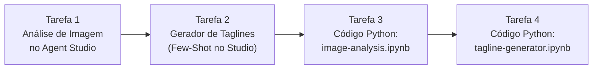

# Guia Didático Passo a Passo: GSP519 — Prompt Design in Agent Platform: Challenge Lab

> [!IMPORTANT]
> **Atenção aos Valores Dinâmicos do Challenge Lab:**
> Como este é um **Laboratório de Desafio (*Challenge Lab*)**, alguns valores mudam a cada vez que você inicia o lab:
> * **`model_name`:** O modelo exato exigido nas Tarefas 1 e 2 (ex: `gemini-3.5-flash`).
> * **`Region`:** A região atribuída ao seu lab para salvar os prompts (ex: `us-east4`, `us-central1`, `us-west1`).
> * **`image file path`:** O caminho da imagem no Cloud Storage na Tarefa 1 (ex: `gs://qwiklabs-gcp-...-bucket/cymbal-product-image.png`).
> * **Dica para o Chrome:** Evite usar o Google Tradutor automático na página do lab enquanto copia nomes de modelos, regiões ou títulos de prompts, para que o navegador não traduza termos técnicos exigidos pelo avaliador.

---

## Visão Geral e Cenário do Desafio

### O que é um Challenge Lab?
Diferente dos laboratórios guiados tradicionais, um **Challenge Lab** testa sua autonomia técnica: o enunciado apresenta um problema de negócio e o que precisa ser entregue, sem dar o passo a passo de onde clicar. Este guia transforma esse desafio em um roteiro didático passo a passo para que você entenda tanto **como resolver** quanto **por que cada etapa funciona**.

### Qual é o nosso cenário de negócio?
Você faz parte de uma startup de conteúdo educacional que fechou uma parceria com a **Cymbal Direct**, uma varejista online que está lançando uma nova linha de roupas e equipamentos de aventura ao ar livre (*outdoor gear*) voltada para conectar jovens com a natureza.

Sua missão na **Agent Platform** é criar duas ferramentas de IA Generativa e depois integrá-las via código **Python no JupyterLab (Workbench)**:
1. **Analisador de Imagem de Produtos:** Gera descrições evocativas e poéticas a partir da foto oficial do produto.
2. **Gerador de Slogans (*Taglines*):** Usa *Few-shot prompting* e parâmetros customizáveis para criar frases de impacto publicitário.



---

## Configuração Inicial e Login

1. Clique em **Start Lab** na página do Google Skills.
2. Clique com o botão direito em **Open Google Cloud console** e selecione **Abrir link em uma janela anônima** (*Incognito*).
3. Faça login com o **Username** e **Password** temporários fornecidos no painel lateral esquerdo do lab.
4. Aceite os termos iniciais para acessar o Console do Google Cloud.

---

## Tarefa 1: Construir uma ferramenta de análise de imagem com o Gemini (*Build a Gemini image analysis tool*)

### 🎓 O que estamos fazendo e para que serve?
* **O que será feito:** Vamos criar um prompt multimodal no **Agent Studio** que recebe a foto de um produto da Cymbal Direct (armazenada em um bucket do Cloud Storage) e gera textos descritivos, frases publicitárias e uma descrição poética voltada para a natureza.
* **Para que serve na prática:** No e-commerce moderno, cadastrar centenas de produtos manualmente demora muito. Usar um modelo multimodal como o Gemini permite que a equipe de marketing envie apenas a foto da mochila ou barraca e receba instantaneamente opções de *copywriting* inspiradas nas cores, texturas e ambiente da foto.

---

### Passo a Passo da Tarefa 1
1. No menu de navegação do Google Cloud Console (`☰`), acesse **Agent Platform > Studio**.
2. No canto superior esquerdo, clique em **+ New > Chat**.
3. No canto superior direito, clique em **Untitled Prompt** e renomeie exatamente para:
   ```text
   Cymbal Product Analysis
   ```
4. No painel **Model settings** (à direita):
   * **Model:** Selecione exatamente o modelo indicado como `model_name` nas instruções da sua página do lab (ex: `gemini-3.5-flash`).
   * **Region:** Mantenha `Global` para execução (mas atenção à região específica do lab na hora de salvar no passo 8!).
   * **Grounding (Google Search):** Desative a chavinha do **Google Search** (deixe cinza/desligada), pois não queremos busca web externa nesta análise de imagem.
5. **Importar a imagem do produto:**
   * Na parte inferior esquerda da caixa de prompt, clique no botão **`+`** e selecione **Import from Cloud Storage**.
   * Navegue até o bucket do seu projeto (ex: `qwiklabs-gcp-...-bucket`), selecione o arquivo **`cymbal-product-image.png`** e clique em **Select**.
6. **Escrever e testar o prompt multimodal:**
   * Ao lado da imagem anexada no campo de prompt, cole o texto abaixo (que já solicita os 3 estilos pedidos pelo desafio):
   ```text
   Analyze this Cymbal Direct product image and generate:
   1. A short, descriptive text inspired by the image (less than 20 words).
   2. Catchy phrases suitable for advertisements.
   3. A poetic description for a nature-focused campaign.
   ```
7. Clique no botão **Submit** (seta / Enter) e aguarde o Gemini gerar as descrições.
8. **Salvar o Prompt na Região Correta (Fundamental para pontuação):**
   * No canto superior direito, clique no ícone de nuvem (**Save**).
   * Na janela de confirmação, certifique-se de que a **Region** selecionada é exatamente a `Region` destacada em amarelo nas instruções da Tarefa 1 (ex: `us-east4`, `us-central1` ou `us-west1`) e clique em **Save**.
9. Volte à página do lab e clique em **Check my progress** na **Tarefa 1**.

---

## Tarefa 2: Construir um gerador de slogans com o Gemini (*Build a Gemini tagline generator*)

### 🎓 O que estamos fazendo e para que serve?
* **O que será feito:** Vamos criar um template de prompt estruturado usando **System Instructions** e **2 exemplos (*Few-shot prompting*)** para ensinar ao Gemini como criar slogans (*taglines*) personalizados com base em três variáveis: atributos do produto, público-alvo e resposta emocional desejada.
* **Para que serve na prática:** Em campanhas de marketing, pedir apenas *"crie um slogan"* gera frases genéricas. Ao fornecer exemplos de entrada/saída (*Few-shot*) que combinam **Atributo + Público + Emoção + Estilo**, garantimos que a IA mantenha a identidade de marca da Cymbal Direct em qualquer novo produto.

---

### Passo a Passo da Tarefa 2
1. No canto superior esquerdo do Agent Studio, clique em **+ New > Chat**.
2. Renomeie o prompt (`Untitled Prompt`) exatamente para:
   ```text
   Cymbal Tagline Generator Template
   ```
3. No campo **System instructions**, cole exatamente o texto exigido pelo lab:
   ```text
   Cymbal Direct is partnering with an outdoor gear retailer. They're launching a new line of products designed to encourage young people to explore the outdoors. Help them create catchy taglines for this product line.
   ```
4. No painel **Model settings** (à direita):
   * **Model:** Selecione novamente o modelo indicado como `model_name` nas instruções do seu lab (ex: `gemini-3.5-flash`).
   * **Grounding (Google Search):** Desative a chave **Google Search** se estiver ligada.
5. **Adicionar os 2 Exemplos (*Few-Shot*):**
   * Na parte inferior da caixa de prompt, clique no botão **`+`** e selecione **Example**.
   * Na janela **Examples** que abrir, preencha o **Exemplo 1** (fornecido pelo próprio lab):
     * **INPUT (Exemplo 1):**
       ```text
       Write a tagline for a durable backpack designed for hikers that makes them feel prepared. Consider styles like minimalist.
       ```
     * **OUTPUT (Exemplo 1):**
       ```text
       Built for the Journey: Your Adventure Essentials.
       ```
   * Clique para adicionar um segundo exemplo (**Exemplo 2**) seguindo a mesma estrutura de parâmetros (Atributo + Público + Emoção):
     * **INPUT (Exemplo 2):**
       ```text
       Write a tagline for a lightweight insulated jacket designed for young adventurers that makes them feel unstoppable. Consider styles like bold and energetic.
       ```
     * **OUTPUT (Exemplo 2):**
       ```text
       Light on Your Shoulders, Fearless on the Trail.
       ```
   * Clique no botão **Add examples** para salvar os dois exemplos e retornar ao editor principal.
6. **Preencher o Novo Input e o Prompt de Teste:**
   * No campo **`{Input} Write value here`** (ou na caixa de entrada principal), cole um novo pedido customizado:
     ```text
     Write a tagline for a waterproof camping tent designed for families and young explorers that makes them feel connected to nature. Consider styles like vibrant and adventurous.
     ```
   * Caso apareça o campo separado **Type a prompt** abaixo do `{Input}`, insira:
     ```text
     Generate a catchy tagline based on the product attributes, target audience, and emotional resonance provided.
     ```
7. Clique em **Submit** (seta / Enter) e aguarde o Gemini gerar o slogan.
8. **Salvar o Prompt:**
   * Clique no ícone de nuvem (**Save**) no canto superior direito.
   * Confirme que a **Region** de salvamento é exatamente a `Region` destacada no seu lab e que o nome é `Cymbal Tagline Generator Template`.
9. Volte à página do lab e clique em **Check my progress** na **Tarefa 2**.

---

## Tarefa 3: Experimentar o código de análise de imagem (*Experiment with image analysis code*)

### 🎓 O que estamos fazendo e para que serve?
* **O que será feito:** Vamos exportar o prompt da Tarefa 1 (`Cymbal Product Analysis`) para código **Python**, executá-lo dentro de um **Jupyter Notebook** no Vertex AI Workbench (`image-analysis.ipynb`) e modificar o código para que o modelo produza descrições **com menos de 10 palavras** e **altamente criativas/inesperadas**.
* **Para que serve na prática:** O Agent Studio é onde você cria e valida o protótipo visualmente. Quando o protótipo é aprovado, os desenvolvedores exportam o script Python (usando o SDK `google-genai`) para integrá-lo ao sistema da empresa.
* **Três aprendizados técnicos importantes nesta etapa:**
  1. **Reiniciar o Kernel após atualizar pacotes (`%pip install`):** A primeira célula do notebook atualiza a biblioteca `google-auth`. É obrigatório reiniciar o Kernel do Jupyter (`Kernel > Restart Kernel`) após essa instalação para evitar o erro `AttributeError: module 'google.auth.environment_vars' has no attribute 'GCE_METADATA_TIMEOUT'`.
  2. **Autenticação Corporativa (`project` e `location`):** O código exportado pela interface web vem com `api_key=os.environ.get("GOOGLE_CLOUD_API_KEY")`. No Workbench, substituímos por `project=PROJECT_ID` e `location=LOCATION` (e removemos blocos desnecessários de `tools` como Google Search/Maps).
  3. **Controle de Criatividade via Código (`temperature`):** Para deixar as respostas o mais criativas e inesperadas possível, ajustamos o parâmetro `temperature` (ex: `1.5`) dentro de `GenerateContentConfig`.

---

### Passo a Passo da Tarefa 3

#### 3.1. Abrir o JupyterLab e Preparar o Kernel
1. No menu de navegação do Google Cloud Console (`☰`), acesse **Agent Platform > Notebooks > Workbench**.
2. Localize a instância de Workbench (`workbench-notebook`) e clique em **Open JupyterLab**.
3. No menu lateral esquerdo do JupyterLab, dê um duplo clique no arquivo **`image-analysis.ipynb`**.
4. Caso perguntado sobre o Kernel, selecione **Python 3 (Local)**.
5. Execute a **Célula 1** (`%pip install --upgrade --quiet google-genai google-auth`) clicando no botão `▶` (ou `Shift + Enter`).
   * *Nota: Avisos em amarelo (`WARNING: Failed to remove contents...`) são normais do `pip`, não são erros.*
6. **PASSO FUNDAMENTAL — Reinicie o Kernel:**
   * Assim que a Célula 1 terminar de rodar, clique no menu superior do JupyterLab em **`Kernel` > `Restart Kernel...`** e confirme no botão vermelho **`Restart`**.
   * **Não rode a Célula 1 novamente!** Vá direto para a **Célula 2** (que define `PROJECT_ID` e `LOCATION`) e execute-a (`Shift + Enter`), e depois execute a **Célula 3**.

#### 3.2. Colar o Código Modificado na Última Célula do `image-analysis.ipynb`
Role o notebook até o final (abaixo da explicação `# USE THIS CODE INSTEAD`), onde há uma **célula de código vazia**.

Você pode exportar o código do seu Studio (`<> Code`) e fazer os ajustes manualmente, ou **colar diretamente o código completo e já corrigido abaixo** (apenas substitua `"SEU_PROJECT_ID"` na linha 6 pelo ID do seu projeto do lab, que aparece escrito na Célula 2 do seu notebook!):

```python
import base64
import os
from google import genai
from google.genai import types

# Copie o PROJECT_ID que aparece na Célula 2 do seu notebook (ex: "qwiklabs-gcp-02-...")
PROJECT_ID = "SEU_PROJECT_ID"
LOCATION = "global"


def generate():
  client = genai.Client(
      vertexai=True,
      project=PROJECT_ID,
      location=LOCATION,
  )

  msg1_image1 = types.Part.from_uri(
      file_uri=f"gs://{PROJECT_ID}-bucket/cymbal-product-image.png",
      mime_type="image/png",
  )
  msg1_text1 = types.Part.from_text(
      text=(
          """Describe this image in less than 10 words. Produce the most creative, unusual, and unexpected descriptions of the image you can think of."""
      )
  )

  model = "gemini-3.5-flash"  # ou o model_name exigido no seu lab
  contents = [
      types.Content(role="user", parts=[msg1_image1, msg1_text1]),
  ]

  generate_content_config = types.GenerateContentConfig(
      temperature=1.5,
      top_p=0.95,
      max_output_tokens=65535,
      safety_settings=[
          types.SafetySetting(
              category="HARM_CATEGORY_HATE_SPEECH", threshold="OFF"
          ),
          types.SafetySetting(
              category="HARM_CATEGORY_DANGEROUS_CONTENT", threshold="OFF"
          ),
          types.SafetySetting(
              category="HARM_CATEGORY_SEXUALLY_EXPLICIT", threshold="OFF"
          ),
          types.SafetySetting(
              category="HARM_CATEGORY_HARASSMENT", threshold="OFF"
          ),
      ],
      thinking_config=types.ThinkingConfig(
          thinking_level="MEDIUM",
      ),
  )

  for chunk in client.models.generate_content_stream(
      model=model,
      contents=contents,
      config=generate_content_config,
  ):
    if (
        not chunk.candidates
        or not chunk.candidates[0].content
        or not chunk.candidates[0].content.parts
    ):
      continue
    print(chunk.text, end="")


generate()
```

#### 3.3. Executar e Salvar o Notebook
1. Aperte **`Shift + Enter`** na última célula e aguarde a descrição curta e criativa ser impressa logo abaixo.
2. Pressione **`Ctrl + S`** (ou vá em **File > Save Notebook**) para salvar o arquivo `image-analysis.ipynb` no disco.
3. Volte à página do lab e clique em **Check my progress** na **Tarefa 3**.

---

## Tarefa 4: Experimentar o código de geração de slogans (*Experiment with tagline generation code*)

### 🎓 O que estamos fazendo e para que serve?
* **O que será feito:** Vamos abrir o segundo notebook (`tagline-generator.ipynb`), inserir o código Python correspondente ao nosso gerador de slogans *Few-shot* (da Tarefa 2) e modificar o último comando de entrada no código para exigir que o slogan gerado contenha obrigatoriamente a palavra-chave **`nature`**.
* **Para que serve na prática:** Mostra como um prompt com exemplos (*Few-shot*) construído visualmente no Agent Studio se traduz em uma lista de mensagens estruturadas (`role="user"` e `role="model"`) no código Python, permitindo adicionar restrições dinâmicas de palavras-chave (SEO / *branding*) via código antes de chamar a API.

---

### Passo a Passo da Tarefa 4

1. No **JupyterLab**, dê um duplo clique no arquivo **`tagline-generator.ipynb`** na barra lateral esquerda.
2. Selecione o kernel **Python 3 (Local)** (se solicitado).
   * *Dica:* Como você já instalou os pacotes na Tarefa 3, **não precisa rodar a Célula 1 (`%pip install`) novamente**! Basta rodar as células que definem `PROJECT_ID` e `LOCATION` (ou usar o bloco completo abaixo que já define essas variáveis).
3. Role até a **última célula vazia** do notebook `tagline-generator.ipynb` e cole o código abaixo (substituindo `"SEU_PROJECT_ID"` na linha 6 pelo `PROJECT_ID` que aparece na Célula 2 do seu notebook):

```python
import base64
import os
from google import genai
from google.genai import types

# Copie o PROJECT_ID que aparece na Célula 2 do seu notebook (ex: "qwiklabs-gcp-02-...")
PROJECT_ID = "SEU_PROJECT_ID"
LOCATION = "global"


def generate():
  client = genai.Client(
      vertexai=True,
      project=PROJECT_ID,
      location=LOCATION,
  )

  si_text1 = (
      """Cymbal Direct is partnering with an outdoor gear retailer. They're"""
      """ launching a new line of products designed to encourage young people"""
      """ to explore the outdoors. Help them create catchy taglines for this"""
      """ product line."""
  )

  model = "gemini-3.5-flash"  # ou o model_name exigido no seu lab
  contents = [
      types.Content(
          role="user",
          parts=[
              types.Part.from_text(
                  text=(
                      """Write a tagline for a durable backpack designed for hikers that makes them feel prepared. Consider styles like minimalist."""
                  )
              )
          ],
      ),
      types.Content(
          role="model",
          parts=[
              types.Part.from_text(
                  text="""Built for the Journey: Your Adventure Essentials."""
              )
          ],
      ),
      types.Content(
          role="user",
          parts=[
              types.Part.from_text(
                  text=(
                      """Write a tagline for a lightweight insulated jacket designed for young adventurers that makes them feel unstoppable. Consider styles like bold and energetic."""
                  )
              )
          ],
      ),
      types.Content(
          role="model",
          parts=[
              types.Part.from_text(
                  text="""Light on Your Shoulders, Fearless on the Trail."""
              )
          ],
      ),
      types.Content(
          role="user",
          parts=[
              types.Part.from_text(
                  text=(
                      """Write a tagline for a waterproof camping tent designed for young explorers that makes them feel connected, and make sure to include the keyword nature."""
                  )
              )
          ],
      ),
  ]

  generate_content_config = types.GenerateContentConfig(
      temperature=1,
      top_p=0.95,
      max_output_tokens=65535,
      system_instruction=[types.Part.from_text(text=si_text1)],
      thinking_config=types.ThinkingConfig(
          thinking_level="MEDIUM",
      ),
  )

  for chunk in client.models.generate_content_stream(
      model=model,
      contents=contents,
      config=generate_content_config,
  ):
    if (
        not chunk.candidates
        or not chunk.candidates[0].content
        or not chunk.candidates[0].content.parts
    ):
      continue
    print(chunk.text, end="")


generate()
```

4. **Executar e Salvar o Notebook:**
   * Aperte **`Shift + Enter`** na célula e verifique que o slogan impresso contém a palavra **`nature`**.
   * Pressione **`Ctrl + S`** (ou **File > Save Notebook**) para salvar o arquivo `tagline-generator.ipynb`.
5. Volte à página do lab e clique em **Check my progress** na **Tarefa 4**!

---

## Resumo de Diagnóstico de Erros Comuns (Troubleshooting)

| Sintoma / Erro | Por que acontece? | Como resolver rapidamente |
| :--- | :--- | :--- |
| **`AttributeError: module 'google.auth.environment_vars' has no attribute 'GCE_METADATA_TIMEOUT'`** | A Célula 1 atualizou o `google-auth` via `pip`, mas o Kernel do Jupyter ainda está com a versão antiga na memória. | Clique em **`Kernel > Restart Kernel...`** no topo do JupyterLab e **não** rode o `%pip install` de novo; rode apenas da Célula 2 em diante. |
| **`NameError: name 'PROJECT_ID' is not defined`** | Após reiniciar o Kernel, a Célula 2 (que cria `PROJECT_ID` e `LOCATION`) não foi executada antes da última célula. | Rode a Célula 2 primeiro ou defina `PROJECT_ID = "..."` e `LOCATION = "global"` direto no topo da última célula (como nos blocos deste guia). |
| **Tarefa 1 ou 2 não valida no Check my progress** | Prompt salvo na região errada, nome traduzido pelo navegador ou `Google Search` Grounding ligado. | Desligue a chave `Google Search`, confirme o modelo exato (`gemini-3.5-flash`) e clique no ícone de nuvem (**Save**) escolhendo a `Region` exata destacada no lab. |
| **Tarefa 3 ou 4 não valida mesmo após o código rodar** | O JupyterLab não salvou a alteração do notebook em disco automaticamente. | Pressione **`Ctrl + S`** dentro do notebook após a resposta ser impressa e aguarde 30 segundos antes de clicar em *Check my progress*. |
