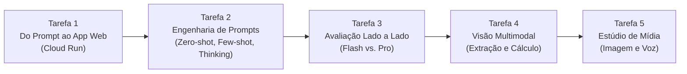

# Guia Didático Passo a Passo: GSP1154 — Get Started with Agent Studio

> [!IMPORTANT]
> **Dica de Ouro para o "Check my progress":** Embora todas as explicações e instruções deste guia estejam em português para facilitar seu aprendizado, **mantenha os nomes dos prompts, modelos, regiões e textos copiados exatamente em inglês** conforme os blocos de código abaixo. O avaliador automático do Google Skills verifica os nomes exatos salvos na região `us-central1`.

---

## Visão Geral e Contexto de Negócio

### O que é a Agent Platform e o Agent Studio?
A **Agent Platform** (evolução do Vertex AI) é a plataforma completa de Machine Learning e IA Generativa do Google Cloud. Dentro dela, o **Agent Studio** funciona como um ambiente visual de prototipagem rápida: ele permite testar, ajustar, comparar modelos (como a família **Gemini**) e até publicar aplicações funcionais diretamente pelo navegador, **sem precisar escrever código** em Python ou configurar APIs manualmente.

### Qual é o nosso cenário neste laboratório?
Você assumirá o papel de um especialista ajudando uma **companhia de seguros** a modernizar seus processos de **subscrição de risco (*underwriting*)** e **análise de sinistros (*claims*)**. Seguradoras lidam diariamente com textos não estruturados (e-mails, notas de clientes, relatórios de vistoria e imagens). Ao longo das 5 tarefas, você transformará ideias de prompts em ferramentas reais para resolver esses problemas.



---

## Configuração Inicial e Login no Ambiente

> [!NOTE]
> **Por que usar uma janela anônima?** O laboratório cria uma conta temporária gratuita no Google Cloud com créditos próprios. Usar uma janela anônima (*Incognito*) evita que o navegador misture sua conta pessoal do Gmail com a conta de estudante (`@qwiklabs.net`), prevenindo erros de permissão ou cobranças acidentais.

1. Clique no botão **Start Lab** na página do Google Skills.
2. Clique com o botão direito em **Open Google Cloud console** e selecione **Abrir link em uma janela anônima** (*Incognito*).
3. Faça login utilizando as credenciais temporárias fornecidas no painel lateral do seu laboratório:
   * **Username:** *(ex: `student-01-...@qwiklabs.net`)*
   * **Password:** *(copie a senha do painel do seu lab)*
4. Aceite os termos de serviço e não adicione opções de recuperação ou verificação em duas etapas.

---

## Tarefa 1: Criar aplicações a partir de prompts (*Create applications from prompts*)

### 🎓 O que estamos fazendo e para que serve?
* **O que será feito:** Vamos criar um assistente de análise de risco para avaliadores de seguros (*underwriters*), configurar suas regras de comportamento e implantá-lo como um aplicativo web acessível por qualquer navegador usando o **Cloud Run**.
* **Para que serve na prática:** Em projetos reais, validar uma ideia de IA com a equipe de negócios costumava exigir semanas de desenvolvimento de front-end e back-end. Com o Agent Studio + Cloud Run, você transforma um prompt em um **protótipo funcional (MVP)** em poucos cliques para que clientes ou gestores possam testar o chatbot imediatamente.
* **Conceitos-chave:**
  * **System Instructions (Instruções do Sistema):** Definem o "papel" (persona), o tom de voz e as regras estritas que o modelo deve obedecer antes mesmo de ler a mensagem do usuário (ex: *"Não invente detalhes; baseie-se apenas nas notas fornecidas"* — essencial para evitar alucinações em análises de risco).
  * **Model Settings (Configurações do Modelo):** Painel onde escolhemos o cérebro da aplicação (aqui, o `gemini-3.8-flash`, ideal para respostas rápidas e eficientes) e a região de processamento.
  * **Cloud Run:** Serviço *serverless* (sem servidor para gerenciar) do Google Cloud que empacota seu prompt em uma interface web de chat pronta para uso.

---

### 1.1. Criar e Configurar o Prompt
1. No menu de navegação do Google Cloud Console (ícone `☰` no canto superior esquerdo), acesse **Agent Platform > Studio**.
2. No canto superior esquerdo do Studio, clique em **+ New > Chat**.
3. No canto superior direito, clique em **Untitled Prompt** e renomeie exatamente para:
   ```text
   Insurance Risk Summary - Prototype
   ```
4. No campo **System instructions**, cole a instrução abaixo *(ela diz ao modelo para agir como um assistente de subscrição objetivo que nunca inventa dados)*:
   ```text
   You are an expert AI assistant for an insurance underwriting department. Your primary goal is to help underwriters by accurately and concisely summarizing client information and highlighting potential risk factors. Maintain a professional and objective tone. Focus only on the information provided in the prompt. Do not invent details.
   ```
5. Na área principal de **Prompt**, cole as notas do cliente *"SafeHarbor Warehousing"* *(pedindo um resumo das medidas de segurança existentes e uma lista em tópicos de possíveis riscos ou dúvidas para o avaliador)*:
   ```text
   Customer Notes for 'SafeHarbor Warehousing': "The applicant is seeking coverage for their 50,000 sq ft warehouse. The business is 5 years old. The building is a concrete tilt-up structure, originally built in 2010. They store a variety of non-hazardous dry goods. Fire safety measures include a full sprinkler system, a centrally monitored fire alarm, and documented annual inspections by a certified third party. Security measures include a 24/7 centrally monitored burglar alarm, comprehensive security camera coverage of the interior and exterior, a fully fenced perimeter, and nightly patrols by a contracted security guard service. The company reports no major property or liability losses in their 5-year history. They have specifically asked to ensure their new automated shelving and retrieval system, installed last month, is adequately covered under the policy." Your Task: 1. Briefly summarize the key details of the 'SafeHarbor Warehousing' business and its existing safety measures. 2. Based *only* on the notes provided, identify any immediate questions an underwriter should ask or potential risk factors they should consider further. Present the summary first, then the questions/risk factors as bullet points.
   ```
6. No painel **Model settings** (à direita):
   * **Model:** Selecione `gemini-3.8-flash` (em *Model > Gemini > gemini-3.8-flash*).
   * **Region:** Certifique-se de que está em `Global`.
7. Clique no botão **Submit** (seta / Enter) e analise a resposta gerada. Veja como o modelo separou o resumo das perguntas sobre o novo sistema automatizado de prateleiras.
   * *Nota: Se ocorrer o erro "429 Quota Exhausted", aguarde 1 minuto e envie novamente.*
8. No canto superior direito (ao lado do nome do prompt), clique em **Save**.
9. Na caixa de diálogo que abrir, confirme que a **Region** de salvamento é `us-central1` e clique em **Save**. *(O primeiro salvamento pode levar alguns instantes).*

### 1.2. Implantar como Aplicação Web no Cloud Run
1. Após salvar, no menu superior direito, clique no ícone **Deploy > Cloud Run > Deploy as app**.
2. Na janela *"Create a web app from the current prompt"*:
   * Em **Access control**, selecione **Allow public access** *(permite abrir o app direto no navegador para fins de teste)*.
   * Marque a caixa de confirmação (*Acknowledgement*) para implantação pública.
   * Clique em **Create App**.

> [!WARNING]
> **Por que a implantação pode falhar na 1ª tentativa?** Quando o lab inicia, as permissões internas do serviço de compilação (*Cloud Build*) ainda estão sendo propagadas em segundo plano. Se aparecer o status **Failed** na janela *Manage web app*:
> 1. Aguarde cerca de **1 minuto**.
> 2. Clique em **Update app** na janela *Manage web app* e depois em **Confirm**.

3. Quando a implantação terminar, clique no botão **Open** dentro da caixa *Manage web app*.
4. Uma nova aba abrirá com o seu aplicativo web (*Welcome to Vertex AI Gen AI App!*). No campo **"Type a message..."** na parte inferior, teste o assistente com um novo cliente (uma frota de vans de entrega):
   ```text
   New Customer Inquiry: "Applicant 'Coastal Goods Delivery' has a fleet of 10 delivery vans, all equipped with GPS and telematics. They operate within a 100-mile radius of their depot. Drivers undergo annual safety training. They had one minor fender bender last year, no injuries, $1500 damages. What are the primary risk considerations?" Please summarize key points and identify potential risks.
   ```
5. Clique na seta de envio. Observe que o aplicativo web já aplica automaticamente as *System Instructions* que você definiu lá no Studio!
6. Volte à página do lab e clique em **Check my progress** para validar a **Tarefa 1**.

---

## Tarefa 2: Criar prompts eficazes (*Design effective prompts*)

### 🎓 O que estamos fazendo e para que serve?
* **O que será feito:** Vamos extrair dados estruturados (número da apólice, nome, data, valor do dano) a partir de mensagens informais de sinistro usando duas abordagens: **Zero-shot** e **Few-shot**. Depois, vamos experimentar como os parâmetros de **Thinking level** (nível de raciocínio) e **Output token limit** (limite de tokens) alteram a geração criativa.
* **Para que serve na prática:** Quando um sistema de software precisa ler textos humanos e salvar no banco de dados, a resposta da IA precisa seguir um formato rigoroso e previsível. A engenharia de prompts garante que o modelo extraia os dados exatos sem texto desnecessário.
* **Conceitos-chave:**
  * **Zero-shot Prompting:** Pedir para o modelo realizar uma tarefa dando apenas a instrução, **sem fornecer exemplos prévios**. É rápido de escrever, mas pode variar na formatação.
  * **Few-shot Prompting:** Fornecer **exemplos de Entrada (Input) e Saída ideal (Output)** antes de pedir a tarefa real. Isso ensina ao modelo exatamente o padrão visual e o nível de detalhe que você espera.
  * **Thinking Level (Nível de Raciocínio):** Os modelos Gemini mais recentes calibram parâmetros clássicos (como Temperatura) automaticamente e oferecem o controle de *Thinking level* (`Low`, `Medium`, `High`). O nível `Low` responde quase instantaneamente (ótimo para extração direta de dados), enquanto `High` faz o modelo "pensar passo a passo" antes de responder (ótimo para problemas complexos ou escrita criativa elaborada).
  * **Output Token Limit:** Define o teto máximo de tokens (pedaços de palavras, incluindo o raciocínio interno e o texto final) que o modelo pode gerar, controlando custos e tamanho da resposta.

---

### 2.1. Zero-Shot Prompting (Extração sem Exemplos)
1. Feche a aba do aplicativo web da Tarefa 1 e volte ao **Agent Studio** no Console. *(Se aparecer um aviso ao sair do prompt anterior, clique em **Exit without saving** e **Continue**)*.
2. No canto superior esquerdo, selecione **+ New > Chat**.
3. Renomeie o prompt (`Untitled Prompt`) para:
   ```text
   Insurance Claim Data Extraction
   ```
4. No campo **System instructions**, cole a regra que instrui o modelo a extrair dados no formato `chave: valor` e escrever `"Not found"` caso algum dado não exista:
   ```text
   You are an AI assistant specializing in parsing and extracting specific data points from unstructured insurance claim notifications. Your goal is to identify and list key information accurately. If a piece of information is not found, clearly state "Not found". Output the extracted information in a key: value format, with each key on a new line.
   ```
5. Na área principal de **Prompt**, cole a nota informal sobre o incêndio na cozinha da Sra. Eleanor Vance:
   ```text
   Claim Notification Received: "Hi team, just got a call from Mrs. Eleanor Vance, policy #POL458892. She reported a kitchen fire that occurred on May 12th, 2025, around 3 PM. The main damage seems to be to the oven and surrounding cabinets. She mentioned smoke damage in the kitchen and dining area too. She thinks the total damage might be around $7,500. Her contact is 555-0123. No injuries reported, thankfully." Extract the following: - Policy Number - Claimant Name - Date of Loss - Time of Loss - Type of Loss - Brief Description of Damage - Estimated Loss Amount - Injuries Reported
   ```
6. Em **Model settings**:
   * **Model:** `gemini-3.8-flash`
   * **Thinking level:** `Low` *(como é apenas extração direta, não precisamos de raciocínio profundo)*
   * **Output token limit:** `2048`
   * **Region:** `Global`
7. Clique em **Submit** (Enter) e observe o resultado do seu primeiro teste *zero-shot*.

### 2.2. Few-Shot Prompting (Ensinando pelo Exemplo)
Agora vamos ensinar ao modelo o padrão exato de resposta usando o recurso estruturado de **Examples**.

1. No canto superior esquerdo, selecione **+ New > Chat**.
2. Na parte inferior da seção de Prompt, clique no botão **`+`** e selecione **Example**.
3. Na janela **Examples** que abrir, vamos cadastrar um caso resolvido (do cliente John Sterling) como gabarito para o modelo:
   * **INPUT:**
     ```text
     Claim Notification Received: "Email from John Sterling (policy POL77521) re: water damage at his shop. Happened sometime last night, May 10th, 2025. A pipe burst in the ceiling. Stockroom is flooded, some damage to inventory. He's not sure on the cost yet, maybe $5k-$10k? No one was there, so no injuries." Extract the following: - Policy Number - Claimant Name - Date of Loss - Time of Loss - Type of Loss - Brief Description of Damage - Estimated Loss Amount - Injuries Reported
     ```
   * **OUTPUT:**
     ```text
     Policy Number: POL77521 Claimant Name: John Sterling Date of Loss: May 10th, 2025 Time of Loss: Night Type of Loss: Water damage Brief Description of Damage: Pipe burst in ceiling, stockroom flooded, some damage to inventory. Estimated Loss Amount: $5,000 - $10,000 Injuries Reported: No
     ```
4. Clique em **Add examples** para salvar o gabarito e voltar ao prompt principal.
5. Como você abriu um novo chat, cole novamente as **System instructions**:
   ```text
   You are an AI assistant specializing in parsing and extracting specific data points from unstructured insurance claim notifications. Your goal is to identify and list key information accurately. If a piece of information is not found, clearly state "Not found". Output the extracted information in a key: value format, with each key on a new line.
   ```
6. No campo **`{Input} Write value here`**, cole a nota da Eleanor Vance que queremos processar agora:
   ```text
   Claim Notification Received: "Hi team, just got a call from Mrs. Eleanor Vance, policy #POL458892. She reported a kitchen fire that occurred on May 12th, 2025, around 3 PM. The main damage seems to be to the oven and surrounding cabinets. She mentioned smoke damage in the kitchen and dining area too. She thinks the total damage might be around $7,500. Her contact is 555-0123. No injuries reported, thankfully."
   ```
7. No campo **Type a prompt**, insira o comando de extração:
   ```text
   Extract the following data points from the provided claim notification: - Policy Number - Claimant Name - Date of Loss - Time of Loss - Type of Loss - Brief Description of Damage - Estimated Loss Amount - Injuries Reported
   ```
8. Em **Model settings**:
   * **Model:** `gemini-3.8-flash`
   * **Thinking level:** `Low`
   * **Output token limit:** `2048`
   * **Region:** `Global`
9. Clique em **Submit** (Enter). Compare como a resposta agora segue fielmente o estilo de formatação do exemplo fornecido!
10. Se o prompt não tiver sido salvo automaticamente, clique em **Save** no canto superior direito (confirmando a região `us-central1`).

### 2.3. Experimentando Configurações do Modelo (*Thinking Level* e *Token Limit*)
Vamos observar na prática como a profundidade de raciocínio e o limite de tokens afetam uma tarefa criativa.

1. No canto superior esquerdo, selecione **+ New > Chat**.
2. Renomeie o prompt para:
   ```text
   Insurance Story
   ```
3. Na caixa de prompt, cole o pedido para escrever o primeiro parágrafo de uma história sobre um sinistro bizarro enviado por um app futurista de IA:
   ```text
   Write the *first paragraph* of a short story about a homeowner who just used a futuristic AI insurance app to file a claim. The claim was for a bizarre and unexpected incident.
   ```
4. **Experimento 1 — Thinking level (`Low` vs `High`):**
   * Defina **Thinking level** como `Low` e clique em **Submit**. Note a velocidade quase imediata.
   * Agora altere **Thinking level** para `High` e envie o mesmo prompt novamente. Clique no resumo de raciocínio (*thinking trace*) que aparece acima da resposta para ver como o modelo planejou a cena e os detalhes criativos antes de redigir o parágrafo!
5. **Experimento 2 — Output token limit (`500` vs `65535`):**
   * Altere **Output token limit** para um número pequeno, como `500`, e clique em **Submit**. Observe como um teto curto de tokens limita ou interrompe a geração (já que a contagem inclui os tokens de pensamento + texto final).
   * Restaure o **Output token limit** para o máximo padrão (`65535`).
6. **Conheça também as outras ferramentas do painel (apenas leitura):**
   * **Structured outputs:** Força a resposta a seguir um esquema estrito (como JSON), ideal para integração direta com APIs.
   * **Grounding: Google Search:** Conecta o modelo à Pesquisa Google para responder com fatos públicos em tempo real.
   * **Grounding: Your data:** Conecta o modelo aos documentos internos da sua empresa (RAG / Agent Platform Search).
7. Clique em **Save** (região `us-central1`) caso não tenha salvo automaticamente.
8. Clique em **Check my progress** na página do lab para validar a **Tarefa 2**.

---

## Tarefa 3: Engenharia e gerenciamento de prompts (*Engineer and manage prompts*)

### 🎓 O que estamos fazendo e para que serve?
* **O que será feito:** Utilizaremos a ferramenta **Compare** do Agent Studio para colocar dois prompts lado a lado e testar três variáveis: (1) mudança nas *System Instructions*, (2) mudança no *Thinking level* (`Low` vs `High`), e (3) comparação entre um modelo rápido (`gemini-3.8-flash`) e um modelo avançado de raciocínio profundo (`gemini-3.1-pro-preview`) diante de regras complexas de subscrição.
* **Para que serve na prática:** Na engenharia de prompts profissional, você nunca adivinha se uma alteração melhorou ou piorou o prompt — você compara lado a lado com o mesmo texto de entrada. Além disso, aprender a escolher entre o modelo **Flash** (mais barato e ultrarrápido para tarefas simples) e o **Pro** (mais preciso para raciocínio lógico encadeado e regras de negócio complexas) é fundamental para equilibrar custo e qualidade.

---

### 3.1. Criar o Prompt Base
1. No canto superior esquerdo, clique em **+ New > Chat**.
2. Renomeie o prompt para:
   ```text
   Insurance Risk Factor Identification
   ```
3. No campo **System instructions**, insira:
   ```text
   You are an insurance risk analyst assistant. Your task is to identify potential risk factors from a given scenario. Be concise.
   ```
4. Na área principal de **Prompt**, cole o cenário do restaurante *"The Fiery Grill"* (que possui forno a lenha, sistema de supressão de incêndio ainda não certificado, palco elevado com música ao vivo e estacionamento com manobrista/valet):
   ```text
   Scenario: "The applicant, 'The Fiery Grill,' is a new upscale restaurant specializing in wood-fired oven pizzas and open-flame grilling. They have installed a brand new, custom-built fire suppression system for their cooking area, but it has not yet been certified by a third party. The restaurant plans to feature live acoustic music on weekend evenings and has a small, raised stage area. They also want to offer valet parking." Based on this scenario, list three primary risk factors an underwriter should consider.
   ```
5. Em **Model settings**:
   * **Model:** `gemini-3.8-flash`
   * **Thinking level:** `Low`
   * **Region:** `Global`
6. Clique em **Submit** (Enter) e veja a lista concisa de 3 fatores de risco.
7. Se não tiver sido salvo automaticamente, clique em **Save** (região `us-central1`).
8. Abaixo da resposta gerada (ou no menu de três pontos `⋮` no canto superior direito), clique em **Compare**.

### 3.2. Comparação 1: O impacto das System Instructions
Vamos testar como pedir "estratégias de mitigação" nas instruções do sistema torna a resposta muito mais útil para o avaliador.

1. Na tela de comparação dividida, vá até a caixa **System instructions do painel da DIREITA** e atualize para:
   ```text
   You are an expert insurance risk analyst assistant. Your task is to identify potential risk factors from a given scenario. For each risk factor, also briefly suggest a potential mitigation strategy or question for the underwriter. Be clear and structured.
   ```
2. Na caixa de prompt na parte inferior da página, cole e envie o mesmo cenário:
   ```text
   Scenario: "The applicant, 'The Fiery Grill,' is a new upscale restaurant specializing in wood-fired oven pizzas and open-flame grilling. They have installed a brand new, custom-built fire suppression system for their cooking area, but it has not yet been certified by a third party. The restaurant plans to feature live acoustic music on weekend evenings and has a small, raised stage area. They also want to offer valet parking." Based on this scenario, list three primary risk factors an underwriter should consider.
   ```
3. Compare os dois lados: enquanto o lado esquerdo apenas lista os riscos, o lado direito já entrega perguntas práticas e ações de mitigação para cada risco!

### 3.3. Comparação 2: O impacto do Thinking Level (`Low` vs `High`)
Agora vamos deixar as instruções iguais nos dois lados e mudar apenas a profundidade de raciocínio.

1. Reverta as **System instructions do painel da DIREITA** para ficarem idênticas às da esquerda:
   ```text
   You are an insurance risk analyst assistant. Your task is to identify potential risk factors from a given scenario. Be concise.
   ```
2. No painel da **DIREITA**, abra **Model settings**, mantenha `gemini-3.8-flash` e altere o **Thinking level** para `High`.
3. Na caixa de prompt inferior, envie novamente:
   ```text
   Scenario: "The applicant, 'The Fiery Grill,' is a new upscale restaurant specializing in wood-fired oven pizzas and open-flame grilling. They have installed a brand new, custom-built fire suppression system for their cooking area, but it has not yet been certified by a third party. The restaurant plans to feature live acoustic music on weekend evenings and has a small, raised stage area. They also want to offer valet parking." Based on this scenario, list three primary risk factors an underwriter should consider.
   ```
4. Observe como o nível `High` analisa interações mais sutis entre os fatores de risco antes de resumir a resposta.

### 3.4. Comparação 3: `gemini-3.8-flash` (Low) vs `gemini-3.1-pro-preview` (High)
Agora vamos submeter uma regra de negócio complexa (com hierarquia de Classes A, B e C, fatores agravantes e exceções) para ver a diferença de precisão analítica entre os modelos **Flash** e **Pro**.

1. No **painel da DIREITA**, abra **Model settings** e configure:
   * **Model:** `gemini-3.1-pro-preview`
   * **Thinking level:** `High`
2. No **painel da ESQUERDA**, abra **Model settings** e configure:
   * **Model:** `gemini-3.8-flash`
   * **Thinking level:** `Low`
3. Na caixa de prompt inferior, envie este cenário com diretrizes estritas de subscrição:
   ```text
   Scenario: "The applicant, 'The Fiery Grill,' is an upscale restaurant specializing in wood-fired ovens and open-flame grilling. They have a brand new, custom-built fire suppression system, but it has not been certified by a third party. The restaurant will feature live acoustic music on a small, raised stage. They also want to offer valet parking, managed by their own staff. The applicant has no prior business history." Underwriting Guidelines: Priority Hierarchy: Liability risks are classed as: - Class A (Critical): Fire, structural failure, failure of safety systems. - Class B (Standard): General premises liability (e.g., slip-and-fall). - Class C (Niche): Auto/Vehicle liability. Compounding Factors: A "compounding risk" (a condition that makes another risk worse) must be elevated to the highest priority. Inexperience: Lack of prior business history is a general negative factor but does not create a primary risk on its own. Auto Liability: Class C risks (Valet) are only considered a primary risk if the applicant is using an unvetted, third-party contractor. Task: Based on the scenario and the underwriting guidelines, identify the single, #1 highest-priority risk. Then, write a 2-sentence justification that explains why it is the #1 risk, citing the specific guideline(s) that apply.
   ```
4. **Analise a diferença:** O `gemini-3.8-flash` (esquerda) tende a dar uma resposta mais geral (ex: "Incêndio"), enquanto o `gemini-3.1-pro-preview` (direita) isola com precisão cirúrgica o **sistema de supressão de incêndio não certificado** como um fator agravante (*compounding factor*) de um risco Classe A, citando exatamente as diretrizes do prompt.
5. No painel da **DIREITA** (`gemini-3.1-pro-preview`), clique em **Select & go back** para escolher essa configuração vencedora e voltar ao editor principal.
6. Clique em **Save** (caso necessário) e depois clique em **Check my progress** no lab para validar a **Tarefa 3**.

---

## Tarefa 4: Usar prompts multimodais com o Gemini (*Use multimodal prompts with Gemini*)

### 🎓 O que estamos fazendo e para que serve?
* **O que será feito:** Vamos importar uma imagem armazenada no Cloud Storage (`timetable.png`, que mostra um painel de horários de voos) e pedir ao Gemini para: (1) dar um título, descrever a cena e extrair toda a tabela em texto estruturado; e (2) calcular a porcentagem exata de voos que partem antes das 11h30 da manhã.
* **Para que serve na prática:** A **multimodalidade nativa** do Gemini permite que ele compreenda imagens, documentos digitalizados, fotos de sinistros ou tabelas complexas junto com texto. Em vez de usar um sistema antigo de OCR (leitura óptica) separado de outro modelo de cálculo, o próprio Gemini enxerga a imagem, extrai os dados e realiza o raciocínio matemático sobre eles em uma única conversa.

---

1. No canto superior esquerdo do Agent Studio, selecione **+ New > Chat**.
2. Renomeie o prompt para:
   ```text
   Timetable Image Analysis
   ```
3. No painel **Model settings** (à direita):
   * **Model:** `gemini-3.8-flash`
   * **Region:** `Global`
4. Na parte inferior esquerda da caixa de prompt, clique no botão **`+`** e selecione **Import from Cloud Storage**.
5. Na janela que abrir, clique no bucket pré-criado do seu lab (ex: `qwiklabs-gcp-...-bucket`), selecione o arquivo **`timetable.png`** e clique em **Select**.
6. Ao lado da imagem inserida no campo de prompt, cole as 3 instruções de extração visual:
   ```text
   1. Provide a concise title for this image (under 5 words). 2. Describe the image in one or two sentences. 3. Extract all visible text from the image. Present the flight schedule as a clearly formatted list with columns for "Time" and "City".
   ```
7. Clique em **Submit** (Enter) e veja como o Gemini leu todos os horários e destinos diretamente da foto do painel.
8. Agora, vamos exigir **raciocínio matemático sobre os dados extraídos da imagem**. Envie o seguinte prompt no mesmo chat:
   ```text
   Based on the flight schedule shown in the image, what percentage of the listed flights depart before 11:30 AM? Show your calculation if possible.
   ```
9. Clique em **Submit** (Enter) e analise o passo a passo da conta feita pelo modelo.
10. **Teste o impacto do Thinking level no cálculo multimodal:**
    * No painel **Model settings**, mude o **Thinking level** para `Low` e reenvie a mesma pergunta da etapa 8:
      ```text
      Based on the flight schedule shown in the image, what percentage of the listed flights depart before 11:30 AM? Show your calculation if possible.
      ```
    * Observe a velocidade e o nível de detalhe. Se quiser, mude para `High` e envie novamente para ver como níveis mais altos verificam cada voo da lista antes de fechar o cálculo percentual.
11. Se o prompt não tiver sido salvo automaticamente, clique em **Save** no canto superior direito (confirmando a região `us-central1`).
12. Clique em **Check my progress** na página do lab para validar a **Tarefa 4**.

---

## Tarefa 5: Gerar mídia no Agent Studio (*Generate media in Agent Studio*)

### 🎓 O que estamos fazendo e para que serve?
* **O que será feito:** Vamos sair da geração apenas de texto e explorar as ferramentas de criação de mídia da Agent Platform: primeiro gerando uma imagem fotorrealista a partir de texto (*Text-to-Image*) com o modelo **Nano Banana 2**, e depois (opcionalmente) gerando voz sintetizada natural (*Text-to-Speech*) com os modelos **Gemini TTS / Chirp 3**.
* **Para que serve na prática:** Empresas utilizam essas ferramentas no mesmo console para criar ativos visuais de campanhas, ilustrações de produtos, protótipos de design e locuções em áudio para assistentes virtuais de atendimento ao cliente.

---

### 5.1. Gerar uma Imagem (Obrigatório para pontuação)
1. No canto superior esquerdo, selecione **+ New > Image**.
2. Renomeie o prompt para:
   ```text
   Honeybee Image Generation
   ```
3. No painel **Model settings** (à direita):
   * Clique no seletor de modelo e altere de `Nano Banana 2.1` para **`Nano Banana 2`**.
   * Certifique-se de que a **Region** está como `Global`.
4. Na caixa de prompt na parte inferior, cole a descrição detalhada da imagem *(especificando o assunto principal, o estilo fotorrealista e o desfoque de fundo)*:
   ```text
   A close-up, photorealistic image of a single honeybee collecting pollen from a vibrant purple lavender flower, with a softly blurred garden background.
   ```
5. Clique em **Submit** (Enter) e aguarde alguns segundos até que a imagem gerada apareça na tela.
6. Se o prompt não tiver sido salvo automaticamente, clique em **Save** no canto superior direito (confirmando a região `us-central1`).
7. Clique em **Check my progress** na página do lab para validar a **Tarefa 5**.

### 5.2. Gerar Voz com Speech (Exploração Opcional)
*Esta etapa permite conhecer a síntese de voz de alta definição do Google Cloud.*

1. No canto superior esquerdo, selecione **+ New > Speech** (ícone de microfone).
2. Caso apareça um aviso pedindo para ativar a API (*Cloud Text-to-Speech API*), clique em **Enable** e aguarde alguns segundos.
3. No campo de texto na parte inferior, digite a frase que deseja transformar em voz:
   ```text
   Welcome to the world of generative AI on Google Cloud
   ```
4. No painel **Model settings** (à direita):
   * **Task:** `Text-to-speech`
   * **Model:** Escolha `Gemini 3.1 Flash TTS (Preview)` ou `Chirp 3: HD Voices`
   * **Language:** `English (United States)`
   * **Voice:** Escolha uma voz da lista (ex: `Achernar (Female)`)
5. Clique em **Submit** e dê *play* no player de áudio gerado para ouvir o resultado.

---

## Resumo de Revisão e Verificação Rápida (Checklist Final)

Se algum botão **Check my progress** não tiver ficado verde, confira na tabela abaixo o que cada tarefa avalia e o que você aprendeu nela:

| Tarefa | Nome Exato do Prompt (`us-central1`) | Modelo Utilizado | O que o Avaliador Verifica | Conceito Aprendido |
| :--- | :--- | :--- | :--- | :--- |
| **Task 1** | `Insurance Risk Summary - Prototype` | `gemini-3.8-flash` | Prompt salvo + App implantado no Cloud Run (`Deploy as app`) | Prototipagem rápida de chatbots serverless com *System Instructions* |
| **Task 2** | `Insurance Claim Data Extraction` e `Insurance Story` | `gemini-3.8-flash` | Prompts salvos com testes de *Zero-shot*, *Few-shot* e *Thinking level* | Extração de dados estruturados com exemplos e controle de raciocínio/tokens |
| **Task 3** | `Insurance Risk Factor Identification` | `gemini-3.8-flash` & `gemini-3.1-pro-preview` | Uso do recurso `Compare` + clique em `Select & go back` no painel direito | Avaliação comparativa lado a lado entre modelos Flash (velocidade) e Pro (precisão lógica) |
| **Task 4** | `Timetable Image Analysis` | `gemini-3.8-flash` | Importação de `timetable.png` do Cloud Storage + execução dos prompts | Visão multimodal combinando leitura óptica (OCR) e cálculo matemático |
| **Task 5** | `Honeybee Image Generation` | `Nano Banana 2` | Geração da imagem em `+ New > Image` + salvamento do prompt | Síntese de mídia (*Text-to-Image* e *Text-to-Speech*) no Media Studio |
