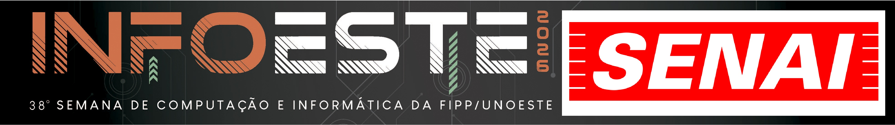
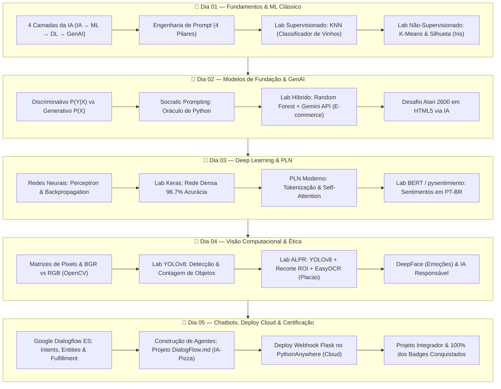

<div align="center">



<br>

# 🚀 Programação em Inteligência Artificial Generativa
### 🎓 SENAI-SP • Infoeste • Trilha Google Cloud Skills Boost

<p align="center">
  <strong>Capacitação Profissional Prática em IA, Machine Learning, Deep Learning, Visão Computacional, LLMs e Agentes Conversacionais.</strong>
</p>

<!-- Badges Oficiais e Tecnologias -->
<p align="center">
  
  
  
  
  
</p>

<p align="center">
  
  
  
  
  
  
  
  
  
  
  
</p>

[🌐 Portal de Slides (GitHub Pages)](https://irineufrancisco.github.io/IASkillBoostInfoeste/) •
[📚 Plano de Ensino Mestre](./plano_de_aula_ia_generativa.md) •
[🎯 Trilha Google Cloud](#-trilha-oficial-google-cloud-skills-boost) •
[📅 Cronograma 5 Dias](#-cronograma-e-conteúdo-programático) •
[💻 Como Executar](#-como-executar-os-laboratórios) •
[📂 Estrutura do Repositório](#-estrutura-do-repositório)

---

</div>

> ### 🌐 Portal de Apresentações Online
> Acesse todas as apresentações interativas renderizadas no navegador via **GitHub Pages**:  
> 👉 **[https://irineufrancisco.github.io/IASkillBoostInfoeste/](https://irineufrancisco.github.io/IASkillBoostInfoeste/)**  
> *(Caso o GitHub exiba o código HTML puro ao clicar em links de arquivos, utilize o endereço do GitHub Pages acima ou ative o Pages nas configurações do repositório).*

## 📌 Sobre o Curso

O curso **Programação em Inteligência Artificial Generativa** foi estruturado pelo **SENAI-SP** no contexto da **Infoeste**, oferecendo uma imersão intensiva de **20 horas (5 encontros de 4 horas)** que une **fundamentos matemáticos**, **laboratórios práticos no Google Colab** e a certificação digital internacional através da **Trilha Oficial Google Cloud Skills Boost**.

O modelo pedagógico adota o formato **intercalado**:
1. 💡 **Exposição Conceitual e Visual:** Slides interativos e ricos em design pedagógico.
2. 🧪 **Prática de Código (Hands-on):** Implementação passo a passo de algoritmos de Machine Learning, Deep Learning, Visão Computacional, LLMs e Engenharia de Prompt no Google Colab e Python local.
3. 🏅 **Certificação Oficial:** Realização das atividades na plataforma Google Cloud Skills Boost, acumulando **4 badges oficiais** ao longo do curso.

---

## 🗺️ Mapa de Evolução do Conhecimento (5 Dias)



---

## 🏅 Trilha Oficial Google Cloud Skills Boost

Durante o curso, os estudantes realizam a trilha oficial:  
**[Beginner: Introduction to Generative AI Learning Path](https://www.cloudskillsboost.google/paths/118)**

| Dia | Atividade / Módulo | Conteúdo Central | Insígnia / Badge Oficial | Progresso |
| :---: | :--- | :--- | :---: | :---: |
| **01** | **Onboarding & Boas-Vindas** | Criação de perfil, validação de acesso e regras da plataforma | 🎓 *Setup Inicial* | Início |
| **02** | **Introduction to Generative AI** | Conceito de IA Generativa, Large Models e Diferenciação do ML Clássico |  | **25%** |
| **03** | **Introduction to Large Language Models** | Arquiteturas LLM, Casos de Uso, Prompt Tuning e Limitações |  | **50%** |
| **04** | **Introduction to Responsible AI** | Princípios de IA do Google, Mitigação de Viés, Segurança e Ética |  | **75%** |
| **05** | **Generative AI Fundamentals** | Consolidação completa da trilha e emissão do selo unificado |  | **100% 🏆** |

> 💡 **Nota Importante:** Para registrar o progresso e desbloquear os badges, é requisito assistir aos vídeos na íntegra e obter aproveitamento mínimo de 75% nos quizzes de avaliação.

---

## 📅 Cronograma e Conteúdo Programático

<details open>
<summary><h3>🔹 Dia 01 — Fundamentos de IA, Prompt Engineering, Machine Learning e Colab (4h)</h3></summary>

* **Foco:** Entender a taxonomia da IA, dominar a criação de prompts estruturados e implementar os primeiros modelos de aprendizado de máquina supervisionado e não-supervisionado.
* **Tópicos Abordados:**
  * As 4 Camadas da Inteligência Artificial: $\text{IA} \to \text{Machine Learning} \to \text{Deep Learning} \to \text{IA Generativa}$.
  * Diferença entre software determinístico clássico e aprendizado por indução estatística.
  * Engenharia de Prompt: Pilares (Persona, Contexto, Tarefa, Formato), *Zero-Shot*, *Few-Shot* e *Chain-of-Thought*.
  * Introdução e boas práticas no ambiente **Google Colab**.
* **Laboratórios Práticos:**
  * 🤖 **Lab 1.0 (Visão No-Code):** [Treinando sua Primeira Rede Neural com Teachable Machine](./Aula_01/lab_teachable_machine.md)
  * 🍷 **Lab 1.1 (Supervisionado):** [Classificador de Vinhos com KNN](./Aula_01/lab_vinhos_knn.md)
  * 🌸 **Lab 1.2 (Não Supervisionado):** [Agrupamento Florístico com K-Means](./Aula_01/lab_iris_kmeans.md)
* **Materiais da Aula:**
  * 🖥️ **Slides:** [Abrir Apresentação Online (GitHub Pages)](https://irineufrancisco.github.io/IASkillBoostInfoeste/Aula_01/slide_aula_01.html) • [Ver Código](./Aula_01/slide_aula_01.html)
  * 📖 [Apostila / Material de Estudo](./Aula_01/material_aula_01.md)
  * 📊 [Visualizações e Datasets](./Aula_01/)

</details>

---

<details open>
<summary><h3>🔹 Dia 02 — Modelos Discriminativos vs. Generativos, Prompt Socrático e Trilha 01 (4h)</h3></summary>

* **Foco:** Diferenciação probabilística entre modelos, técnicas avançadas de depuração e criação de pipelines híbridos conectando Machine Learning a LLMs.
* **Tópicos Abordados:**
  * Paradigma Matemático: $P(Y|X)$ (Discriminativo) vs. $P(X)$ / $P(X|Y)$ (Generativo).
  * Modelos de Fundação (*Foundation Models*): Gemini, GPT-4o, Claude 3.5 Sonnet, Llama 3.
  * Hiperparâmetros de inferência: Temperatura ($0.0$ a $1.2+$), Top-K, Top-P e penalidade de repetição.
* **Laboratórios Práticos:**
  * 🧙‍♂️ **Lab 2.1 (Socratic Prompting):** [O Oráculo de Python e o Código Amaldiçoado](./Aula_02/lab_oraculo_prompt_socratico.md)
  * 🛒 **Lab 2.2 (Pipeline Híbrido ML + LLM):** [Predição de Churn e Cupons com Gemini](./Aula_02/lab_ecommerce_churn_gemini.md)
  * 🕹️ **Lab 2.3 (Desafio de IA Generativa):** Recriação de um clássico do Atari 2600 em HTML5 Canvas utilizando prompts iterativos.
  * 🏅 **Trilha Google Cloud:** Conclusão da atividade *Introduction to Generative AI* (**1º Badge conquistado**).
* **Materiais da Aula:**
  * 🖥️ **Slides:** [Abrir Apresentação Online (GitHub Pages)](https://irineufrancisco.github.io/IASkillBoostInfoeste/Aula_02/slide_aula_02.html) • [Ver Código](./Aula_02/slide_aula_02.html)
  * 📖 [Apostila / Material de Estudo](./Aula_02/material_aula_02.md)
  * 🐍 [Scripts de Apoio (Prompt Engineering & LangChain)](./Aula_02/)

</details>

---

<details open>
<summary><h3>🔹 Dia 03 — Redes Neurais Profundas, PLN (BERT) e Trilha 02 (4h)</h3></summary>

* **Foco:** Entrar no universo do Deep Learning, entender como redes neurais aprendem e aplicar Processamento de Linguagem Natural com Transformers em língua portuguesa.
* **Tópicos Abordados:**
  * Do neurônio biológico ao Perceptron e Redes Neurais Densas (*Multilayer Perceptron*).
  * O ciclo de aprendizagem: *Forward Pass*, Funções de Perda (*Loss Function*), *Backpropagation* e Otimizadores (*Adam*, *SGD*).
  * PLN Moderno: Tokenização por subpalavras (*WordPiece*, *BPE*), Vetorização, Espaços Vetoriais e *Self-Attention*.
  * Arquitetura Transformers, modelos BERT, conceitos de RAG (*Retrieval-Augmented Generation*) e *Function Calling*.
* **Laboratórios Práticos:**
  * 🍎 **Lab 3.1A (Simulador Interativo):** Ajuste manual de sinapses no [Simulador de Redes Neurais](https://irineufrancisco.github.io/ExemploRedeNeural/).
  * 🧠 **Lab 3.1B (Deep Learning Keras):** [Redes Neurais Profundas com Keras](./Aula_03/lab_redes_neurais_keras.md) (elevando acurácia para 96.7%).
  * 💬 **Lab 3.2 (PLN com BERT):** [Análise de Sentimentos em Português com BERT](./Aula_03/lab_sentimentos_bert_pln.md) (testando negação, emojis e ironia).
  * 🏅 **Trilha Google Cloud:** Conclusão da atividade *Introduction to Large Language Models* (**2º Badge conquistado**).
* **Materiais da Aula:**
  * 🖥️ **Slides:** [Abrir Apresentação Online (GitHub Pages)](https://irineufrancisco.github.io/IASkillBoostInfoeste/Aula_03/slide_aula_03.html) • [Ver Código](./Aula_03/slide_aula_03.html)
  * 📖 [Apostila / Material de Estudo](./Aula_03/material_aula_03.md)
  * 🔬 [Infográficos e Análise de PLN](./Aula_03/)

</details>

---

<details open>
<summary><h3>🔹 Dia 04 — Visão Computacional (YOLOv8, ALPR, DeepFace), Ética e Trilha 03 (4h)</h3></summary>

* **Foco:** Processamento de imagens em matrizes multidimensionais, detecção de objetos em tempo real, reconhecimento facial e leitura de caracteres automotivos.
* **Tópicos Abordados:**
  * Representação digital de imagens: Matrizes de Pixels, canais de cores, BGR vs. RGB com OpenCV.
  * Classificação de Imagens vs. Detecção de Objetos (*Bounding Boxes* e *Confidence Scores*) vs. Segmentação.
  * Reconhecimento Facial, extração de marcos (*facial landmarks*) e análise de microexpressões.
  * Ética e IA Responsável: Vieses em conjuntos de treino, privacidade, LGPD e impactos na segurança pública.
* **Laboratórios Práticos:**
  * 🎯 **Lab 4.1 (YOLOv8 Detecção & Contagem):** [Detecção e Contagem de Objetos com YOLOv8](./Aula_04/lab_yolo_deteccao_objetos.md)
  * 🚗 **Lab 4.2 (ALPR Leitura de Placas):** [Sistema ALPR de Leitura de Placas Mercosul](./Aula_04/lab_alpr_reconhecimento_placas.md)
  * 😊 **Lab 4.3 (DeepFace):** Detecção de emoção dominante (*dominant_emotion*), idade aparente e gênero facial.
  * 🏅 **Trilha Google Cloud:** Conclusão da atividade *Introduction to Responsible AI* (**3º Badge conquistado**).
* **Materiais da Aula:**
  * 🖥️ **Slides:** [Abrir Apresentação Online (GitHub Pages)](https://irineufrancisco.github.io/IASkillBoostInfoeste/Aula_04/slide_aula_04.html) • [Ver Código](./Aula_04/slide_aula_04.html)
  * 📖 [Apostila / Material de Estudo](./Aula_04/material_aula_04.md)
  * 📓 [Notebooks Colab de YOLOv8 e Leitura de Placas](./Aula_04/)

</details>

---

<details open>
<summary><h3>🔹 Dia 05 — Chatbots Inteligentes com Dialogflow ES, Deploy Cloud e Trilha 04 (4h)</h3></summary>

* **Foco:** Arquitetura de Agentes Conversacionais de NLU, integração com webhooks em nuvem pública e encerramento da capacitação.
* **Tópicos Abordados:**
  * Componentes do **Google Dialogflow ES**: *Intents*, *Training Phrases*, *Entities* de sistema e personalizadas, *Slot Filling*, *Contextos* de entrada/saída e *Fulfillment*.
  * Integração de front-end com widget **Dialogflow Messenger**.
  * Configuração de microframework web **Flask** para atendimento a webhooks JSON.
  * Hospedagem e publicação de serviços na nuvem com **PythonAnywhere** (WSGI, Force HTTPS e rotas seguras).
* **Laboratórios Práticos:**
  * 🤖 **Lab 5.1 (Projeto DialogFlow.md):** [Agente Delivery IA-Pizza & Agendamento IA-Style](./Aula_05/DialogFlow.md) (Intents, Entities, Slot Filling e Contextos).
  * ☁️ **Lab 5.2 (Cloud Deployment):** [Deploy de Webhook Flask no PythonAnywhere](./Aula_05/lab_webhook_flask_pythonanywhere.md) (Fulfillment e Rich Cards).
  * 🛍️ **Projeto Integrador SIMI:** Apresentação da solução integrada *TechVision Smart Store*.
  * 🏅 **Trilha Google Cloud:** Finalização da 4ª atividade oficial (**100% da Trilha e 4 Badges alcançados**).
* **Materiais da Aula:**
  * 🖥️ **Slides:** [Abrir Apresentação Online (GitHub Pages)](https://irineufrancisco.github.io/IASkillBoostInfoeste/Aula_05/slide_aula_05.html) • [Ver Código](./Aula_05/slide_aula_05.html)
  * 📖 [Apostila / Material de Estudo](./Aula_05/material_aula_05.md)
  * 🌐 [Código do Servidor Webhook Flask](./Aula_05/flask_app.py)

</details>

---

## 🛠️ Stack Tecnológica & Ferramentas

| Categoria | Tecnologias e Bibliotecas |
| :--- | :--- |
| **Linguagem Principal** | `Python 3.10+` |
| **Ambientes de Execução** | `Google Colab (GPU/CPU)`, `VS Code`, `Jupyter Notebook` |
| **Modelos de Linguagem e APIs** | `Google Gemini API`, `Hugging Face Transformers`, `pysentimiento (BERT)` |
| **Machine Learning & Ciência de Dados** | `scikit-learn`, `NumPy`, `Pandas`, `Matplotlib`, `Seaborn` |
| **Deep Learning & Redes Neurais** | `TensorFlow`, `Keras`, `PyTorch` |
| **Visão Computacional** | `Ultralytics YOLOv8`, `OpenCV-Python`, `EasyOCR`, `DeepFace` |
| **Processamento de Linguagem Natural & Chatbots** | `Google Dialogflow ES`, `NLTK`, `Regex`, `Dialogflow Messenger` |
| **Serviços Web & Deploy Nuvem** | `Flask`, `PythonAnywhere (WSGI/HTTPS)`, `Google Cloud Platform` |

---

## 📂 Estrutura do Repositório

```plaintext
IASkillBoostInfoeste/
├── README.md                                    # Guia principal e documentação do repositório
├── plano_de_aula_ia_generativa.md               # Plano de aula pedagógico mestre (20 horas)
│
├── Aula_01/                                     # MÓDULO 01 — Fundamentos, Prompt, ML & Colab
│   ├── slide_aula_01.html                       # Apresentação interativa de slides
│   ├── material_aula_01.md                      # Apostila teórica e laboratórios práticos
│   ├── iris.csv                                 # Dataset florístico para clustering K-Means
│   └── *.png                                    # Gráficos (Matriz de confusão, Silhueta, Cotovelo)
│
├── Aula_02/                                     # MÓDULO 02 — Modelos de Fundação, Socratic Prompt & GenAI
│   ├── slide_aula_02.html                       # Apresentação interativa de slides
│   ├── material_aula_02.md                      # Apostila teórica e roteiros práticos
│   ├── ecommerce_clientes.csv                   # Dataset para modelo híbrido de churn
│   ├── aula02_prompt_engineering.py             # Script de teste de prompts estruturados
│   └── aula11_langchain_prompt_templates.py     # Exemplos de templates de prompt
│
├── Aula_03/                                     # MÓDULO 03 — Deep Learning, Keras, PLN & BERT
│   ├── slide_aula_03.html                       # Apresentação interativa de slides
│   ├── material_aula_03.md                      # Apostila completa de redes neurais e NLP
│   ├── Análise de Sentimentos.md                # Roteiro prático com pysentimiento / Transformers
│   └── rede_neural_curvas_treino.png            # Curvas de perda e acurácia do modelo
│
├── Aula_04/                                     # MÓDULO 04 — Visão Computacional, YOLOv8, OCR & Ética
│   ├── slide_aula_04.html                       # Apresentação interativa de slides
│   ├── material_aula_04.md                      # Apostila de Visão Computacional e Ética
│   ├── Detectar_objetos_em_fotos_v2.ipynb       # Notebook Colab de inferência com YOLOv8
│   ├── Detectar placa de carro_v3 (2).ipynb     # Notebook Colab de leitura de placas Mercosul
│   └── Aula Visão Computacional - Placas.md     # Roteiro passo a passo do pipeline ALPR
│
└── Aula_05/                                     # MÓDULO 05 — Dialogflow ES, Webhooks & Deploy Cloud
    ├── slide_aula_05.html                       # Apresentação interativa de slides
    ├── material_aula_05.md                      # Apostila de agentes conversacionais
    ├── flask_app.py                             # Servidor Flask pronto para PythonAnywhere
    ├── DialogFlow.md                            # Guia prático de configuração de intents/entities
    └── Integração Cantina SENAI.md              # Documentação de integração webhook e widget
```

---

## 💻 Como Executar os Laboratórios

### 1. No Google Colab (Recomendado para aulas práticas)
A maioria das atividades práticas pode ser executada diretamente no navegador sem necessidade de instalação local:
1. Acesse o [Google Colab](https://colab.research.google.com/).
2. Abra a aba **GitHub** e cole a URL do repositório: `https://github.com/IrineuFrancisco/IASkillBoostInfoeste`.
3. Selecione os notebooks desejados (ex: [Detectar_objetos_em_fotos_v2.ipynb](./Aula_04/Detectar_objetos_em_fotos_v2.ipynb)).
4. Para os notebooks de Visão Computacional e Deep Learning, ative a aceleração por hardware em:  
   `Ambiente de Execução` $\to$ `Alterar tipo de ambiente de execução` $\to$ **GPU T4**.

---

### 2. Ambiente Local (Clonando o repositório)

Caso deseje executar os scripts Python e os notebooks em sua máquina:

```bash
# 1. Clone o repositório
git clone https://github.com/IrineuFrancisco/IASkillBoostInfoeste.git

# 2. Acesse a pasta do projeto
cd IASkillBoostInfoeste

# 3. Crie e ative um ambiente virtual Python
python -m venv .venv

# No Windows:
.venv\Scripts\activate

# No Linux/macOS:
source .venv/bin/activate

# 4. Instale as bibliotecas essenciais
pip install numpy pandas scikit-learn matplotlib seaborn
pip install tensorflow keras torch torchvision
pip install ultralytics opencv-python easyocr deepface
pip install pysentimiento transformers google-generativeai flask
```

---

### 3. Visualizando os Slides Interativos (GitHub Pages)

Por padrão de segurança, o GitHub exibe arquivos `.html` como código-fonte em vez de executá-los. Para abrir as apresentações diretamente no navegador:

#### 🌐 Opção A — Acessar via GitHub Pages (Recomendado)
Acesse o portal do repositório ou os links diretos das aulas:
* 🚀 **[Portal Completo de Slides](https://irineufrancisco.github.io/IASkillBoostInfoeste/)**
* 📊 [Slides da Aula 01](https://irineufrancisco.github.io/IASkillBoostInfoeste/Aula_01/slide_aula_01.html)
* 📊 [Slides da Aula 02](https://irineufrancisco.github.io/IASkillBoostInfoeste/Aula_02/slide_aula_02.html)
* 📊 [Slides da Aula 03](https://irineufrancisco.github.io/IASkillBoostInfoeste/Aula_03/slide_aula_03.html)
* 📊 [Slides da Aula 04](https://irineufrancisco.github.io/IASkillBoostInfoeste/Aula_04/slide_aula_04.html)
* 📊 [Slides da Aula 05](https://irineufrancisco.github.io/IASkillBoostInfoeste/Aula_05/slide_aula_05.html)

> ⚙️ **Como ativar o GitHub Pages no seu repositório (em 3 passos):**
> 1. No topo do repositório no GitHub, clique em **Settings** (Configurações).
> 2. No menu lateral esquerdo, clique em **Pages**.
> 3. Em **Build and deployment** > **Branch**, selecione `main` e a pasta `/ (root)`. Clique em **Save**.  
> Em 1 minuto o site estará publicado automaticamente!

#### 💻 Opção B — Visualização Local
* Basta clonar o repositório ou baixar o arquivo `.html` e dar um duplo clique nele para abrir em qualquer navegador (Google Chrome, Edge, Firefox).

#### 🔗 Opção C — Prévia Imediata sem GitHub Pages (HTMLPreview)
* Caso o GitHub Pages ainda não esteja habilitado, é possível usar o serviço gratuito:  
  `https://htmlpreview.github.io/?https://github.com/IrineuFrancisco/IASkillBoostInfoeste/blob/main/Aula_01/slide_aula_01.html`

---

## 🎯 Projetos e Laboratórios de Destaque

| Projeto | Módulo | Tecnologias Principais | Descrição do Resultado |
| :--- | :---: | :--- | :--- |
| **Wine Classification & Iris Cluster** | `Aula 01` | `Scikit-Learn`, `KMeans`, `KNN` | Comparativo entre aprendizado supervisionado (72% acurácia) e clustering espacial com Método do Cotovelo. |
| **Previsão de Churn + Cupons GenAI** | `Aula 02` | `RandomForest`, `Gemini API`, `JSON` | Pipeline híbrido que identifica propensão de cancelamento e gera automaticamente mensagens persuasivas. |
| **Classificador Neural Profundo** | `Aula 03` | `TensorFlow`, `Keras Densa` | Rede neural profunda com regularização e padronização elevando a precisão da classificação para **96.7%**. |
| **Análise de Sentimentos em PT-BR** | `Aula 03` | `BERT`, `pysentimiento` | Modelo de linguagem baseado em Transformers avaliando ironias, negações e nuances linguísticas. |
| **Sistema ALPR de Leitura de Placas** | `Aula 04` | `YOLOv8`, `EasyOCR`, `OpenCV` | Pipeline de detecção veicular, recorte automático de placa Mercosul e OCR de alta fidelidade. |
| **Cantina SENAIBOT Cloud** | `Aula 05` | `Dialogflow ES`, `Flask`, `PythonAnywhere` | Chatbot com processamento de linguagem natural, slot filling e webhook publicado com HTTPS público. |

---

## 🤝 Créditos e Realização

* **Instrutor & Desenvolvedor de Conteúdo:** Irineu Francisco
* **Instituição de Ensino:** [SENAI-SP](https://sp.senai.br/)
* **Evento / Contexto:** [Infoeste](https://www.fipp.unoeste.br/infoeste/)
* **Parceria Tecnológica:** [Google Cloud Skills Boost](https://www.cloudskillsboost.google/)

---

<div align="center">

⭐ **Gostou do conteúdo? Deixe uma estrela neste repositório!** ⭐

<p align="center">
  <sub>Construído com dedicação para a formação de novos talentos em Inteligência Artificial.</sub>
</p>

</div>
