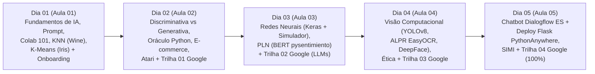

# 🧭 Plano de Aula Mestre — Programação em Inteligência Artificial Generativa (SENAI-SP)
**Unidade Curricular:** Programação em Inteligência Artificial Generativa (20 Horas — 5 Encontros de 4 Horas)  
**Formato Pedagógico:** **Intercalado (Conceitos Visuais + Laboratórios Práticos no Google Colab + Trilha Oficial Google Cloud Skills Boost)**  
**Trilha Oficial Integrada:** *Iniciante: programa de aprendizado Introdução à IA generativa* (*Beginner: Introduction to Generative AI Learning Path*)

---

## 🗺️ Visão Geral do Cronograma Intercalado (5 Dias)

---

## 📅 Detalhamento das Aulas, Laboratórios e Links Rápidos

### 🔹 Dia 01 — Aula 01 (4h): Introdução à IA, Engenharia de Prompt, Machine Learning e Onboarding
- **Apresentação de Slides:** [slide_aula_01.html](./Aula_01/slide_aula_01.html)
- **Material Didático Completo:** [material_aula_01.md](./Aula_01/material_aula_01.md)
- **Laboratórios e Roteiros:**
  1. **Lab 1.0 (No-Code / Visão):** [lab_teachable_machine.md](./Aula_01/lab_teachable_machine.md) — Treinando a Primeira Rede Neural com Google Teachable Machine.
  2. **Lab 1.1 (Supervisionado):** [lab_vinhos_knn.md](./Aula_01/lab_vinhos_knn.md) — Classificador de Vinhos (`load_wine`) com `KNeighborsClassifier (KNN)`.
  3. **Lab 1.2 (Não Supervisionado):** [lab_iris_kmeans.md](./Aula_01/lab_iris_kmeans.md) — Agrupamento de Flores Iris com `KMeans`, Método do Cotovelo e Silhueta.
- **Onboarding Google Cloud Skills Boost:** Criação de perfil e início da trilha oficial.

---

### 🔹 Dia 02 — Aula 02 (4h): Modelos Discriminativos vs. Generativos, Prompt Socrático e Trilha 01
- **Apresentação de Slides:** [slide_aula_02.html](./Aula_02/slide_aula_02.html)
- **Material Didático Completo:** [material_aula_02.md](./Aula_02/material_aula_02.md)
- **Laboratórios e Roteiros:**
  1. **Lab 2.1 (Socratic Prompting):** [lab_oraculo_prompt_socratico.md](./Aula_02/lab_oraculo_prompt_socratico.md) — O Oráculo de Python e o Código Amaldiçoado (Guardrails e Rubber Duck Debugging).
  2. **Lab 2.2 (Pipeline Híbrido ML + LLM):** [lab_ecommerce_churn_gemini.md](./Aula_02/lab_ecommerce_churn_gemini.md) — Predição de Churn com RandomForest e Geração de Cupons com Google Gemini API.
  3. **Lab 2.3 (Desafio em Duplas):** Recriação do Atari 2600 em HTML5 Canvas via Engenharia de Prompt.
- **Google Cloud Skills Boost — Atividade 01:** *Introduction to Generative AI* (**1º Badge / 25% da Trilha**).

---

### 🔹 Dia 03 — Aula 03 (4h): Redes Neurais Profundas, PLN (Transformers/BERT) e Trilha 02
- **Apresentação de Slides:** [slide_aula_03.html](./Aula_03/slide_aula_03.html)
- **Material Didático Completo:** [material_aula_03.md](./Aula_03/material_aula_03.md)
- **Laboratórios e Roteiros:**
  1. **Lab 3.1A (Simulador Web):** [Simulador de Redes Neurais Maçã vs. Laranja](https://irineufrancisco.github.io/ExemploRedeNeural/).
  2. **Lab 3.1B (Deep Learning Keras):** [lab_redes_neurais_keras.md](./Aula_03/lab_redes_neurais_keras.md) — Rede Neural Densa com Keras superando 96% de acurácia no dataset de vinhos.
  3. **Lab 3.2 (PLN com BERT):** [lab_sentimentos_bert_pln.md](./Aula_03/lab_sentimentos_bert_pln.md) — Análise de Sentimentos em Português com `pysentimiento` (desafios de negação, emojis e ironia).
- **Google Cloud Skills Boost — Atividade 02:** *Introduction to Large Language Models (LLMs)* (**2º Badge / 50% da Trilha**).

---

### 🔹 Dia 04 — Aula 04 (4h): Visão Computacional (`YOLOv8`, `EasyOCR`, `DeepFace`), Ética e Trilha 03
- **Apresentação de Slides:** [slide_aula_04.html](./Aula_04/slide_aula_04.html)
- **Material Didático Completo:** [material_aula_04.md](./Aula_04/material_aula_04.md)
- **Laboratórios e Roteiros:**
  1. **Lab 4.1 (YOLOv8 Detecção & Contagem):** [lab_yolo_deteccao_objetos.md](./Aula_04/lab_yolo_deteccao_objetos.md) — Detecção e inventário quantitativo com Ultralytics YOLOv8.
  2. **Lab 4.2 (ALPR Leitura de Placas):** [lab_alpr_reconhecimento_placas.md](./Aula_04/lab_alpr_reconhecimento_placas.md) — Pipeline veicular YOLOv8 + Recorte ROI + EasyOCR para placas Mercosul.
  3. **Lab 4.3 (DeepFace):** Reconhecimento de microexpressões, idade e gênero.
- **Google Cloud Skills Boost — Atividade 03:** *Introduction to Responsible AI* (**3º Badge / 75% da Trilha**).

---

### 🔹 Dia 05 — Aula 05 (4h): Chatbots com Dialogflow ES, Deploy Cloud PythonAnywhere e Trilha 04 (100%)
- **Apresentação de Slides:** [slide_aula_05.html](./Aula_05/slide_aula_05.html)
- **Material Didático Completo:** [material_aula_05.md](./Aula_05/material_aula_05.md)
- **Laboratórios e Roteiros:**
  1. **Lab 5.1 (Projeto DialogFlow.md):** [DialogFlow.md](./Aula_05/DialogFlow.md) — Construção do Agente de Delivery Pizzaria IA (`Pizzaria_IA_Bot`) com Intents, Entities, Slot Filling e Contextos (ou Variação Agendamento IA-Style).
  2. **Lab 5.2 (Cloud Deployment):** [lab_webhook_flask_pythonanywhere.md](./Aula_05/lab_webhook_flask_pythonanywhere.md) — Deploy de servidor web Flask público no PythonAnywhere com webhook e Rich Cards.
  3. **Projeto Integrador SIMI:** Apresentação da solução integrada *TechVision Smart Store*.
- **Google Cloud Skills Boost — Atividade 04:** Conclusão da Trilha Oficial (**100% Concluído e 4 Badges Oficiais**).
