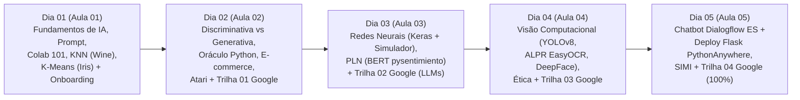

# 🧭 Plano de Aula Mestre — Programação em Inteligência Artificial Generativa (SENAI-SP)
**Unidade Curricular:** Programação em Inteligência Artificial Generativa (20 Horas — 5 Encontros de 4 Horas)  
**Formato Pedagógico:** **Intercalado (Conceitos Visuais + Laboratórios Práticos no Google Colab + Trilha Oficial Google Cloud Skills Boost)**  
**Trilha Oficial Integrada:** *Iniciante: programa de aprendizado Introdução à IA generativa* (*Beginner: Introduction to Generative AI Learning Path*)

---

## 🗺️ Visão Geral do Cronograma Intercalado (5 Dias)

---

## 📅 Detalhamento das Aulas, Laboratórios e Links Rápidos

### 🔹 Dia 01 — Aula 01 (4h): Introdução à IA, Engenharia de Prompt, Machine Learning e Onboarding
- **Apresentação de Slides (23 slides):** [slides_aula_1_estudante.html](file:///C:/Users/Instrutor/.gemini/antigravity/brain/2def7d10-b738-49f5-8f6f-980678220051/slides_aula_1_estudante.html)
- **Material Didático Completo:** [material_aula_1_ia_ml_scikitlearn.md](file:///C:/Users/Instrutor/.gemini/antigravity/brain/2def7d10-b738-49f5-8f6f-980678220051/material_aula_1_ia_ml_scikitlearn.md)
- **Datasets e Saídas Visuais:** [iris.csv](file:///C:/Users/Instrutor/.gemini/antigravity/brain/2def7d10-b738-49f5-8f6f-980678220051/iris.csv), [matriz_confusao_vinhos.png](file:///C:/Users/Instrutor/.gemini/antigravity/brain/2def7d10-b738-49f5-8f6f-980678220051/matriz_confusao_vinhos.png), [iris_dispersao_original.png](file:///C:/Users/Instrutor/.gemini/antigravity/brain/2def7d10-b738-49f5-8f6f-980678220051/iris_dispersao_original.png), [iris_pairplot_original.png](file:///C:/Users/Instrutor/.gemini/antigravity/brain/2def7d10-b738-49f5-8f6f-980678220051/iris_pairplot_original.png), [iris_pairplot_kmeans.png](file:///C:/Users/Instrutor/.gemini/antigravity/brain/2def7d10-b738-49f5-8f6f-980678220051/iris_pairplot_kmeans.png), [iris_metodo_cotovelo.png](file:///C:/Users/Instrutor/.gemini/antigravity/brain/2def7d10-b738-49f5-8f6f-980678220051/iris_metodo_cotovelo.png), [iris_indice_silhueta.png](file:///C:/Users/Instrutor/.gemini/antigravity/brain/2def7d10-b738-49f5-8f6f-980678220051/iris_indice_silhueta.png)
- **Conteúdo e Laboratórios:**
  1. **Módulo 1:** As 4 Camadas da IA (IA $\to$ ML $\to$ Deep Learning $\to$ IA Generativa), Software Clássico vs. ML vs. GenAI, Multimodalidade + *Google Teachable Machine*.
  2. **Módulo 2:** Engenharia de Prompt Prática (4 Pilares: Persona, Tarefa, Contexto, Formato; *Zero-Shot* vs. *Few-Shot* e *Chain-of-Thought*).
  3. **Módulo 3:** Introdução ao **Google Colab** (Como abrir, criar o primeiro notebook, renomear, executar células com `Shift+Enter` e salvar com `Ctrl+S`).
  4. **Lab 1.1 (Supervisionado):** Classificador de Vinhos (`load_wine`) com `KNeighborsClassifier (KNN)` em 6 passos + análise da Matriz de Confusão (`72%` de acurácia e importância da padronização).
  5. **Lab 1.2 (Não Supervisionado):** Agrupamento de Flores ([iris.csv](file:///C:/Users/Instrutor/.gemini/antigravity/brain/2def7d10-b738-49f5-8f6f-980678220051/iris.csv)) com `KMeans` + `StandardScaler`, Método do Cotovelo ($K=3$) e Índice de Silhueta.
  6. **Onboarding Google Cloud Skills Boost:** Criação de conta, inscrição na trilha e **regra obrigatória de assistir aos vídeos até o fim**.

---

### 🔹 Dia 02 — Aula 02 (4h): Modelos Discriminativos vs. Generativos, Prompt Socrático e Trilha 01
- **Apresentação de Slides (18 slides):** [slides_aula_2_estudante.html](file:///C:/Users/Instrutor/.gemini/antigravity/brain/2def7d10-b738-49f5-8f6f-980678220051/slides_aula_2_estudante.html)
- **Material Didático Completo:** [material_aula_2_redes_neurais_keras.md](file:///C:/Users/Instrutor/.gemini/antigravity/brain/2def7d10-b738-49f5-8f6f-980678220051/material_aula_2_redes_neurais_keras.md)
- **Datasets e Saídas Visuais:** [ecommerce_clientes.csv](file:///C:/Users/Instrutor/.gemini/antigravity/brain/2def7d10-b738-49f5-8f6f-980678220051/ecommerce_clientes.csv), [ecommerce_matriz_importancia.png](file:///C:/Users/Instrutor/.gemini/antigravity/brain/2def7d10-b738-49f5-8f6f-980678220051/ecommerce_matriz_importancia.png), [info_engenharia_prompt.png](file:///C:/Users/Instrutor/.gemini/antigravity/brain/2def7d10-b738-49f5-8f6f-980678220051/info_engenharia_prompt.png)
- **Conteúdo e Laboratórios:**
  1. **Módulo 1:** Paradigma Matemático Discriminativo ($P(Y|X)$) vs. Generativo ($P(X)$ / $P(X|Y)$), Modelos de Fundação (Gemini, GPT-4o, Claude, Llama 3) e Controle de Temperatura (`0.0` a `1.2+`).
  2. **Lab 2.1 (Socratic Prompting & Rubber Duck Debugging):** *"O Oráculo de Python e o Código Amaldiçoado"* — System Prompt em Latim com Guardrail proibindo entregar o código pronto e depuração guiada dos 7 bugs do Sistema Escolar.
  3. **Lab 2.2 (Colab — Pipeline Híbrido):** Predição de abandono de carrinho (`ecommerce_clientes.csv`) com `RandomForestClassifier` (`92%` de acurácia + *Feature Importance*) acionando a API do Gemini para gerar cupons personalizados em JSON.
  4. **Lab 2.3 (Desafio em Duplas):** *"De Volta ao Futuro do Atari com IA"* — Recriação de um jogo clássico de Atari 2600 em HTML5 Canvas via Prompt Engineering.
  5. **Google Cloud Skills Boost — Atividade 01:** *Introduction to Generative AI* (Vídeo completo + Quiz = **1º Badge / 25% da Trilha**).

---

### 🔹 Dia 03 — Aula 03 (4h): Redes Neurais Profundas, PLN (Transformers/BERT) e Trilha 02
- **Apresentação de Slides (13 slides):** [slides_aula_3_estudante.html](file:///C:/Users/Instrutor/.gemini/antigravity/brain/2def7d10-b738-49f5-8f6f-980678220051/slides_aula_3_estudante.html)
- **Material Didático Completo:** [material_aula_3_pln_ia_generativa.md](file:///C:/Users/Instrutor/.gemini/antigravity/brain/2def7d10-b738-49f5-8f6f-980678220051/material_aula_3_pln_ia_generativa.md)
- **Saídas Visuais:** [rede_neural_curvas_treino.png](file:///C:/Users/Instrutor/.gemini/antigravity/brain/2def7d10-b738-49f5-8f6f-980678220051/rede_neural_curvas_treino.png), [info_pln_sentimentos.png](file:///C:/Users/Instrutor/.gemini/antigravity/brain/2def7d10-b738-49f5-8f6f-980678220051/info_pln_sentimentos.png)
- **Conteúdo e Laboratórios:**
  1. **Módulo 1:** Do Neurônio Biológico ao Perceptron Artificial, Camadas (Input, Hidden, Output) e os 4 passos do aprendizado (*Forward Pass*, *Loss*, *Backpropagation*).
  2. **Lab 3.1A (Simulador Interativo):** Calibrando sinapses manualmente no Simulador Maçã vs. Laranja (`https://irineufrancisco.github.io/ExemploRedeNeural/`).
  3. **Lab 3.1B (Colab — Deep Learning com Keras):** Rede Neural Densa (`Sequential`) com `StandardScaler` elevando a acurácia de classificação de vinhos de `72%` para `96.7%`, com análise gráfica das curvas de Loss e Acurácia.
  4. **Módulo 2 & Lab 3.2 (Colab — PLN Profundo com BERT):** Os 3 pilares do PLN (Tokenização, Embeddings, *Self-Attention*), Agentes de IA (RAG e *Function Calling*) e laboratório prático com `pysentimiento` em Português testando os 4 desafios (Contexto/Negação, Emojis, Neutralidade e Ironia/Sarcasmo).
  5. **Google Cloud Skills Boost — Atividade 02:** *Introduction to Large Language Models (LLMs)* (Vídeo completo + Quiz = **2º Badge / 50% da Trilha**).

---

### 🔹 Dia 04 — Aula 04 (4h): Visão Computacional (`YOLOv8`, `EasyOCR`, `DeepFace`), Ética e Trilha 03
- **Apresentação de Slides (16 slides):** [slides_aula_4_estudante.html](file:///C:/Users/Instrutor/.gemini/antigravity/brain/2def7d10-b738-49f5-8f6f-980678220051/slides_aula_4_estudante.html)
- **Material Didático Completo:** [material_aula_4_visao_computacional_yolo.md](file:///C:/Users/Instrutor/.gemini/antigravity/brain/2def7d10-b738-49f5-8f6f-980678220051/material_aula_4_visao_computacional_yolo.md)
- **Saídas Reais Extraídas dos Notebooks:** [yolo_obj_out_1.png](file:///C:/Users/Instrutor/.gemini/antigravity/brain/2def7d10-b738-49f5-8f6f-980678220051/yolo_obj_out_1.png), [yolo_placa_out_1.png](file:///C:/Users/Instrutor/.gemini/antigravity/brain/2def7d10-b738-49f5-8f6f-980678220051/yolo_placa_out_1.png), [yolo_placa_out_2.png](file:///C:/Users/Instrutor/.gemini/antigravity/brain/2def7d10-b738-49f5-8f6f-980678220051/yolo_placa_out_2.png), [yolo_placa_out_3.png](file:///C:/Users/Instrutor/.gemini/antigravity/brain/2def7d10-b738-49f5-8f6f-980678220051/yolo_placa_out_3.png), [yolo_placa_out_4.png](file:///C:/Users/Instrutor/.gemini/antigravity/brain/2def7d10-b738-49f5-8f6f-980678220051/yolo_placa_out_4.png), [info_emocoes_deepface.png](file:///C:/Users/Instrutor/.gemini/antigravity/brain/2def7d10-b738-49f5-8f6f-980678220051/info_emocoes_deepface.png)
- **Conteúdo e Laboratórios:**
  1. **Módulo 1:** Matrizes de Pixels (`OpenCV` BGR vs. RGB), diferença entre Classificação, Detecção de Objetos (`Bounding Box` + `Confidence Score`) e Análise Facial (*Landmarks*).
  2. **Lab 4.1 (Colab — Detecção e Contagem com `YOLOv8`):** Detecção automática com `yolov8s.pt` e contagem estruturada de objetos com `Counter` (`dog`, `bicycle`, `truck`).
  3. **Lab 4.2 (Colab — Monitoramento e Leitura de Placas ALPR):** Pipeline `YOLOv8` (classes de veículos `[2, 3, 5, 7]`) $\to$ Recorte de Região de Interesse (`ROI`) $\to$ `EasyOCR` para leitura de placas Mercosul.
  4. **Lab 4.3 (Colab — Reconhecimento de Emoções com `DeepFace`):** Detecção de microexpressões faciais (`dominant_emotion`), idade e gênero.
  5. **Módulo 5 & Google Cloud Skills Boost — Atividade 03:** Ética em Visão Computacional (Viés demográfico, Falsos Positivos, LGPD) + Curso *Introduction to Responsible AI* (Vídeo completo + Quiz = **3º Badge / 75% da Trilha**).

---

### 🔹 Dia 05 — Aula 05 (4h): Chatbots com Dialogflow ES, Deploy Cloud PythonAnywhere e Trilha 04 (100%)
- **Apresentação de Slides (12 slides):** [slides_aula_5_estudante.html](file:///C:/Users/Instrutor/.gemini/antigravity/brain/2def7d10-b738-49f5-8f6f-980678220051/slides_aula_5_estudante.html)
- **Material Didático Completo:** [material_aula_5_modelos_personalizados_nuvem.md](file:///C:/Users/Instrutor/.gemini/antigravity/brain/2def7d10-b738-49f5-8f6f-980678220051/material_aula_5_modelos_personalizados_nuvem.md)
- **Infográfico de Apoio:** [info_dialogflow_projeto.png](file:///C:/Users/Instrutor/.gemini/antigravity/brain/2def7d10-b738-49f5-8f6f-980678220051/info_dialogflow_projeto.png)
- **Conteúdo e Laboratórios:**
  1. **Módulo 1:** Arquitetura NLU no **Google Dialogflow ES** (*Intents*, *Training Phrases*, *Entities*, *Slot Filling*, *Contextos* e *Fulfillment*).
  2. **Lab 5.1 (Dialogflow ES):** Construção do Agente **Cantina SENAI (`SENAIBOT` — intent `pedido-coxinha`)** e variações práticas (**Pizzaria IA** e **Agendamento IA-Style**), ativando o widget **Dialogflow Messenger**.
  3. **Lab 5.2 (Cloud Deployment no PythonAnywhere):** Configuração completa de servidor web **Flask** público na nuvem (`flask_app.py`, `WSGI configuration file`, `Force HTTPS`, rota `GET /` renderizando `<df-messenger>` e rota `POST /webhook` retornando *Rich Content Cards* em JSON).
  4. **Projeto Final SIMI & Google Cloud Skills Boost — Atividade 04:** Apresentação do Projeto Integrador SIMI (*TechVision Smart Store*) e conclusão da 4ª atividade do Google Cloud Skills Boost (**100% da Trilha e 4 Badges conquistados**).
